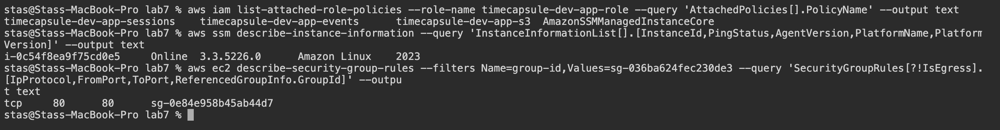
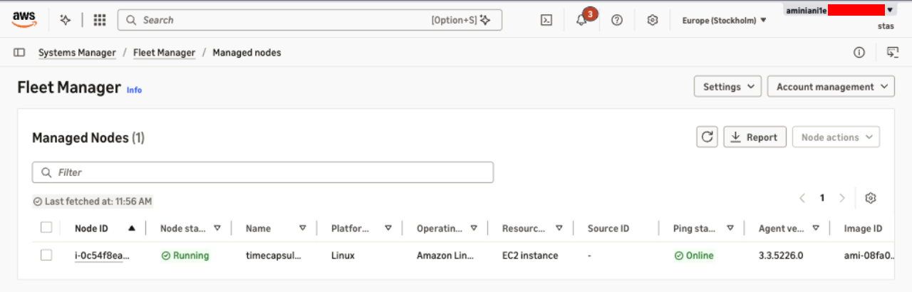
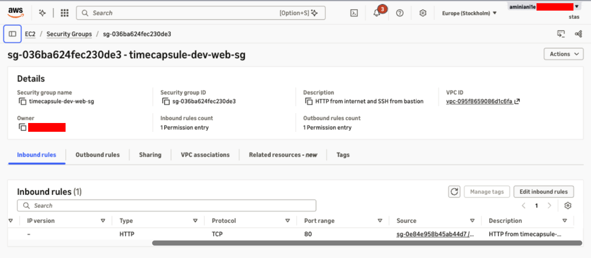
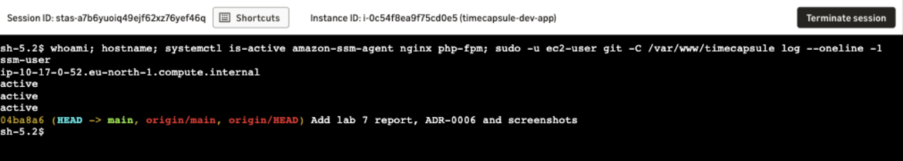
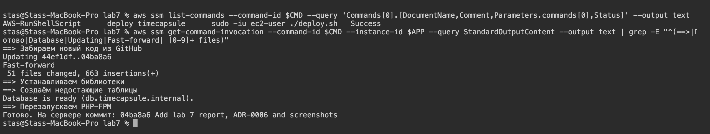
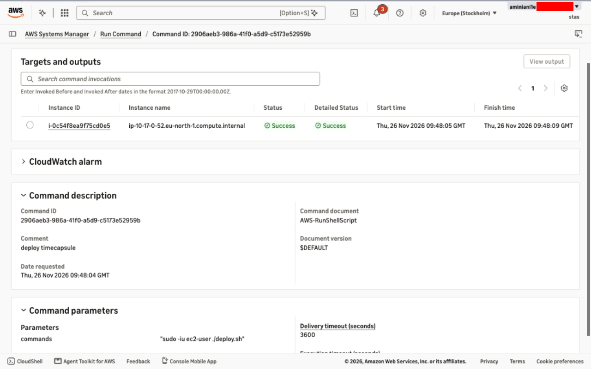
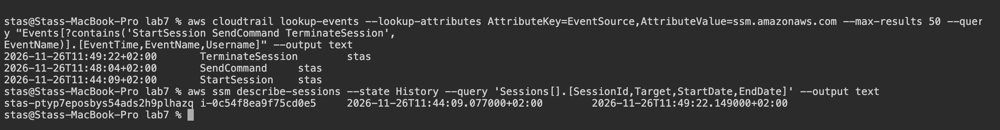

# Индивидуальное задание. AWS Systems Manager: доступ к серверу без SSH

- **ФИО:** Voronetchii Stanislav
- **Группа:** IA2404
- **Сервис:** AWS Systems Manager (Session Manager и Run Command), на курсе не разбирался
- **Репозиторий:** https://github.com/sta5on-cloud/timecapsule
- **Отчёт ЛР7:** [docs/lab7/README.md](../lab7/README.md)

## Зачем

С ЛР3 на `app-server` можно было попасть только через bastion: SSH-ключ `stas-ec2` на компьютере, правило
`22 от моего IP` в `timecapsule-dev-bastion-sg`, правило `22 от bastion-sg` в `timecapsule-dev-web-sg`,
`ProxyJump bastion` в `~/.ssh/config`. Деплой (`ssh app ./deploy.sh`) шёл тем же путём. Минусы такой схемы:

- ключ - постоянный секрет: если он утечёт, его нужно менять на всех серверах, а отозвать доступ у одного человека нельзя;
- bastion - ещё один сервер с открытым портом 22, его надо обновлять и включать перед каждым входом;
- кто и когда заходил на сервер, видно только в журналах самого сервера.

Session Manager даёт консоль на сервере без SSH: агент SSM на экземпляре сам устанавливает исходящее HTTPS-соединение
со службой Systems Manager, а вход разрешает IAM. Run Command тем же каналом выполняет команды на сервере без
интерактивной сессии.

## Что сделано

| Было | Стало |
| --- | --- |
| Вход: SSH-ключ, bastion, порт 22 | Вход: `Start session` в консоли или `aws ssm start-session`, права IAM пользователя `stas` |
| В `timecapsule-dev-web-sg` правила `80 от alb-sg` и `22 от bastion-sg` | Только `80 от alb-sg`, входящего SSH нет |
| Деплой: `ssh app ./deploy.sh` через bastion | Деплой: Run Command `AWS-RunShellScript` выполняет тот же `deploy.sh` |
| Журнал входов только на сервере | `StartSession`, `SendCommand`, `TerminateSession` в CloudTrail |

Роли сервера добавлена управляемая политика `AmazonSSMManagedInstanceCore`. Агент SSM в Amazon Linux 2023 уже
установлен, а выход в интернет у `app-server` есть (публичная подсеть), поэтому больше ничего ставить не пришлось:
через 20 секунд после запуска сервер появился в Fleet Manager со статусом `Online`.

```bash
aws iam attach-role-policy --role-name timecapsule-dev-app-role \
  --policy-arn arn:aws:iam::aws:policy/AmazonSSMManagedInstanceCore
aws ec2 start-instances --instance-ids i-0c54f8ea9f75cd0e5
aws ssm describe-instance-information
aws ec2 revoke-security-group-ingress --group-id sg-036ba624fec230de3 \
  --ip-permissions 'IpProtocol=tcp,FromPort=22,ToPort=22,UserIdGroupPairs=[{GroupId=sg-0a37ceeac1f965173}]'
```



У роли четыре политики, сервер `Online` (агент 3.3.5226.0), в `web-sg` осталось одно входящее правило: 80 от
`timecapsule-dev-alb-sg`.



Fleet Manager: `app-server` - управляемый узел, `Ping status = Online`.



`timecapsule-dev-web-sg`: одно входящее правило HTTP 80 с источником `sg-0e84e958b45ab44d7` (`timecapsule-dev-alb-sg`), правила SSH больше нет.

## Сессия на сервере



Сессия открыта из консоли (`Systems Manager → Session Manager → Start session`). Команды выполняются от
`ssm-user` на `ip-10-17-0-52`, агент SSM, nginx и PHP-FPM работают, на сервере коммит `04ba8a6` после деплоя
из следующего раздела. Порт 22 для этого не нужен.

## Деплой через Run Command

```bash
CMD=$(aws ssm send-command --instance-ids $APP --document-name AWS-RunShellScript \
  --comment 'deploy timecapsule' --parameters 'commands=["sudo -iu ec2-user ./deploy.sh"]' \
  --query Command.CommandId --output text)
aws ssm get-command-invocation --command-id $CMD --instance-id $APP --query StandardOutputContent --output text
```



`deploy.sh` из ЛР2 не менялся: Run Command запустил его от `ec2-user`, сервер забрал коммит `04ba8a6`,
статус `Success`.



Тот же запуск в консоли: документ `AWS-RunShellScript`, комментарий `deploy timecapsule`, параметр
`sudo -iu ec2-user ./deploy.sh`, на сервере `Success`.

## Журнал



CloudTrail записал открытие сессии, запуск команды и завершение сессии от пользователя `stas`. История сессий
хранит идентификатор, сервер, время начала и конца. С SSH такого журнала в AWS не было.

## Как это устроено и чем ограничено

- **Сеть.** Агент сам подключается наружу к `ssm`, `ssmmessages` и `ec2messages` по HTTPS (443). Входящие порты
  не нужны, поэтому правило SSH удалено. Серверу в приватной подсети без NAT понадобились бы три interface VPC
  endpoint (около $0,011 в час каждый на зону), как и для Lambda-функций из [ЛР7](../lab7/README.md).
- **Права.** Сервер получает право общаться со службой через роль (`AmazonSSMManagedInstanceCore`), а человек -
  через свою политику IAM (`ssm:StartSession`, `ssm:SendCommand`). Отозвать доступ - убрать право в IAM, ключи
  на серверах менять не нужно.
- **Стоимость.** Session Manager и Run Command для экземпляров EC2 бесплатны.
- **Что не сделано.** Содержимое сессий не записывается: для этого в настройках Session Manager включают запись
  в S3 или CloudWatch Logs. `sshd` на сервере по-прежнему запущен, но порт 22 закрыт Security Group.
  Bastion больше не нужен для `app-server` и остаётся остановленным.
- **Если понадобится SSH** (например, в ЛР8): вернуть правило `22 от timecapsule-dev-bastion-sg` в
  `timecapsule-dev-web-sg` или пробросить SSH через Session Manager (`ProxyCommand aws ssm start-session
  --document-name AWS-StartSSHSession`), не открывая порт.
