# Лабораторная работа №4. Облачные хранилища. Amazon S3

- **ФИО:** Voronetchii Stanislav
- **Группа:** IA2404
- **Специальность:** Informatica Aplicata
- **Уровень:** продвинутый
- **Репозиторий:** https://github.com/sta5on-cloud/timecapsule
- **Изменения модуля хранения:** коммит [`df0a3d2` Store attachments in S3](https://github.com/sta5on-cloud/timecapsule/commit/df0a3d2)
- **Отчёты ЛР2 и ЛР3:** [README.md](../../README.md), [docs/lab3/README.md](../lab3/README.md)

| Ресурс | Имя |
| --- | --- |
| Бакет S3 | `timecapsule-dev-uploads-sta5on` |
| Правило жизненного цикла | `timecapsule-dev-noncurrent` |
| Политика IAM | `timecapsule-dev-app-s3` |
| Тестовая роль | `timecapsule-dev-s3-tester` |
| Роль сервера | `timecapsule-dev-app-role` |

Теги всех ресурсов: `Project=timecapsule`, `Environment=dev`, `Owner=sta5on`, `Lab=lab4`.

## Базовый уровень

### Задание 1. Бакет и объекты в консоли

Бакет создан с типом `General purpose`, `ACLs disabled`, `Block all public access`, без версионирования, с шифрованием `SSE-S3` и обязательными тегами.


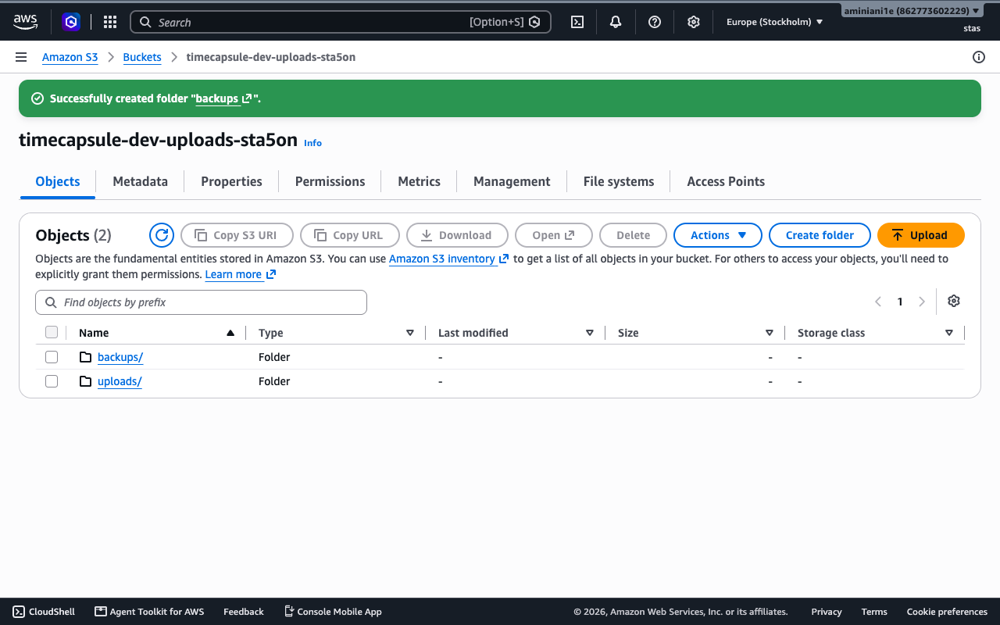


Свойства картинки: ключ `uploads/capsule-photo.png`, `ETag` `0ea473fe095d86438656932fd09f70e9`, `Content-Type` `image/png`,
`Object URL` `https://timecapsule-dev-uploads-sta5on.s3.eu-north-1.amazonaws.com/uploads/capsule-photo.png`.

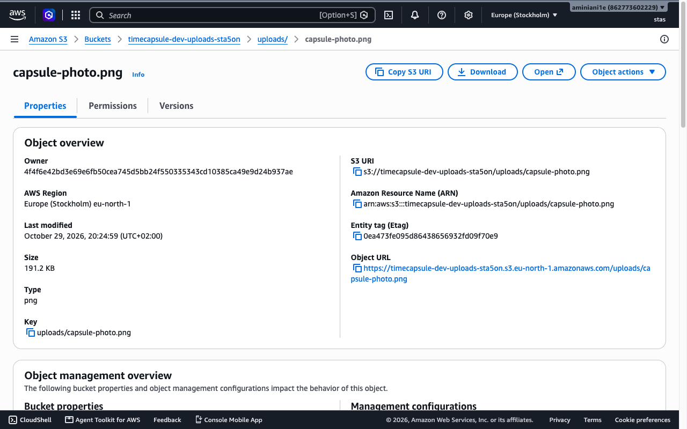

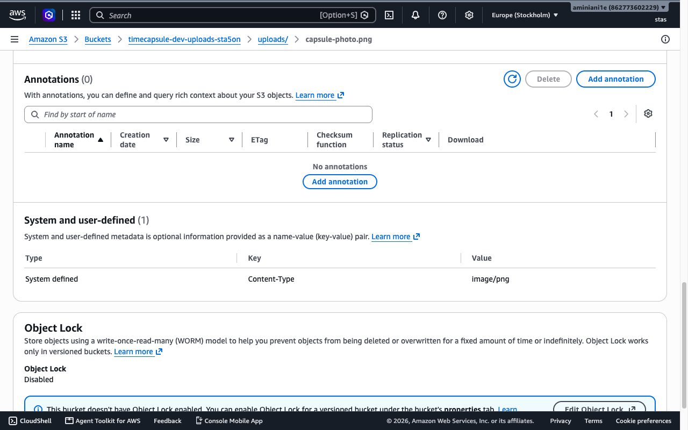

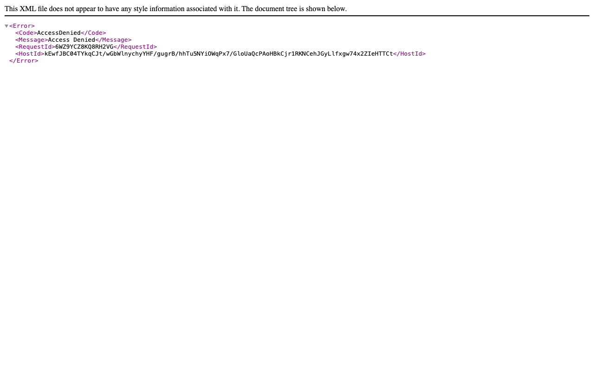

**Какой ключ у картинки?** `uploads/capsule-photo.png`. В S3 нет папок, есть только плоский список ключей; `uploads/` это часть ключа.

**Почему `Object URL` не открывается, хотя вы владелец бакета?** Браузер открывает адрес анонимным запросом без подписи,
и S3 не знает, что это владелец: права в консоли действуют только для подписанных запросов от её имени. Бакет закрыт
`Block all public access` и не имеет политики, разрешающей анонимное чтение, поэтому S3 отвечает `AccessDenied`.

**Что на самом деле создала кнопка `Create folder`?** Пустой объект нулевого размера с ключом, оканчивающимся на `/`
(`uploads/`, `backups/`). Его видно в выводе `aws s3 ls --recursive` в задании 2. Консоль показывает такие ключи как папки.

### Задание 2. Объекты из командной строки


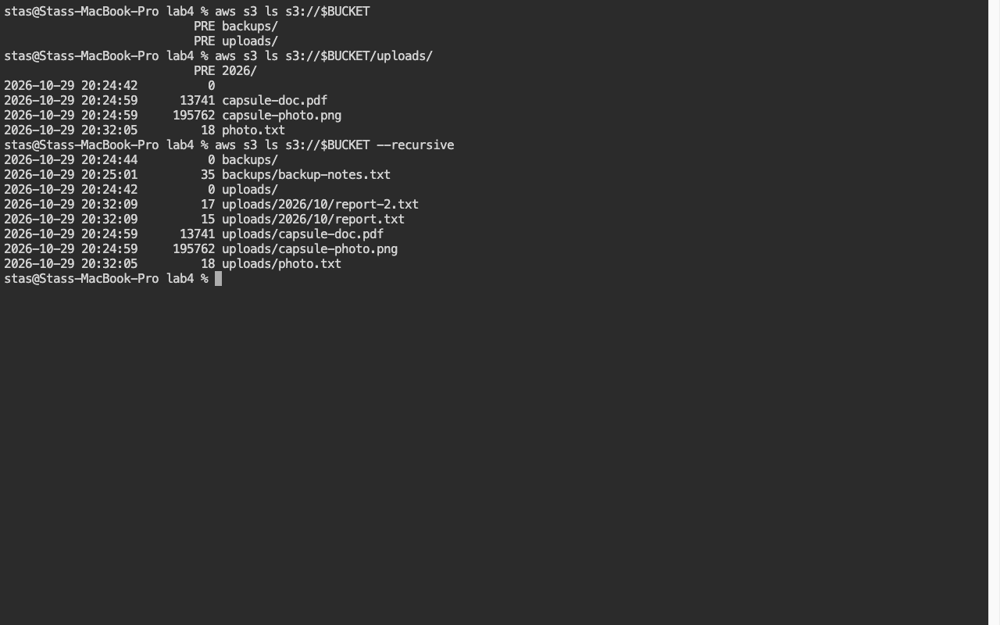

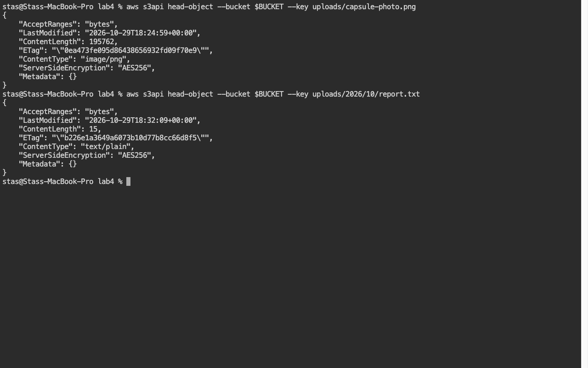


**Почему первая команда `ls` показывает `PRE uploads/` и `PRE backups/`, а третья показывает полные ключи?**
Без `--recursive` CLI вызывает `ListObjectsV2` с разделителем `/`, и S3 сворачивает ключи с общим началом в «общие
префиксы» (`PRE`). С `--recursive` разделитель не передаётся, и S3 возвращает все ключи целиком, включая пустые объекты-папки.

**Какой `Content-Type` получил `report.txt`, хотя вы его не указывали?** `text/plain`. AWS CLI при загрузке угадывает тип
по расширению файла и передаёт его в заголовке `Content-Type`.

### Задание 3. Политика бакета: только HTTPS

```json
{
    "Version": "2012-10-17",
    "Statement": [
        {
            "Sid": "DenyInsecureTransport",
            "Effect": "Deny",
            "Principal": "*",
            "Action": "s3:*",
            "Resource": [
                "arn:aws:s3:::timecapsule-dev-uploads-sta5on",
                "arn:aws:s3:::timecapsule-dev-uploads-sta5on/*"
            ],
            "Condition": {
                "Bool": {
                    "aws:SecureTransport": "false"
                }
            }
        }
    ]
}
```

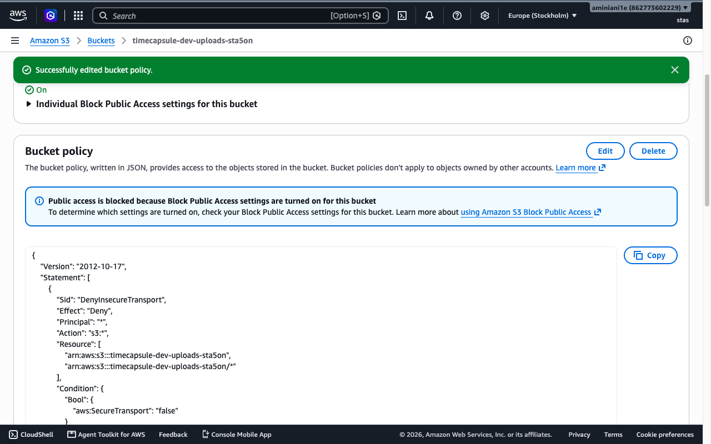

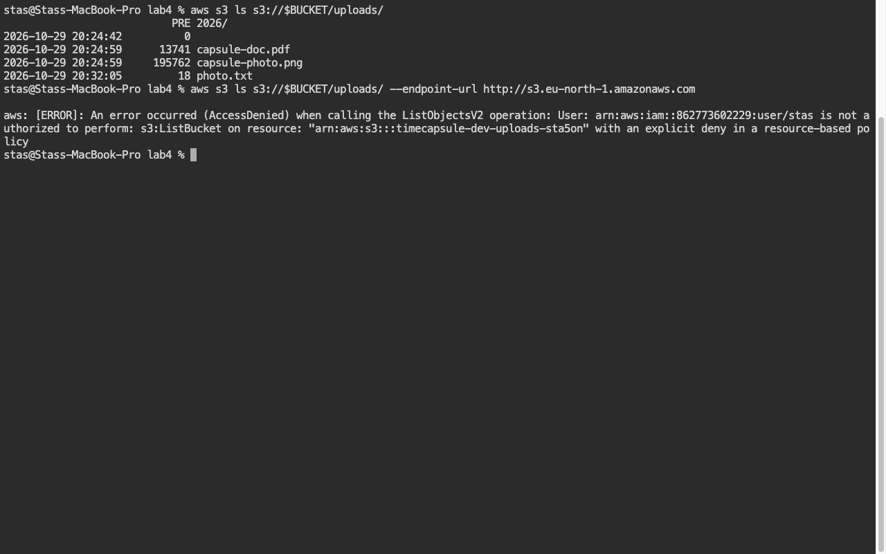

**Почему вторая команда получает `AccessDenied`, хотя у вас права администратора?** В AWS явный запрет (`Deny`) всегда
сильнее любого разрешения. Политика бакета запрещает всем участникам любые действия при `aws:SecureTransport = false`,
поэтому запрос по `http://` отклоняется до того, как учитываются права администратора. В ошибке это видно:
`with an explicit deny in a resource-based policy`.

**Почему Block Public Access не помешал сохранить политику с `"Principal": "*"`?** Block Public Access запрещает только
политики, которые открывают доступ (`Allow` для всех). Наша политика ничего не разрешает, а только запрещает,
поэтому публичной она не считается.

### Задание 4. Версионирование и защита от удаления

После включения версионирования у файлов, загруженных раньше, идентификатор версии `null`. При удалении `notes.txt`
с выключенным `Show versions` консоль предупреждает, что будут добавлены маркеры удаления, и просит ввести `delete`.
Файл пропадает из списка, а в списке версий видно, что произошло на самом деле:

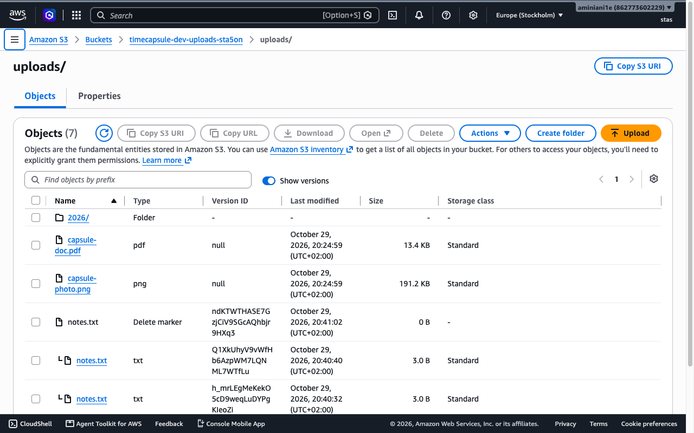

После удаления маркера объект вернулся с текстом `v2`. Удаление версии `v2` при включённом `Show versions` консоль
подтверждает иначе: нужно ввести `permanently delete`. После отката текущей стала версия `v1` (`aws s3 cp ... -` выводит `v1`):

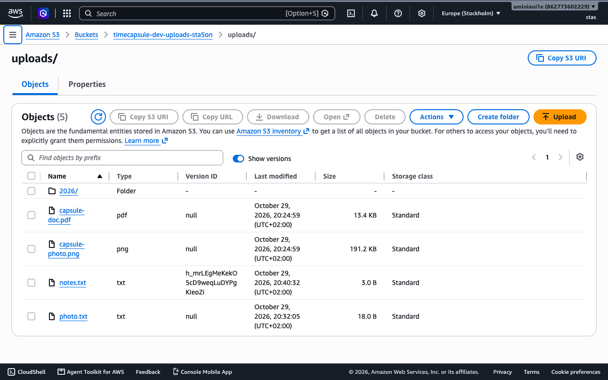

**Чем удаление в шаге 3 отличается от удаления в шаге 5? Какое из них можно отменить?** В шаге 3 удаляется объект без
указания версии: S3 ничего не стирает, а добавляет маркер удаления, который становится текущей версией. Отменить можно,
удалив маркер. В шаге 5 удаляется конкретная версия (`DeleteObjectVersion`): она стирается навсегда, отменить нельзя.

**Какой из двух способов защищает от случайного удаления, а какой нужно запрещать приложению?** Защищает обычное
удаление с маркером: данные остаются в старой версии. Приложению нужно запрещать удаление версий
(`s3:DeleteObjectVersion`), иначе ошибка или злоумышленник с правами приложения уничтожит данные без возможности восстановления.

### Задание 5. Правило жизненного цикла

Правило `timecapsule-dev-noncurrent` действует только на префикс `uploads/`.


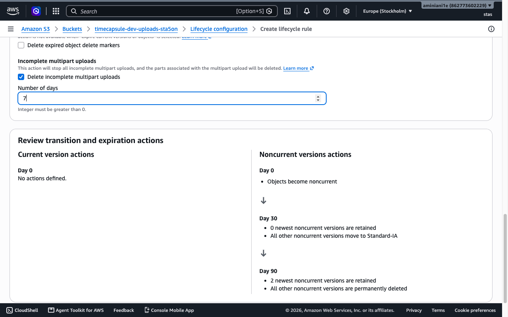


**Как поведёт себя правило для файла, который перезаписывали 10 раз за неделю?** Будет 11 версий: одна текущая и 10
неактуальных. Текущую правило не трогает. Каждая неактуальная версия через 30 дней после того, как стала неактуальной,
переходит в Standard-IA. Через 90 дней неактуальные версии удаляются, но две самые новые из них сохраняются всегда.
В итоге останутся текущая версия и две последние старые.

**Почему наши маленькие тестовые файлы в Standard-IA не попадут?** По умолчанию переходы не применяются к объектам меньше
128 КБ (на странице `Lifecycle configuration`: `Default minimum object size for transitions: All storage classes 128K`). Для маленьких объектов
Standard-IA дороже: в нём минимальный тарифицируемый размер объекта 128 КБ и плата за каждый переход.

**Что такое незавершённая загрузка частями и почему за неё приходится платить?** Большие файлы загружаются частями
(multipart upload): части сохраняются в S3 по отдельности и собираются в объект командой завершения. Если загрузка
прервалась и не была ни завершена, ни отменена, части остаются в бакете. В списке объектов их не видно, но место
они занимают и оплачиваются. Правило удаляет такие загрузки через 7 дней.

### Задание 6. Подписанные URL

Ссылка из консоли на 5 минут открыла картинку в приватном окне, ссылка из CLI на 2 минуты вернула `photo placeholder`.

Ссылка, в которой `photo.txt` заменён на `notes.txt`:

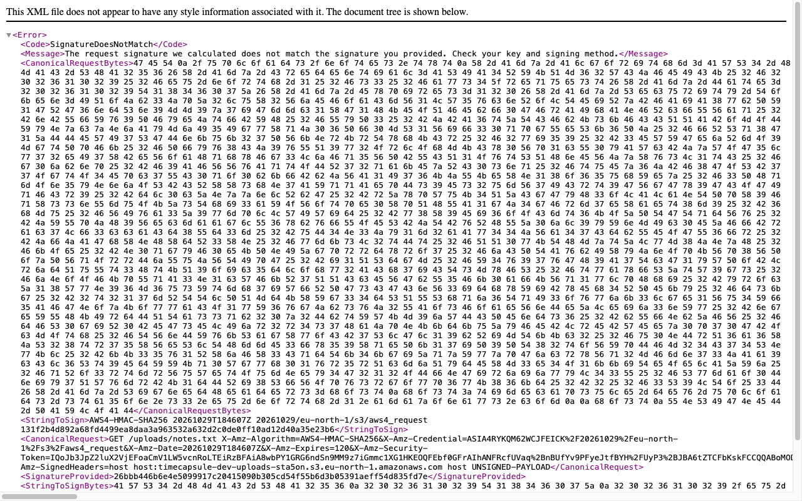

Исходная ссылка через 2 минуты:

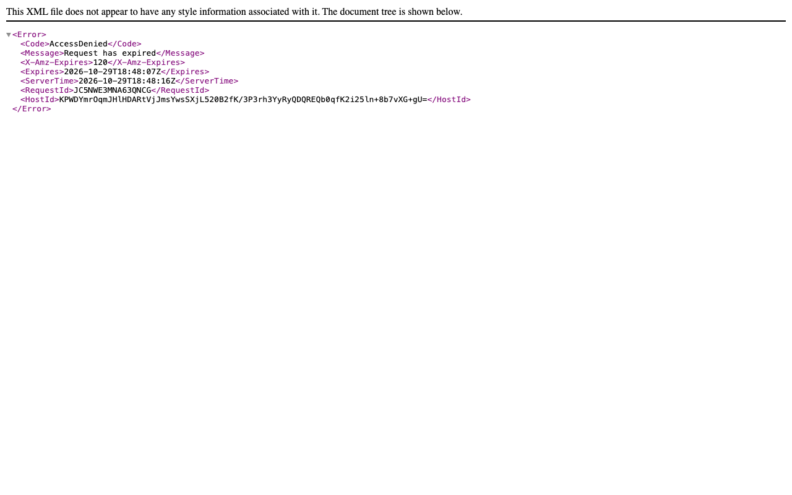

**Какие ошибки вернул S3 в шагах 3 и 4?** В шаге 3 `SignatureDoesNotMatch` (подпись не соответствует запросу),
в шаге 4 `AccessDenied` с сообщением `Request has expired` и временем окончания в `<Expires>`.

**Почему нельзя получить другой файл, просто поменяв ключ в ссылке?** Подпись `X-Amz-Signature` вычисляется
от всего запроса: метода, бакета, ключа, параметров `X-Amz-*` и времени. S3 заново вычисляет подпись для пришедшего
запроса секретным ключом подписавшего. Если ключ изменён, подписи не совпадают, а подобрать новую без секретного ключа нельзя.

**Обращалась ли команда `aws s3 presign` к S3, когда создавала ссылку?** Нет. Ссылка вычисляется локально из учётных
данных, ключа объекта и срока действия. Поэтому `presign` создаст ссылку даже на несуществующий объект или без прав
на него: ошибка появится только при открытии ссылки.

Временные файлы удалены: `cd ~ && rm -rf lab4`.

## Продвинутый уровень

### Задание 7. Политика приложения

```json
{
    "Version": "2012-10-17",
    "Statement": [
        {
            "Sid": "ListOnlyUploadsPrefix",
            "Effect": "Allow",
            "Action": "s3:ListBucket",
            "Resource": "arn:aws:s3:::timecapsule-dev-uploads-sta5on",
            "Condition": {
                "StringLike": {
                    "s3:prefix": ["uploads/*"]
                }
            }
        },
        {
            "Sid": "ReadWriteDeleteUploads",
            "Effect": "Allow",
            "Action": ["s3:GetObject", "s3:PutObject", "s3:DeleteObject"],
            "Resource": "arn:aws:s3:::timecapsule-dev-uploads-sta5on/uploads/*"
        }
    ]
}
```


**Почему `s3:ListBucket` относится к ресурсу «бакет», а `s3:GetObject` к ресурсу «объект»?** Список объектов это
операция над бакетом (`GET /?list-type=2`), её ресурс `arn:aws:s3:::бакет`. Чтение, запись и удаление работают с
конкретным объектом, их ресурс `arn:aws:s3:::бакет/ключ`. IAM сверяет ARN запроса с `Resource` правила.

**Что произойдёт, если перепутать ARN в этих двух правилах?** Ни одно правило не сработает: `ListBucket` с ресурсом
`бакет/uploads/*` никогда не совпадёт с ARN бакета, а `GetObject` с ресурсом `бакет` не совпадёт с ARN объекта.
Приложение получит `AccessDenied` на все операции. Консоль IAM при этом предупреждает о несовпадении действий и ресурсов.

### Задание 8. Проверка прав через тестовую роль

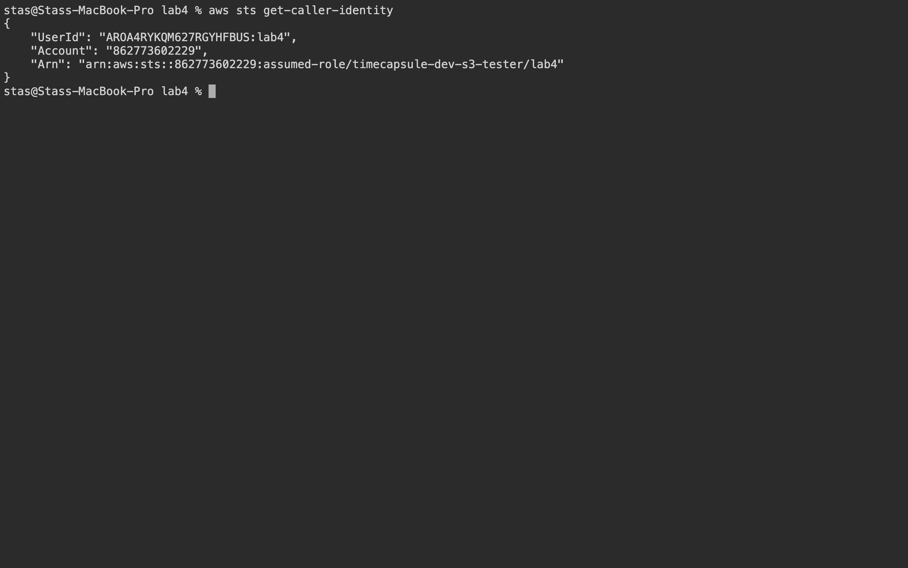

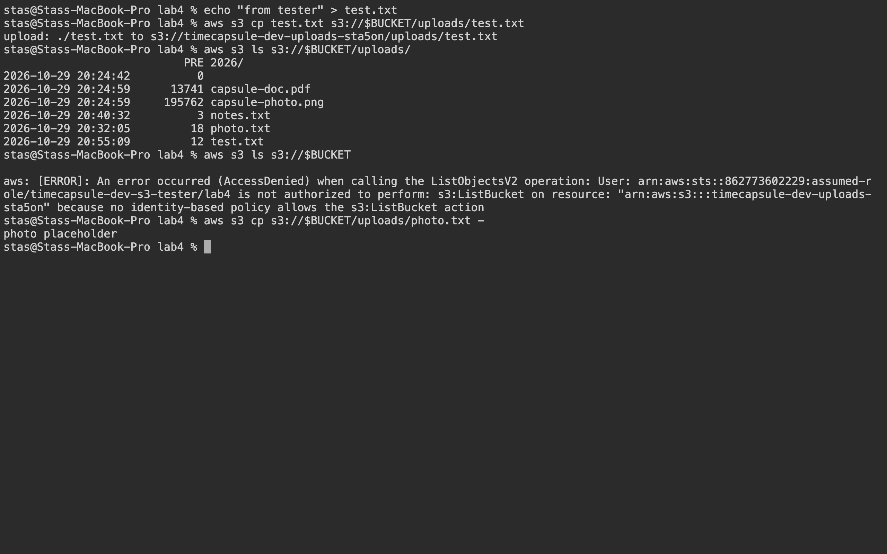

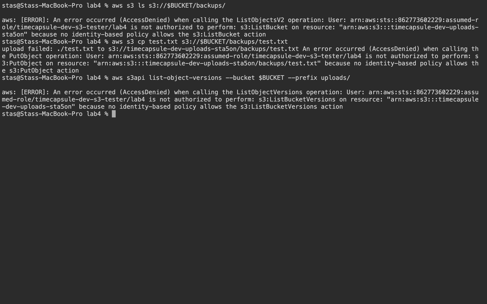

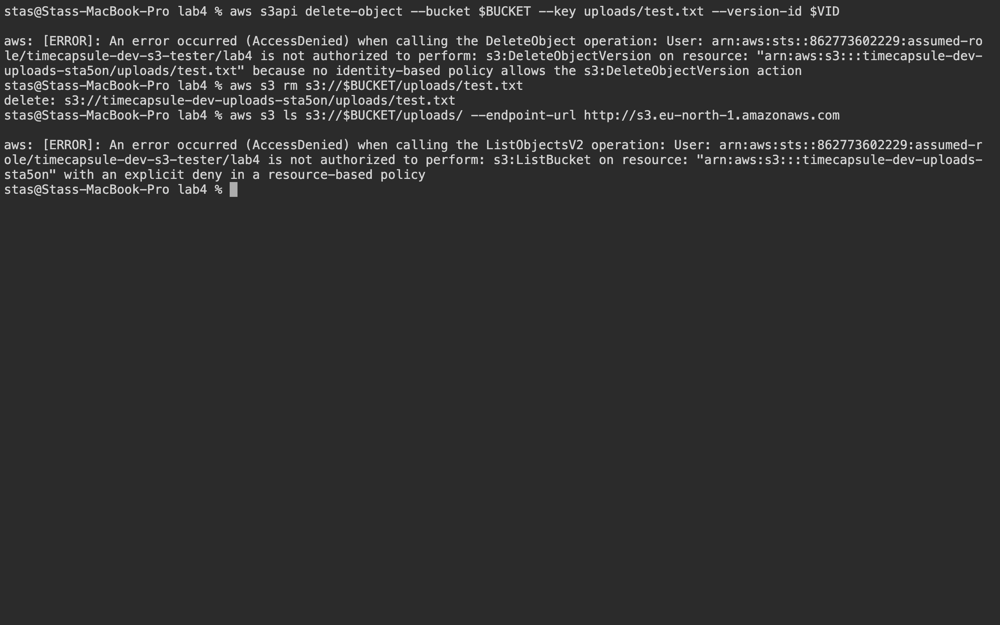

| № | Команда | Ожидаю | Получил | Какое правило сработало |
| --- | --- | --- | --- | --- |
| 1 | `aws s3 cp test.txt s3://$BUCKET/uploads/test.txt` | разрешено | разрешено | разрешение в политике приложения (`s3:PutObject` на `uploads/*`) |
| 2 | `aws s3 ls s3://$BUCKET/uploads/` | разрешено | разрешено | разрешение в политике приложения (`s3:ListBucket`, `prefix=uploads/`) |
| 3 | `aws s3 ls s3://$BUCKET` | AccessDenied | AccessDenied | неявный запрет (пустой префикс не подходит под `uploads/*`) |
| 4 | `aws s3 cp s3://$BUCKET/uploads/photo.txt -` | разрешено | разрешено | разрешение в политике приложения (`s3:GetObject`) |
| 5 | `aws s3 ls s3://$BUCKET/backups/` | AccessDenied | AccessDenied | неявный запрет (префикс `backups/`) |
| 6 | `aws s3 cp test.txt s3://$BUCKET/backups/test.txt` | AccessDenied | AccessDenied | неявный запрет (`PutObject` только на `uploads/*`) |
| 7 | `aws s3api list-object-versions --bucket $BUCKET --prefix uploads/` | AccessDenied | AccessDenied | неявный запрет (нужно `s3:ListBucketVersions`) |
| 8 | `aws s3api delete-object --bucket $BUCKET --key uploads/test.txt --version-id <VersionId>` | AccessDenied | AccessDenied | неявный запрет (нужно `s3:DeleteObjectVersion`) |
| 9 | `aws s3 rm s3://$BUCKET/uploads/test.txt` | разрешено | разрешено | разрешение в политике приложения (`s3:DeleteObject`) |
| 10 | `aws s3 ls s3://$BUCKET/uploads/ --endpoint-url http://s3.eu-north-1.amazonaws.com` | AccessDenied | AccessDenied | явный запрет в политике бакета (запрос без HTTPS) |

Все результаты совпали с ожиданием. `VersionId` для команды 8 (`foYgKHoTH38y1vIcSDOwJ9x0jNnDvuX5`) взят из списка
версий `uploads/test.txt`. Команды 8-10 выполнены дважды: первый скрин обрезал длинную строку команды 8, поэтому они
повторены для чистого скрина с тем же результатом. Из-за этого у `test.txt` два лишних маркера удаления.

После проверки свои права возвращены: `unset AWS_ACCESS_KEY_ID AWS_SECRET_ACCESS_KEY AWS_SESSION_TOKEN`.

**Чем политика доверия роли отличается от политики прав?** Политика доверия (trust policy) определяет, кто может
взять роль на себя (`sts:AssumeRole`): у тестовой роли это участники нашего аккаунта (`arn:aws:iam::<аккаунт>:root`).
Политика прав определяет, что можно делать, уже взяв роль: здесь это `timecapsule-dev-app-s3`.

**Что на самом деле произошло с `test.txt` после команды 9, и можно ли его восстановить?** Объект не стёрт: S3 добавил
маркер удаления, а версия с текстом `from tester` осталась. Восстановить можно, удалив маркер в консоли с включённым
`Show versions` или командой `aws s3api delete-object --version-id <id маркера>` под пользователем с правами на удаление версий.

**Сможет ли злоумышленник, получивший учётные данные приложения, уничтожить файлы пользователей без возможности
восстановления? А если бы в политике было `"s3:*"`?** С нашей политикой нет: он может удалить объект или перезаписать его,
но это только добавит маркер или новую версию, а старые версии останутся. Удалить версии (`DeleteObjectVersion`),
увидеть их список, отключить версионирование, поменять правило жизненного цикла или политику бакета он не может.
С `"s3:*"` он смог бы удалить все версии, приостановить версионирование, задать правило немедленного удаления
и даже удалить политику бакета, то есть уничтожить данные безвозвратно.

### Задание 9. Роль сервера

Роль `timecapsule-dev-app-role` создана в консоли IAM (`AWS service`, `EC2`, только политика `timecapsule-dev-app-s3`, теги).
К `app-server` она привязана командой `aws ec2 associate-iam-instance-profile`, которая делает то же, что
`Actions → Security → Modify IAM role`: страница консоли в этот момент не загружалась. Перезапуск сервера не понадобился.

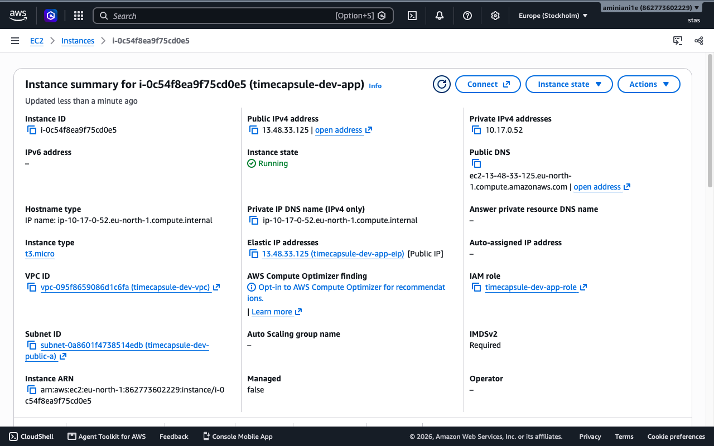

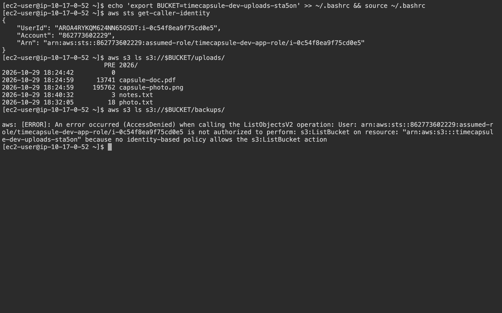

**Где AWS CLI на сервере взял учётные данные?** Из службы метаданных экземпляра (IMDSv2, `169.254.169.254`). EC2
по профилю экземпляра сам берёт роль `timecapsule-dev-app-role` и выдаёт временные ключи, которые CLI и SDK
находят автоматически в цепочке поиска учётных данных. Ключи меняются до истечения срока.

**Чем политика доверия этой роли отличается от тестовой?** У роли сервера доверенный участник — сервис
`ec2.amazonaws.com`, то есть роль может взять только EC2 для экземпляра. У тестовой роли доверенный участник — наш
аккаунт, то есть пользователи и роли аккаунта с правом `sts:AssumeRole`.

**Почему такие учётные данные безопаснее ключа доступа в файле `.env`?** Ключи временные (действуют часы) и
обновляются автоматически, их не нужно хранить и вращать вручную. Их нет на диске, в репозитории и в резервных копиях,
поэтому их нельзя случайно закоммитить в публичный репозиторий. Получить их можно только изнутри экземпляра, а при
утечке они скоро истекут. Постоянный ключ из `.env` действует, пока его не отзовут.

### Задание 10. Перенос существующих файлов

Приложение на сервере лежит в `/var/www/timecapsule` (без `current`, как в ЛР2 и ЛР3).

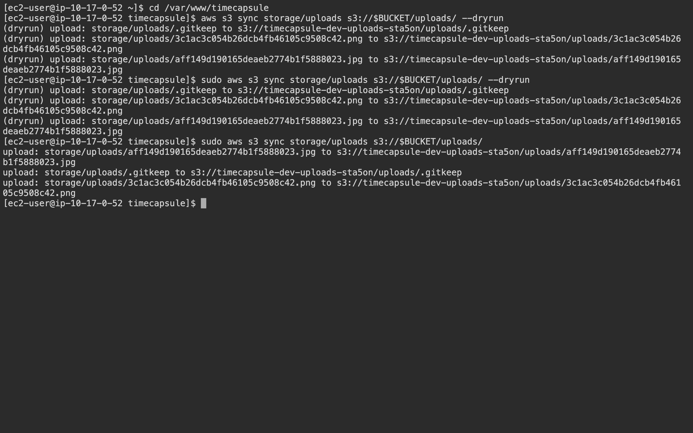

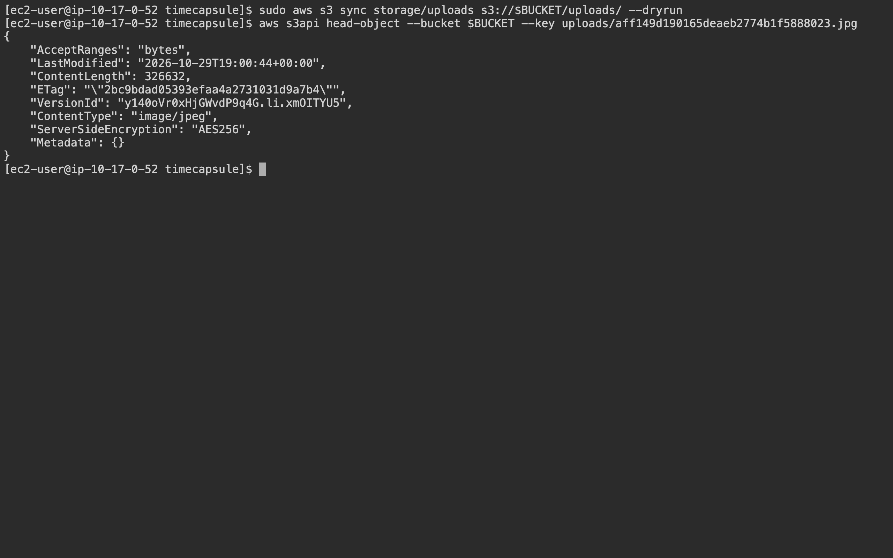

**Хватило ли для `aws s3 sync` прав политики приложения? Какие из разрешённых действий использовала команда?** Хватило.
`sync` сначала получает список объектов под `uploads/` (`s3:ListBucket` с префиксом `uploads/`), сравнивает его с
локальными файлами по размеру и времени изменения и загружает новые и изменённые (`s3:PutObject`). Чтение и удаление не понадобились.

### Задание 11. Модуль хранения на S3

Изменения в коммите [`df0a3d2`](https://github.com/sta5on-cloud/timecapsule/commit/df0a3d2):

- [`src/storage.php`](../../src/storage.php): `storage_save()` загружает файл `putObject` с `SourceFile` и
  `ContentType` из `mime_content_type()`, `storage_delete()` вызывает `deleteObject`, `storage_stream()` отвечает
  `302` на подписанный URL `GetObject` сроком 5 минут с `ResponseContentType` и `ResponseContentDisposition`.
  Клиент `S3Client` создаётся один раз.
- [`views/layout.php`](../../views/layout.php): в подвале вместо `local disk (storage/uploads)` имя бакета.
- [`.env.example`](../../.env.example): `S3_BUCKET` и `AWS_REGION` вместо `UPLOAD_DIR`.
- `composer.json` и `composer.lock`: пакет `aws/aws-sdk-php`. Composer установлен только на сервере, поэтому
  `composer require` выполнен там во временной копии репозитория.

Ключей доступа в `.env` нет: SDK получает учётные данные роли сервера.

### Задание 12. Деплой и проверка

Выпуск тем же способом, что в ЛР2 и ЛР3: `ssh app ./deploy.sh` (`git pull`, `composer install`, `init-db.php`,
перезагрузка PHP-FPM). Перед этим в `/var/www/timecapsule/.env` добавлены `S3_BUCKET` и `AWS_REGION`, после деплоя
PHP-FPM перезапущен.


Новые объекты под `uploads/` и их `Content-Type`:

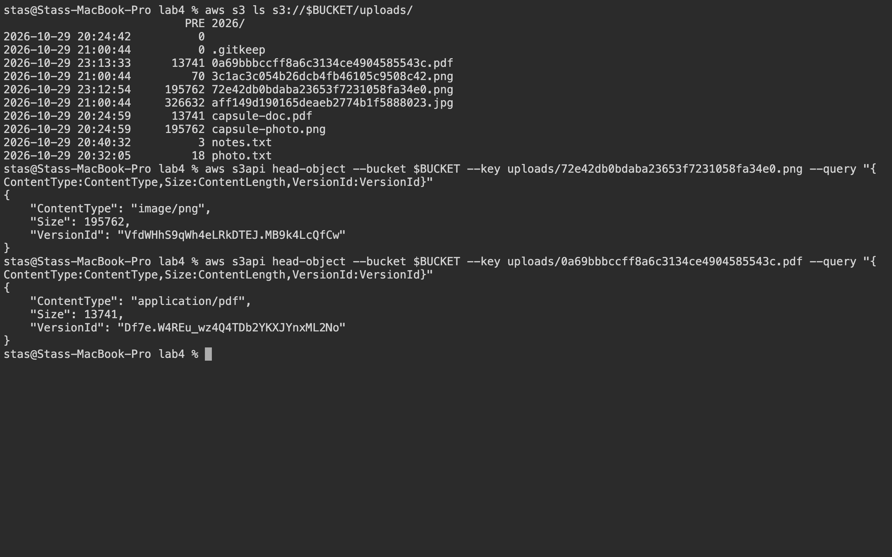


Картинка в новой вкладке: адрес `timecapsule-dev-uploads-sta5on.s3.eu-north-1.amazonaws.com/uploads/...png` с параметрами `X-Amz-*`.

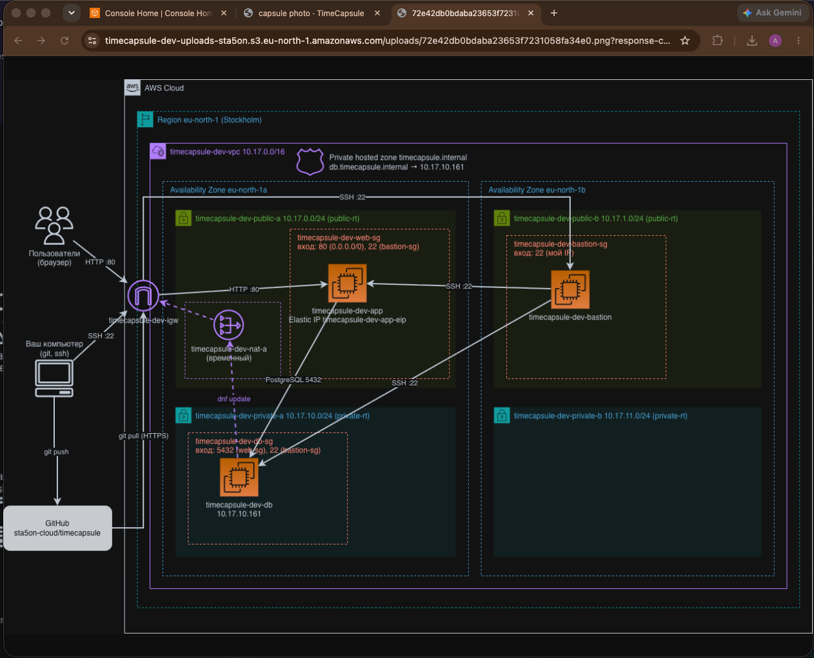

PDF скачался под исходным именем `capsule-doc.pdf`. Вложение старой капсулы из ЛР2 тоже приходит из S3, с исходным
именем файла в `response-content-disposition`.

Та же ссылка через 5 минут:

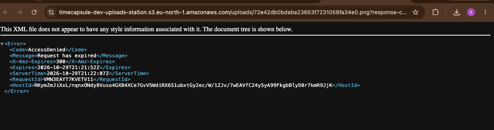

После удаления капсулы с картинкой текущей версией её объекта стал маркер удаления, файл остался в старой версии:

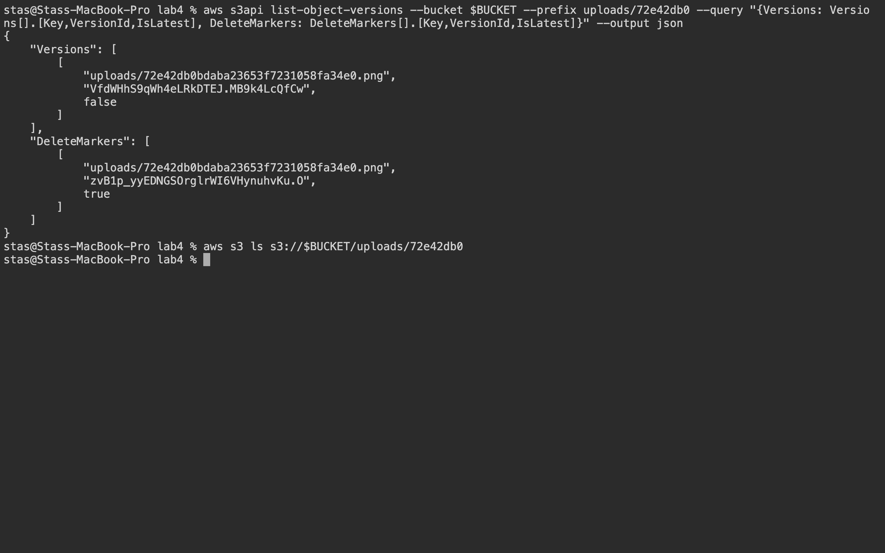

**Почему ссылку, которую пользователь переслал другу, не нужно специально отзывать?** Она действует 5 минут
(`X-Amz-Expires=300`) и не дольше временных учётных данных роли, которыми подписана. После этого S3 её отклоняет,
а новая ссылка выдаётся только после проверки прав в приложении.

**Что осталось в бакете после удаления капсулы и когда это исчезнет окончательно?** Осталась версия файла
(195 КБ), ставшая неактуальной, и маркер удаления поверх неё. Через 30 дней правило переведёт эту версию в Standard-IA
(она больше 128 КБ). Удалить её правило не сможет: оно удаляет неактуальные версии через 90 дней, но всегда сохраняет
две самые новые, а у этого ключа неактуальная версия одна. Имена файлов случайные и не повторяются, поэтому новых версий
у ключа не появится, и файл останется в Standard-IA, пока его версию не удалит владелец бакета. Чтобы удалённые
вложения исчезали сами, в правиле нужно убрать `Number of newer versions to retain` (тогда версия удалится через
90 дней), а для маркеров без версий включить `Delete expired object delete markers`.

### Задание 13. Сервер без состояния

Папка `storage/uploads` перемещена с сервера в `~/uploads-backup`. Старые и новые капсулы открываются, PDF скачивается,
новая капсула с вложением создаётся, и её файл приходит из S3:

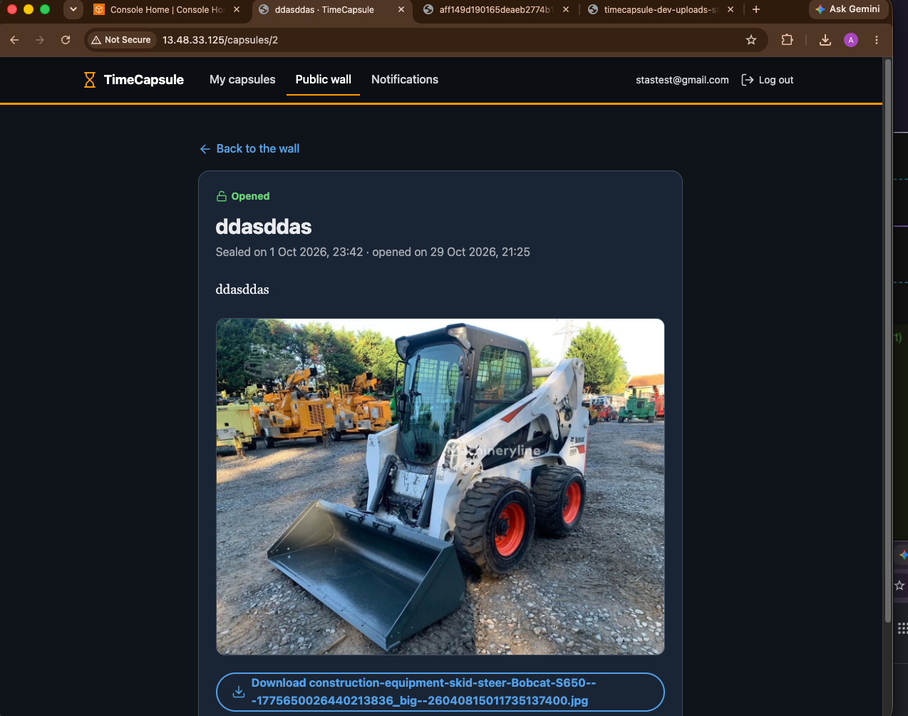

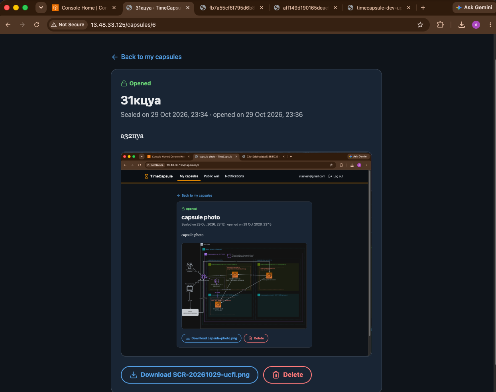

После проверки копия удалена: `sudo rm -rf ~/uploads-backup`.

Новая версия политики `v2` без правила `s3:ListBucket` (создана командой `aws iam create-policy-version --set-as-default`):

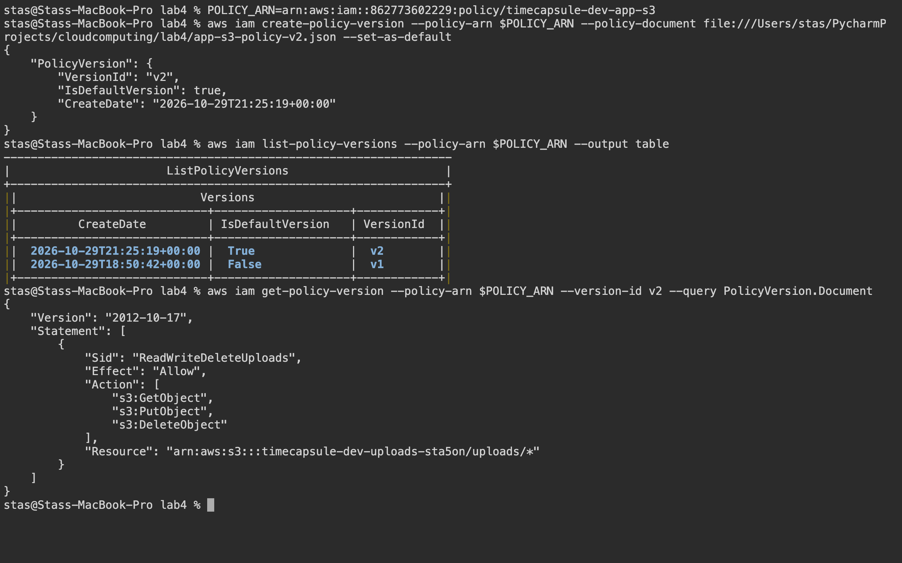

После этого приложение работает (скрины выше сделаны уже с политикой `v2`), а на сервере `aws s3 ls` получает `AccessDenied`.
Запрос несуществующего объекта на сервере и под своим пользователем:

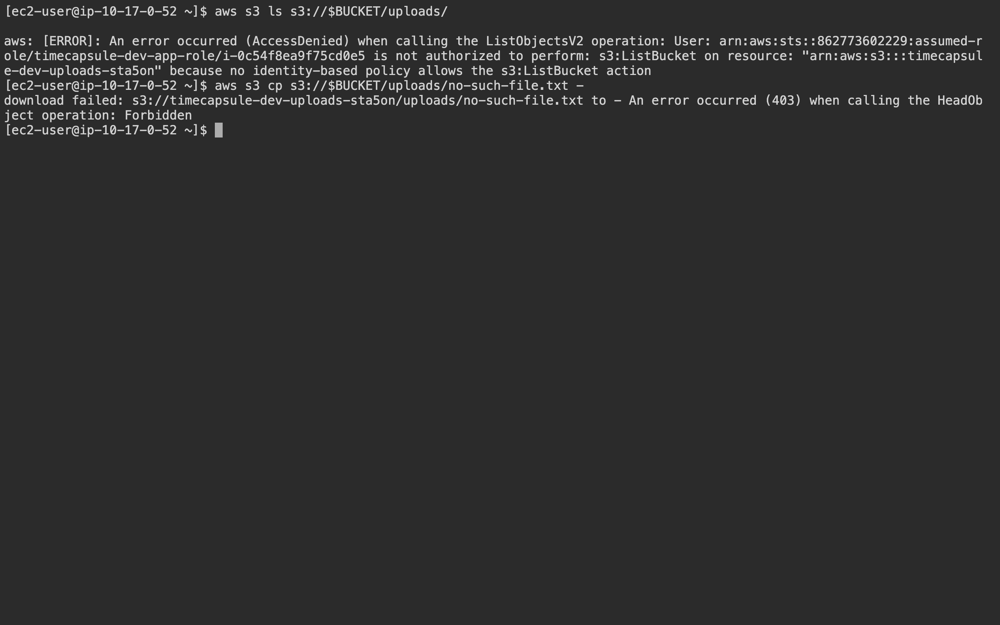

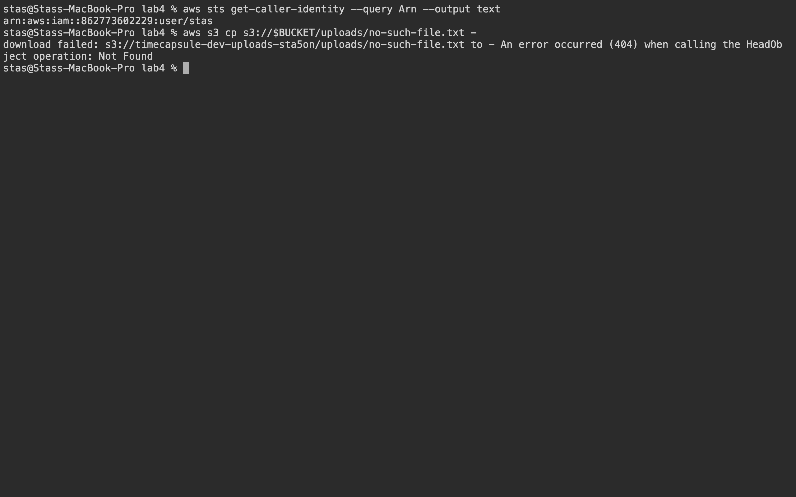

**Почему S3 ответил вам и серверу по-разному?** Серверу без `s3:ListBucket` S3 отвечает `403 Forbidden`,
а пользователю с правом на список объектов — `404 Not Found`.

**Зачем S3 так поступает?** Чтобы не раскрывать, какие объекты существуют. Если бы S3 отвечал `404` всем, по разнице
`403`/`404` можно было бы перебором узнавать имена файлов без права на чтение. Поэтому «объекта нет» говорится только
тому, кому разрешено видеть список объектов.

**Что теперь нужно сделать, чтобы заменить `app-server` новым сервером без потери данных?** Данных на сервере нет:
вложения в S3, база на `db-server`. Нужно поднять новый экземпляр в `public-a` с той же группой `web-sg`, привязать
роль `timecapsule-dev-app-role`, развернуть код из GitHub, положить `.env` (пароль базы, `S3_BUCKET`, `AWS_REGION`),
выполнить `composer install` и перенести Elastic IP на новый сервер. Пользователи потеряют только сессии
из `storage/sessions` и войдут заново.

## Архитектура

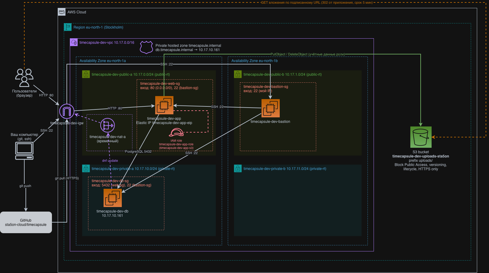

Схема в формате draw.io: [architecture.drawio](architecture.drawio). Добавлены бакет S3 вне VPC внутри региона
(`timecapsule-dev-uploads-sta5on`, префикс `uploads/`), роль сервера `timecapsule-dev-app-role` у `app-server`,
стрелка запросов приложения к S3 (`PutObject`, `DeleteObject`) и стрелка скачивания вложений браузером по подписанному URL.

Решение о хранении вложений: [ADR-0003](../adr/0003-attachment-storage.md).

## Устные вопросы

**1. Как проходит запрос на скачивание вложения? Где проверяются права пользователя приложения, а где права роли?**
Браузер запрашивает `/capsules/{id}/file` у `app-server`. Приложение по сессии определяет пользователя и проверяет,
что он может видеть капсулу и что она открыта (права пользователя приложения). Затем SDK подписывает URL `GetObject`
временными ключами роли и приложение отвечает `302`. Браузер идёт напрямую в S3. S3 проверяет подпись и срок, а потом
права того, кто подписал: роли `timecapsule-dev-app-role` (`s3:GetObject` на `uploads/*`) и политику бакета (HTTPS).

**2. Какие настройки бакета и свойства подписанного URL не дают постороннему открыть вложение по прямому адресу?**
`Block all public access` и `ACLs disabled` не дают сделать объекты публичными, политики разрешающей анонимное чтение нет,
поэтому прямой адрес без подписи возвращает `AccessDenied`. Имена файлов случайные. Подписанный URL действует 5 минут,
привязан к одному ключу объекта и параметрам ответа (их нельзя изменить без `SignatureDoesNotMatch`), а выдаётся
только после проверки прав в приложении. Политика бакета запрещает HTTP, так что ссылку нельзя перехватить в открытом виде.

**3. Почему приложение отдаёт файлы через подписанный URL, а не открывает бакет для чтения всем?**
Вложения капсул личные: закрытую капсулу или чужую капсулу видеть нельзя. При публичном бакете любой, кто узнал адрес
(из истории браузера, логов, пересылки), мог бы скачать файл когда угодно, и запечатанные капсулы перестали бы быть
запечатанными. Подписанный URL сохраняет проверку прав в приложении и ограничивает срок доступа, а файл при этом всё равно
идёт напрямую из S3, без нагрузки на сервер.

**4. Как изменится схема, если вложения должны пережить отказ всего региона `eu-north-1`?**
Нужен второй бакет в другом регионе (например, `eu-central-1`) с включённым версионированием и правило
Cross-Region Replication из основного бакета в него. Роли репликации нужны права на чтение исходного и запись в целевой
бакет. При отказе региона приложение (развёрнутое во втором регионе вместе с копией базы) переключается на резервный бакет
через `S3_BUCKET` и `AWS_REGION`. Можно использовать Multi-Region Access Point, чтобы адрес не менялся. Стоимость хранения
и трафик репликации при этом примерно удваиваются.

## Завершение работы

Бакет, политика и роли оставлены для следующих работ. Серверы bastion, `app-server` и `db-server` останавливаются после сдачи.
