# Лабораторная работа №5. Облачные базы данных. Amazon RDS

- **ФИО:** Voronetchii Stanislav
- **Группа:** IA2404
- **Специальность:** Informatica Aplicata
- **Уровень:** продвинутый
- **Репозиторий:** https://github.com/sta5on-cloud/timecapsule
- **Решение о базе:** [ADR-0004](../adr/0004-database-hosting.md)
- **Отчёты ЛР2-ЛР4:** [README.md](../../README.md), [docs/lab3/README.md](../lab3/README.md), [docs/lab4/README.md](../lab4/README.md)

> Ресурсы созданы в регионе `eu-north-1` (Stockholm), как и в ЛР2-ЛР4, поэтому зоны называются `eu-north-1a`
> и `eu-north-1b`, а не `eu-central-1a` и `eu-central-1b`.
>
> Аккаунт на бесплатном плане AWS (Free plan). Он не даёт хранить автоматические резервные копии дольше 1 дня:
> при сроке 7 дней создание базы завершилось ошибкой `The specified backup retention period exceeds the maximum
> available to free tier customers`. Поэтому у обеих баз срок хранения 1 день, восстановление на момент времени
> (задание 5) работает и с ним. Шаблона `Sandbox` в консоли нет, вместо него выбран `Free tier`: он так же отключает
> Multi-AZ и дорогие классы.

| Ресурс | Имя |
| --- | --- |
| DB subnet group (Часть 1) | `lab5-db-subnets` |
| Security Group веб-сервера / базы (Часть 1) | `lab5-web-sg` / `lab5-rds-sg` |
| Учебная база, реплика, восстановленная копия | `lab5-db`, `lab5-db-replica`, `lab5-db-restore` |
| Security Group базы приложения | `timecapsule-dev-rds-sg` |
| DB subnet group | `timecapsule-dev-db-subnets` |
| База приложения | `timecapsule-dev-rds` |
| Политика IAM / роль для расписания | `timecapsule-dev-rds-stop` / `timecapsule-dev-scheduler-role` |
| Расписание EventBridge Scheduler | `timecapsule-dev-rds-nightly-stop` |

Теги Части 1: `Lab=lab5`. Теги Части 2: `Project=timecapsule`, `Environment=dev`, `Owner=sta5on`, `Lab=lab5`.

## Базовый уровень

### Задание 1. Размещение и доступ

Subnet group `lab5-db-subnets` состоит из двух приватных подсетей ЛР3 в разных зонах:
`private-a` (`10.17.10.0/24`, `eu-north-1a`) и `private-b` (`10.17.11.0/24`, `eu-north-1b`).

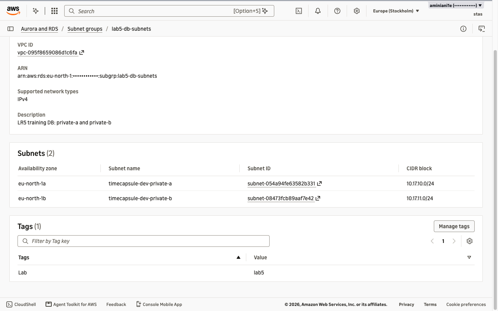

Группа веб-сервера `lab5-web-sg` без входящих правил: она нужна только как «пропуск» к базе. Группа базы `lab5-rds-sg`
пропускает TCP 5432 только от `lab5-web-sg`, других входящих правил нет.

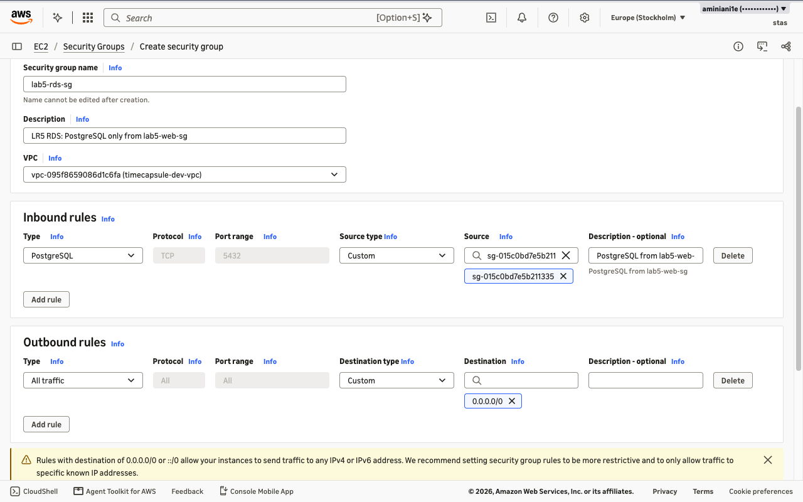

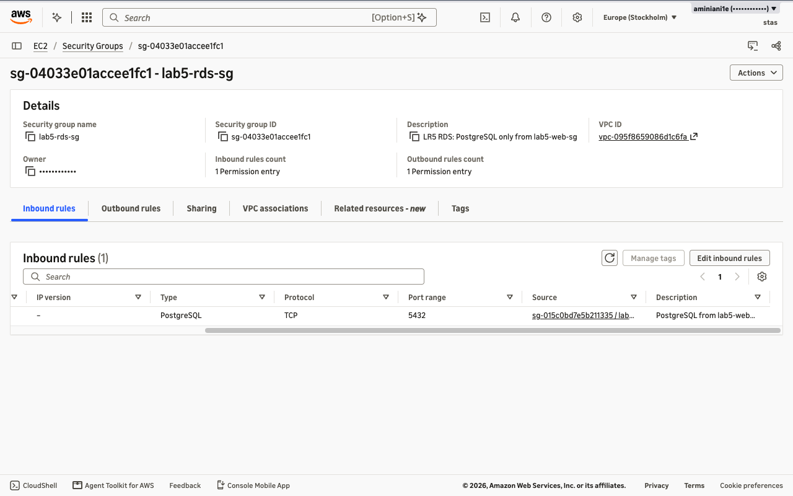

**Почему для ограничения доступа удобнее использовать Security Group источника, а не его IP-адрес?** Правило с группой
действует для любого экземпляра, у которого она есть: сервер можно пересоздать, его адрес сменится, а правило менять
не нужно. Доступ выдаётся и отзывается тем, что группу добавляют серверу или снимают с него. Правило по IP пришлось бы
править при каждой смене адреса, а широкий диапазон открыл бы порт и лишним серверам подсети.

**Зачем указывать две подсети, если учебная база будет работать в одной зоне?** RDS требует, чтобы subnet group
покрывала минимум две зоны. Из этих подсетей RDS выбирает адрес для базы, реплики, восстановленной копии и standby
Multi-AZ. Реплика в задании 4 создана в `eu-north-1b`, то есть в `private-b`, а при отказе зоны `1a` базу можно
восстановить в `1b` без изменения сети.

### Задание 2. Экземпляр RDS

База `lab5-db`: PostgreSQL 18.6 (последняя версия), шаблон `Free tier`, `db.t4g.micro`, `gp3` 20 GiB без автоматического
роста, пользователь `dbadmin`, subnet group `lab5-db-subnets`, зона `eu-north-1a`, без публичного доступа, группа
`lab5-rds-sg`, начальная база `lab5`, резервные копии 1 день, шифрование и `deletion protection` включены.

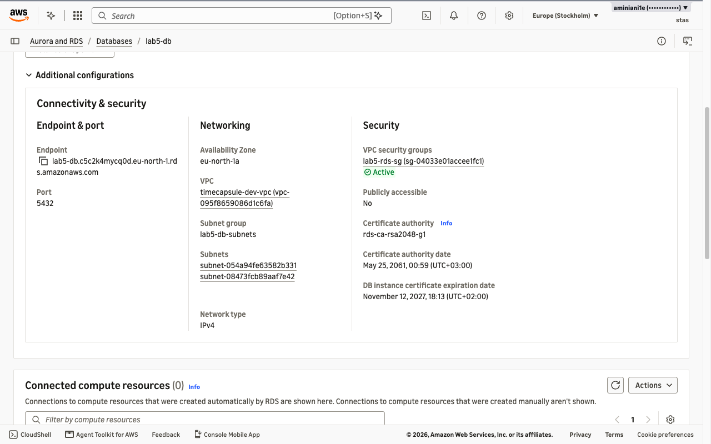

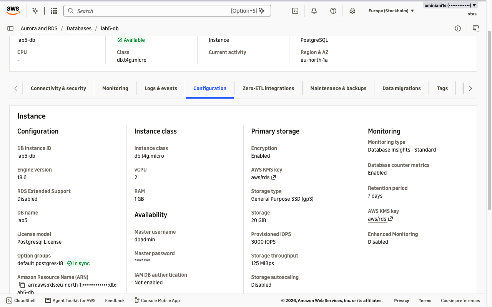

**Как убедиться, что база принимает подключения только с нужного сервера?** Проверить с нескольких мест (задание 3):
с `app-server`, у которого есть `lab5-web-sg`, порт 5432 открыт и `psql` подключается; с bastion из той же VPC порт
закрыт (таймаут), с моего компьютера тоже. В консоли видно `Publicly accessible: No` и единственное входящее правило
в `lab5-rds-sg`.

**Почему для неё выбрана зона `eu-central-1a` (у нас `eu-north-1a`)?** В этой зоне находится сервер, который к ней
подключается (`app-server` в `public-a`). Трафик внутри одной зоны бесплатный и быстрее, чем между зонами, а реплику
в задании 4 намеренно размещаем в другой зоне.

**От чего защищает `deletion protection`, а от чего нет?** От случайного удаления самой базы: пока защита включена,
RDS отказывает в `DeleteDBInstance`, её нужно сначала выключить через `Modify`. От потери данных внутри базы она не
защищает: `DELETE`, `DROP TABLE`, ошибка в приложении или взлом с паролем `dbadmin` выполнятся как обычно. От этого
спасают резервные копии и восстановление на момент времени (задание 5).

### Задание 3. Подключение и таблица

Отдельную ВМ я не создавал: группа `lab5-web-sg` добавлена к уже работающему `app-server` (на нём есть клиент `psql`),
после Части 1 она снимается.

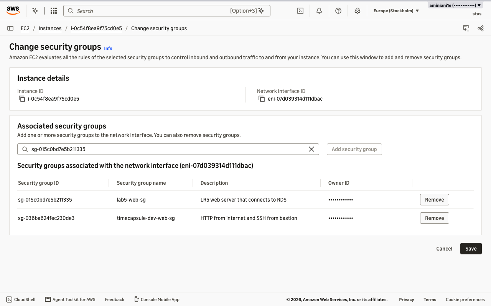

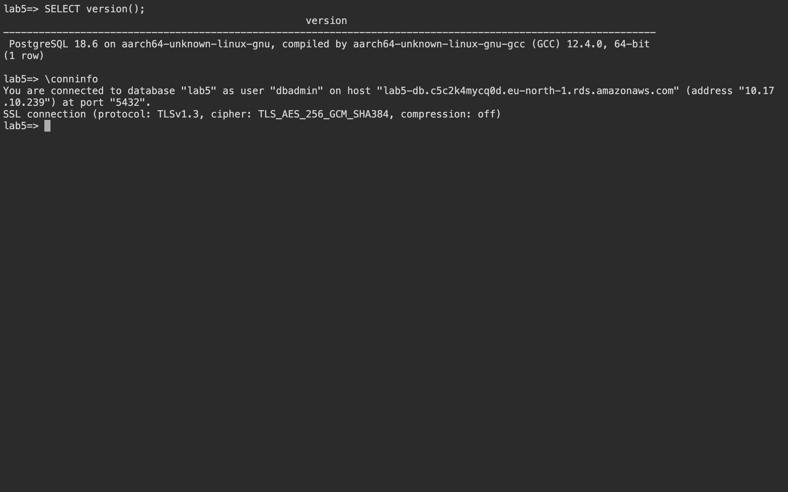

Соединение зашифровано (TLSv1.3), хотя ключи `sslmode` не указывались: `psql` по умолчанию пробует TLS, а RDS для
PostgreSQL его требует. Клиент 16.15 работает с сервером 18.6 с предупреждением о разных версиях.

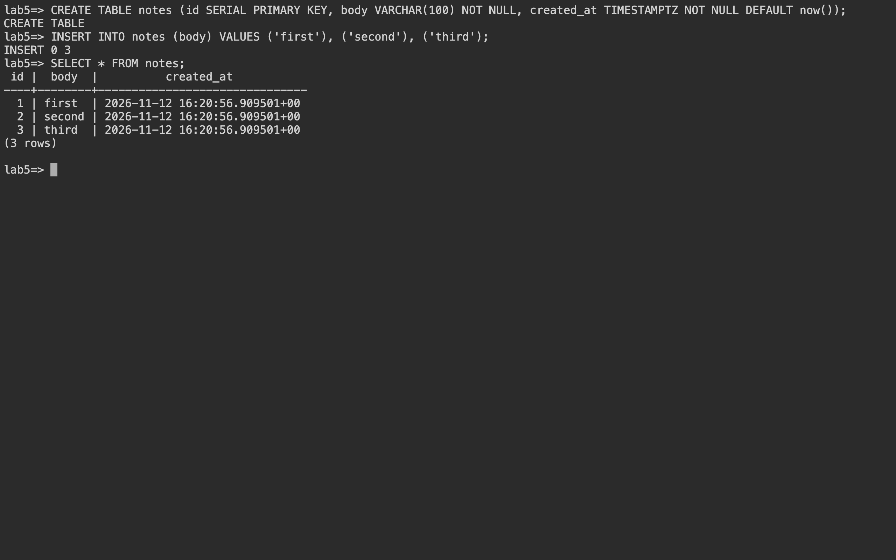

Имя endpoint и с `app-server`, и с моего компьютера разрешается в один и тот же приватный адрес `10.17.10.239`:
публичная DNS-запись RDS указывает на приватный адрес, потому что база без публичного доступа. С компьютера
подключиться по этому адресу нельзя (`nc` завершается таймаутом): он не маршрутизируется из интернета.

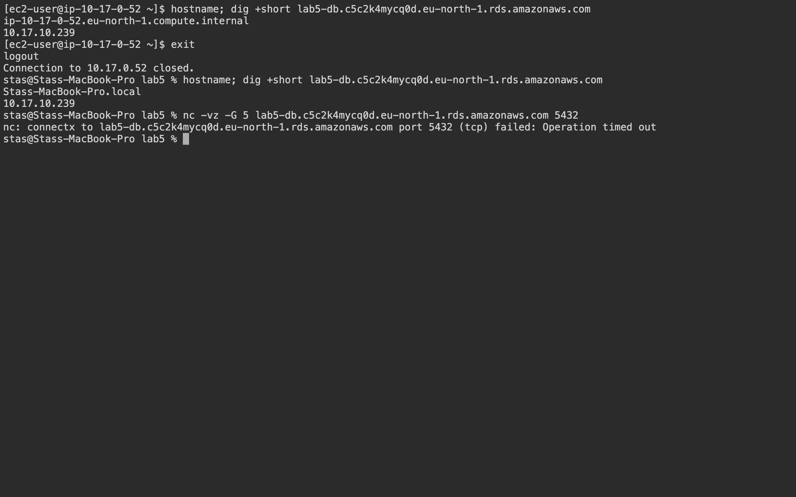

Проверка доступа: с bastion порт 5432 закрыт, с `app-server` открыт.

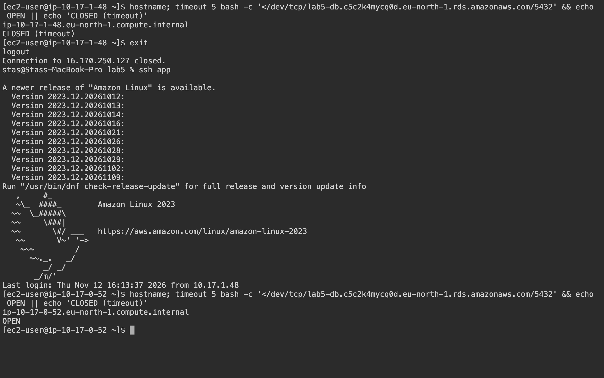

### Задание 4. Реплика для чтения

Реплика `lab5-db-replica`: `db.t4g.micro`, зона `eu-north-1b`, без публичного доступа, группа `lab5-rds-sg`, без защиты
от удаления. Бесплатный план её создать разрешил. На реплике `pg_is_in_recovery()` = `t`, данные из таблицы видны,
а `INSERT` завершается ошибкой `cannot execute INSERT in a read-only transaction`.

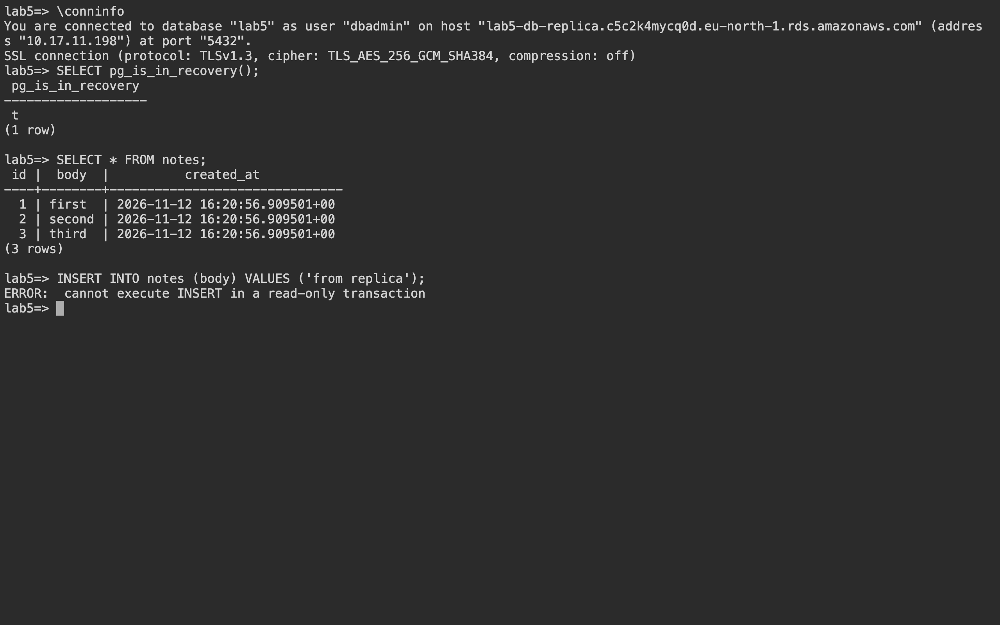

На основной базе `pg_is_in_recovery()` = `f`, строка `fourth` добавлена:

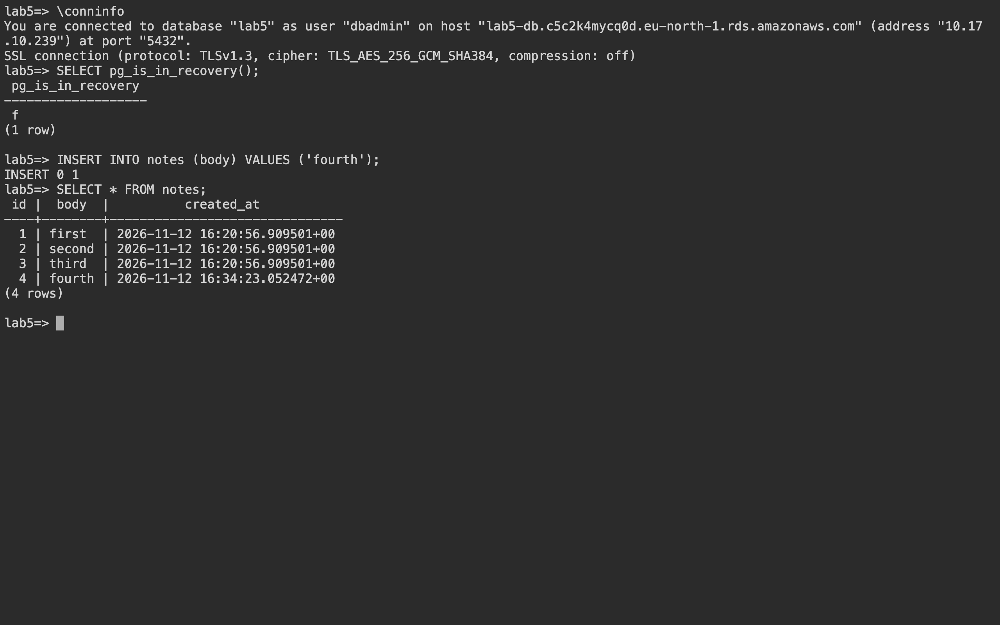

Через несколько секунд строка `fourth` есть и на реплике:


`ReplicaLag` (максимум за минуту): 413 с сразу после создания реплики (догоняла основную базу), 53 с, пока в основную
базу никто не писал (отставание считается от времени последней воспроизведённой транзакции и на простое растёт),
и 7 с сразу после вставки `fourth`. На вкладке `Monitoring` график усредняется по 5 минутам, поэтому подробнее
метрика показана в CloudWatch с периодом 1 минута.

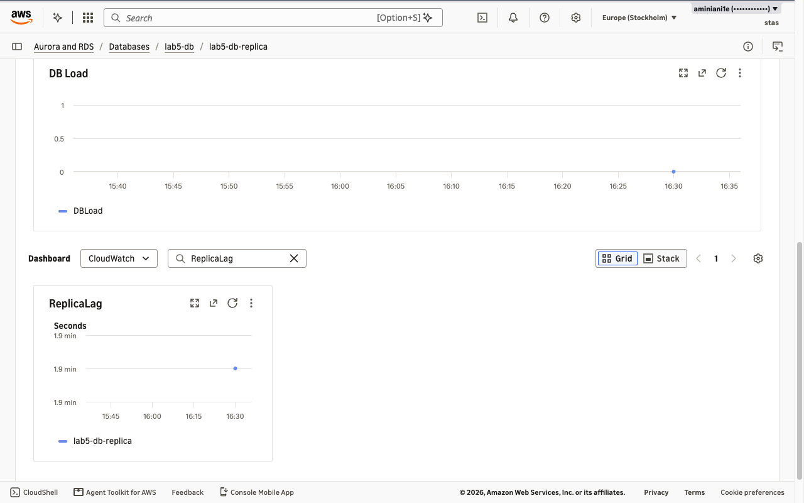

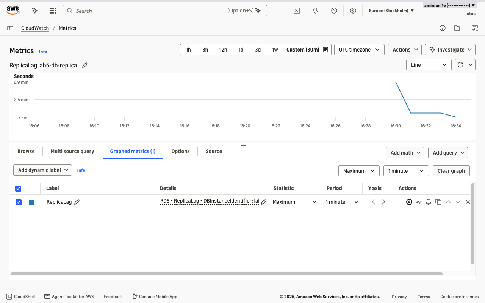

**Почему `INSERT` на реплике не выполнился?** Реплика PostgreSQL работает в режиме восстановления: она только
применяет поток WAL от основной базы и открыта лишь на чтение. Записывать можно только в основную базу, иначе
данные на копиях разошлись бы.

**Чем реплика для чтения отличается от резервного экземпляра Multi-AZ?** Реплика асинхронная, у неё свой endpoint,
и её используют для чтения (отчёты, разгрузка основной базы); при отказе основной её нужно вручную повысить
(`Promote`), и последние транзакции могут не успеть дойти. Standby Multi-AZ синхронный, запросов не принимает, своего
endpoint не имеет: при отказе RDS сам переключает endpoint основной базы на него без потери подтверждённых транзакций.

### Задание 5. Восстановление после ошибки

Время на основной базе перед ошибкой: `2026-11-12 16:36:29 UTC`. Через минуту, в `16:37:42 UTC`, выполнен
`DELETE FROM notes` (удалено 4 строки), и сразу же таблица опустела и на реплике.

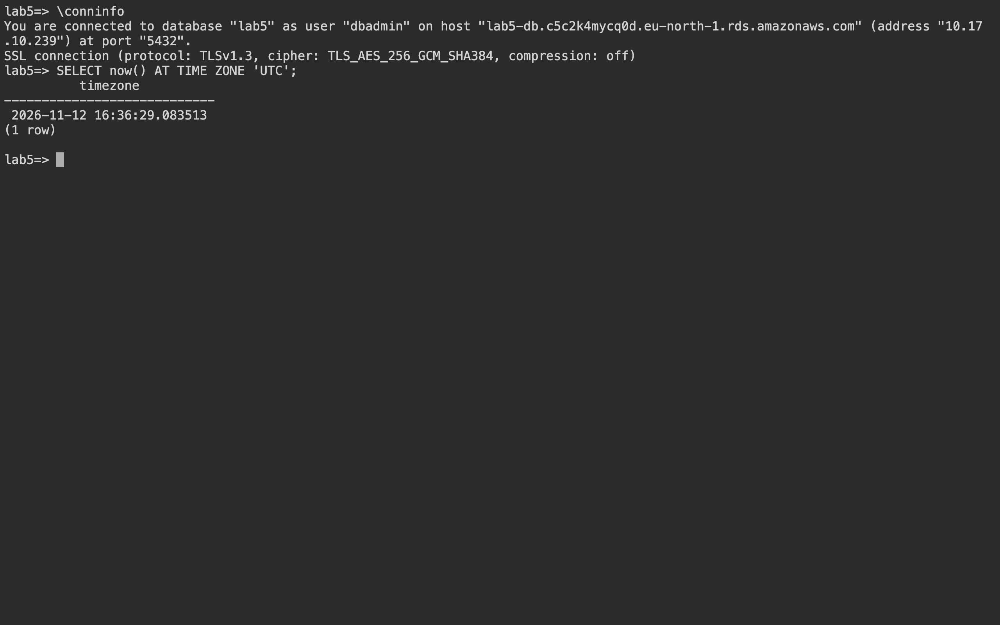

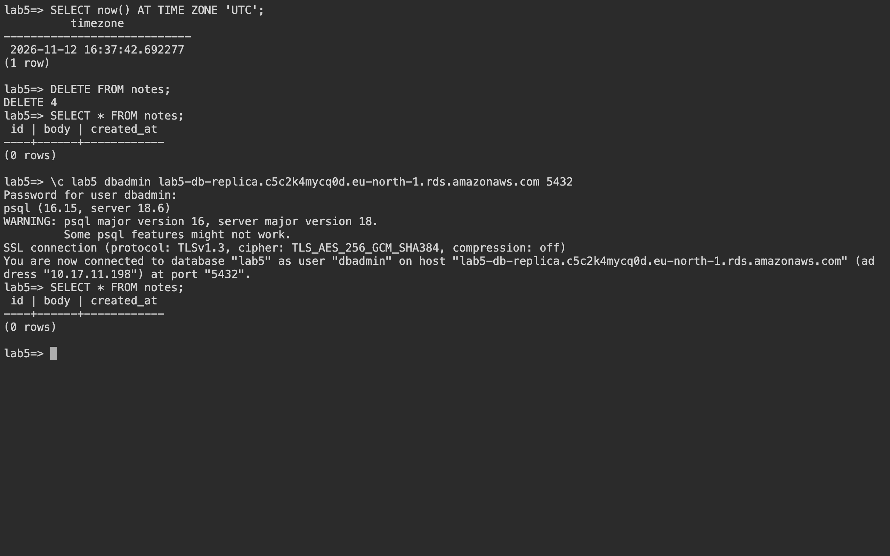

После удаления реплики `Latest restore time` был `16:34:21 UTC`, раньше нужного момента. Через несколько минут RDS
выгрузил журналы, и он стал `16:39:21 UTC` (`18:39` в UTC+2 на скриншоте):

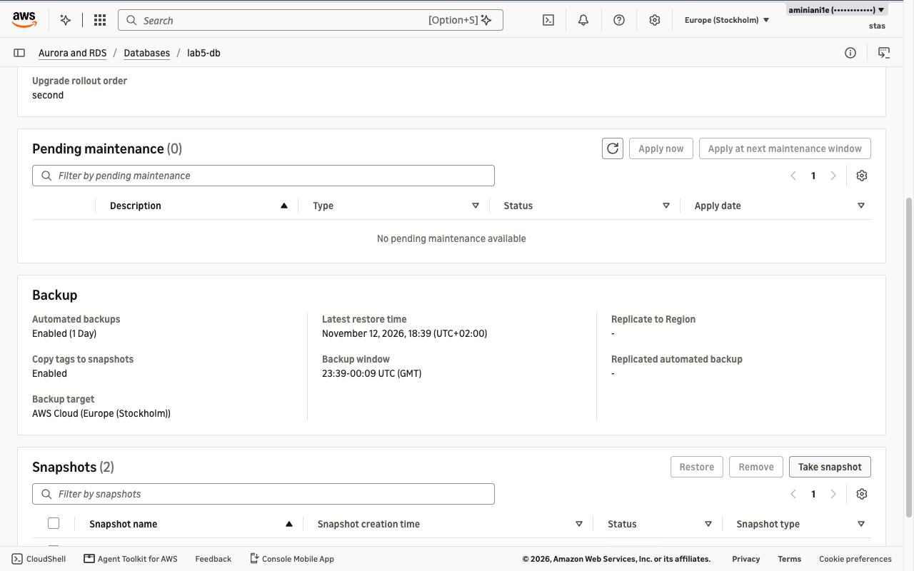

Восстановление на `18:36:29` в поле с часовым поясом UTC+2:00, то есть на `16:36:29 UTC`. Имя `lab5-db-restore`,
одна зона, `db.t4g.micro`, `lab5-db-subnets`, без публичного доступа, `lab5-rds-sg`, без защиты от удаления:

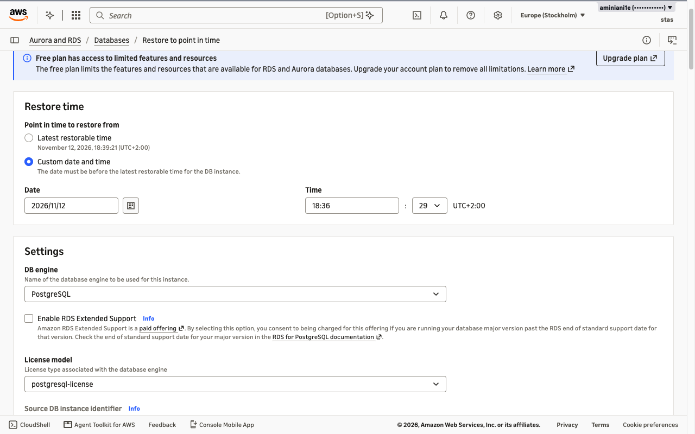

В восстановленной базе все четыре строки:

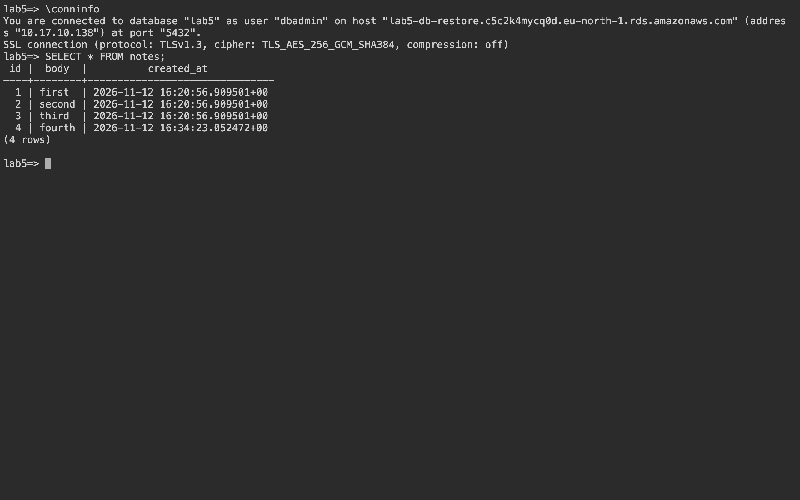

Копия удалена без финального снимка и без сохранения резервных копий.

**Почему реплика не спасла данные?** Реплика повторяет все изменения основной базы, в том числе ошибочные: `DELETE`
дошёл до неё за секунды. Она защищает от отказа сервера или зоны, но не от ошибки пользователя или приложения.

**Почему восстановление создаёт новую базу, а не откатывает старую?** RDS берёт ежедневный снимок и применяет к нему
журналы транзакций до нужного момента, а это можно сделать только на новом диске. Старая база остаётся как есть:
можно сравнить данные, перенести из копии только нужные строки и не потерять изменения, сделанные после ошибки.
Если копия должна заменить базу, приложение переключают на её endpoint (или переименовывают экземпляры).

### Завершение Части 1

См. раздел [Завершение работы](#завершение-работы).

## Продвинутый уровень

### Задание 6. База приложения

Subnet group `timecapsule-dev-db-subnets` из `private-a` и `private-b`:

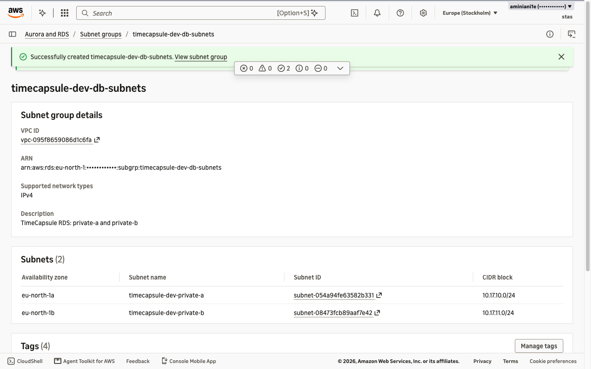

Группа `timecapsule-dev-rds-sg`: 5432 только от `timecapsule-dev-web-sg` (группа `app-server`).

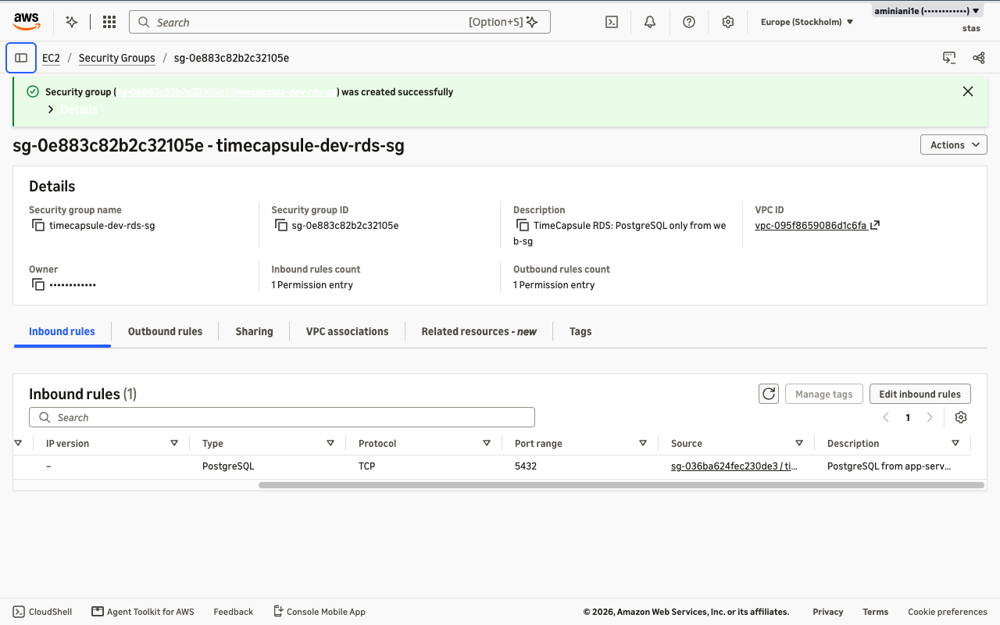

База `timecapsule-dev-rds`: PostgreSQL 16.15 (ветка 16, как на `db-server`, иначе `pg_dump` 16 не снимет дамп),
`db.t4g.micro`, `gp3` 20 GiB без автоматического роста, `eu-north-1a`, без публичного доступа, шифрование и защита от
удаления включены, резервные копии 1 день, `Initial database name` пустое.

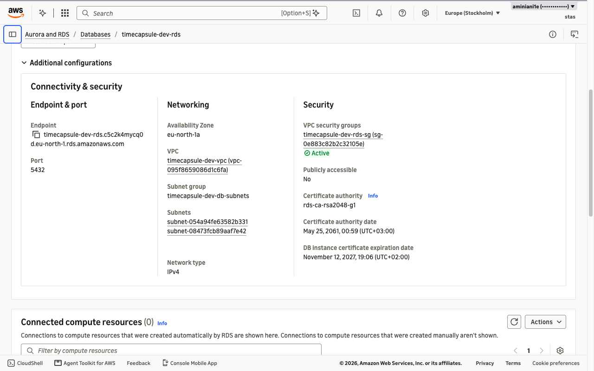

**Какие параметры базы приложения вы выбрали бы иначе для рабочей системы с реальными пользователями? Почему?**
Multi-AZ, чтобы отказ зоны или обслуживание не останавливали сервис. Срок резервных копий 7-35 дней и копирование
снимков в другой регион, чтобы ошибку можно было исправить и через неделю. Класс не burstable (`db.m7g` или хотя бы
`db.t4g.medium`), чтобы не упираться в кредиты CPU, и включённый автоматический рост диска. Никакой ночной остановки,
пароль `dbadmin` в Secrets Manager с ротацией, Enhanced Monitoring и экспорт журналов PostgreSQL в CloudWatch.

### Задание 7. Ночная остановка по расписанию

Политика `timecapsule-dev-rds-stop` разрешает одно действие на одну базу:

```json
{
    "Version": "2012-10-17",
    "Statement": [
        {
            "Sid": "StopTimecapsuleRds",
            "Effect": "Allow",
            "Action": "rds:StopDBInstance",
            "Resource": "arn:aws:rds:eu-north-1:<account-id>:db:timecapsule-dev-rds"
        }
    ]
}
```

Роль `timecapsule-dev-scheduler-role` с этой политикой может принять только `scheduler.amazonaws.com` и только для
расписаний моего аккаунта (условие `aws:SourceAccount`):

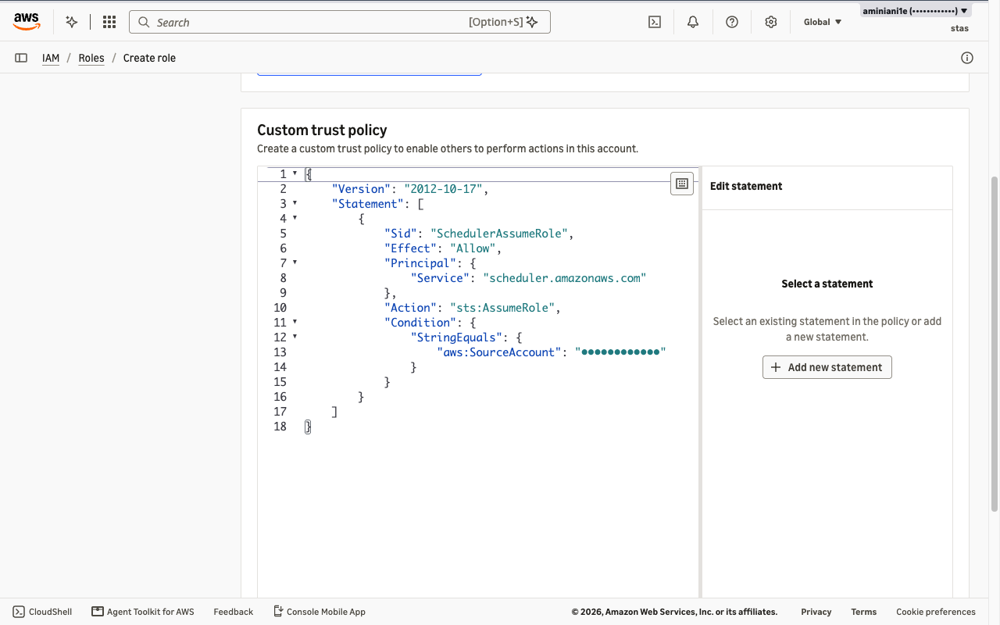

Для проверки расписание сначала создано с `cron(18 19 * * ? *)` в `Europe/Chisinau`, без гибкого окна, цель
`Amazon RDS StopDBInstance` с входом `{"DbInstanceIdentifier": "timecapsule-dev-rds"}`, роль
`timecapsule-dev-scheduler-role`:

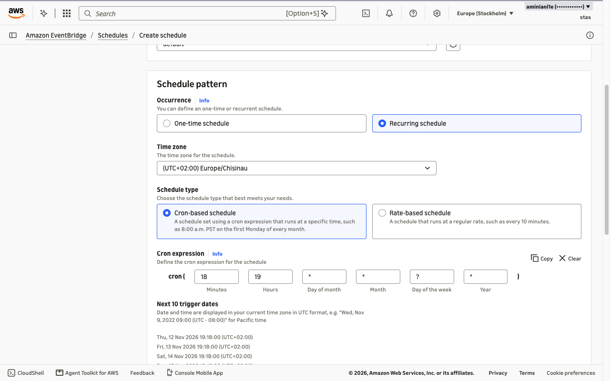

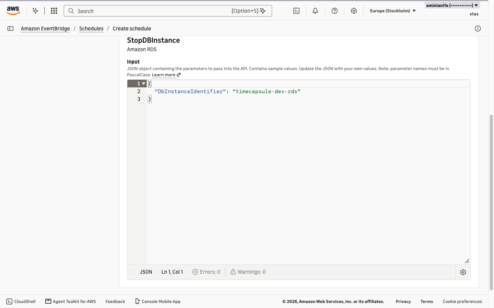

В 19:18 база перешла в `stopping`, в 19:22 в журнале событий появилось `DB instance stopped`:

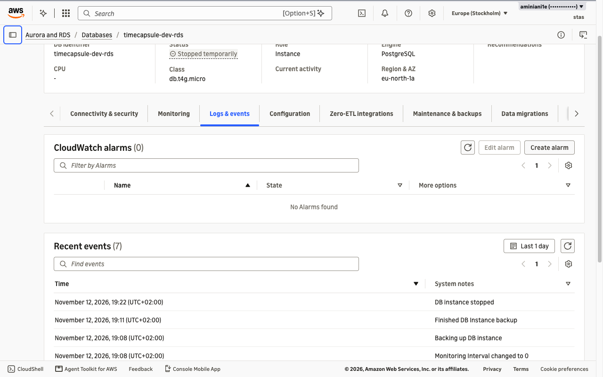

После проверки выражение заменено на `cron(0 23 * * ? *)`, база снова запущена:

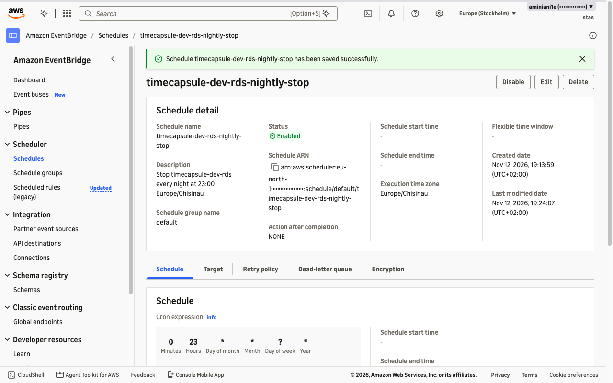

**Зачем расписанию своя роль, если вы и сами можете остановить базу?** Расписание выполняется в AWS без меня, когда
я не в консоли, и действует не от моего имени: Scheduler принимает роль и вызывает API её временными учётными данными.
Мои права ему передать нельзя, а отдельная роль показывает в CloudTrail, кто именно остановил базу (задание 11).

**Почему роль может остановить только одну базу?** По принципу наименьших привилегий. Если расписание настроят
неправильно или роль кто-то использует, максимум, что получится, - остановить `timecapsule-dev-rds`. Удалить,
изменить, запустить её или тронуть другие базы роль не может.

### Задание 8. Пользователь и база

От имени `dbadmin` в базе `postgres` созданы пользователь и база. Пароль задан командой `\password` из `DB_PASSWORD`
в `.env` на `app-server`, поэтому `.env` не менялся, а пароль не попал в историю `psql` и на скриншоты.

```sql
CREATE USER timecapsule;
\password timecapsule
GRANT timecapsule TO dbadmin;
CREATE DATABASE timecapsule OWNER timecapsule;
```

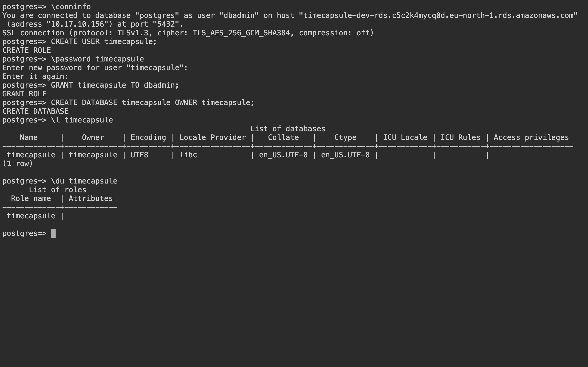

**Почему приложению нужен отдельный пользователь, а не `dbadmin`?** `dbadmin` - главный пользователь RDS: он
создаёт роли и базы и управляет всеми базами экземпляра. Пароль приложения лежит в `.env` на публичном сервере;
если его украдут через уязвимость в приложении, у взломщика будут права только на базу `timecapsule`, а не на весь
экземпляр. Отдельный пользователь также позволяет сменить его пароль, не трогая администратора, и отличать запросы
приложения в журналах.

### Задание 9. Перенос данных

С `app-server` снят дамп с `db.timecapsule.internal` (ещё указывал на `db-server`) с `--no-owner --no-privileges`
и загружен в RDS от имени `timecapsule`. Пароль передан через переменную `PGPASSWORD`, которая читается из `.env`.

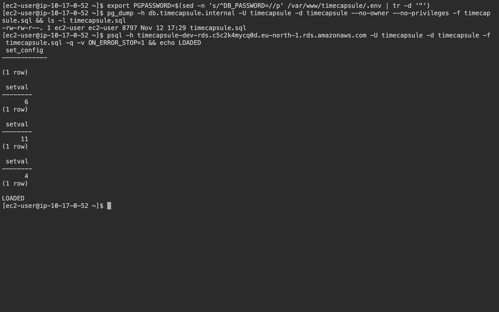

В обеих базах 4 пользователя и 5 капсул. Файл `timecapsule.sql` удалён: в нём хеши паролей.

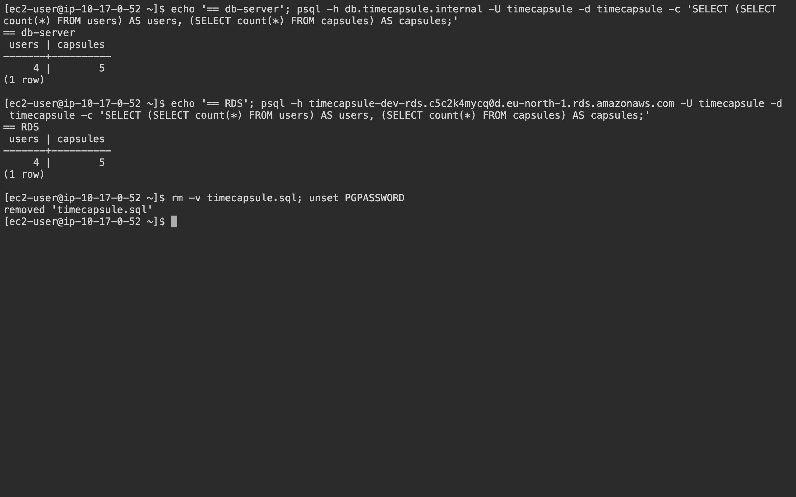

### Задание 10. Переключение приложения

В зоне `timecapsule.internal` удалена запись A `db` → `10.17.10.161` и сразу создана CNAME `db` → endpoint RDS, TTL 60:

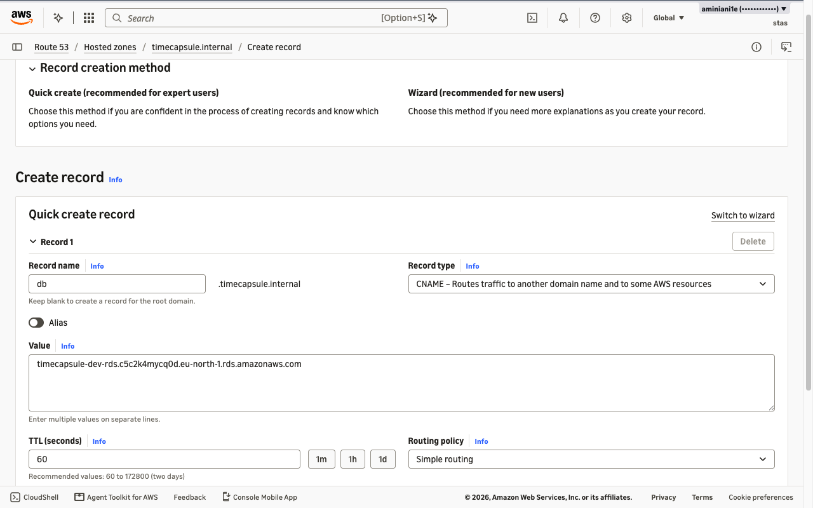

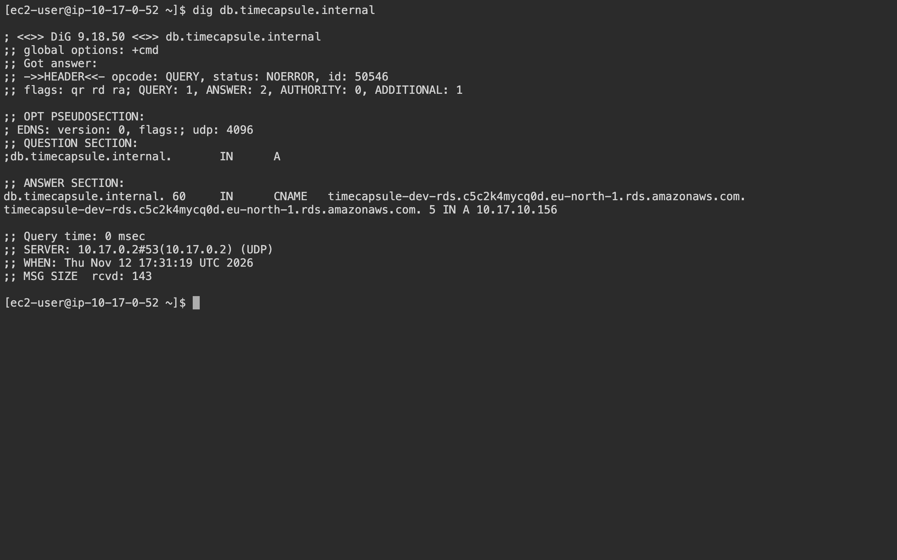

Приложение на PHP, поэтому шифрование включилось само (`PGSSLMODE` не нужен). `/health` отвечает `ok`:

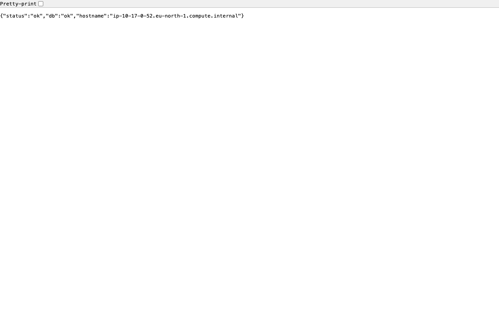

Через сайт зарегистрирован пользователь `lab5@timecapsule.test` и создана капсула `LR5: stored in RDS`. Она есть
в таблице `capsules` в RDS:

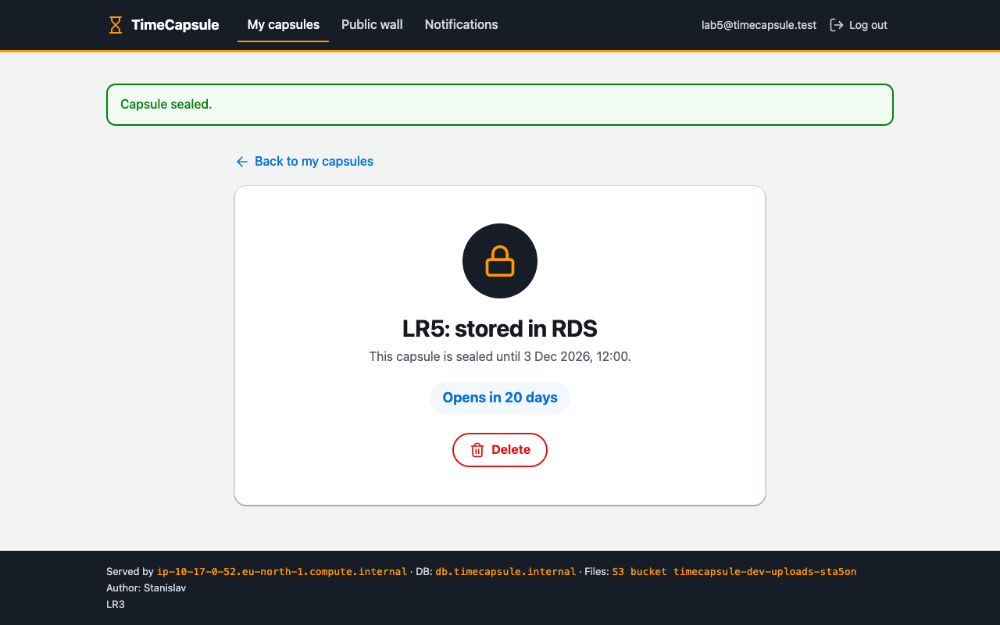

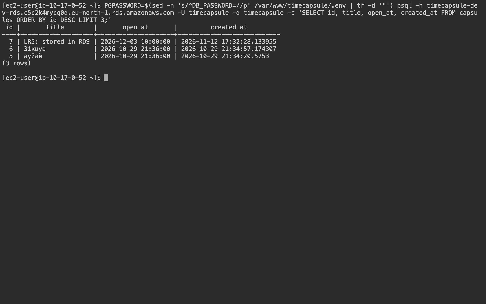

`db-server` остановлен, приложение продолжает работать, после этого сервер удалён:

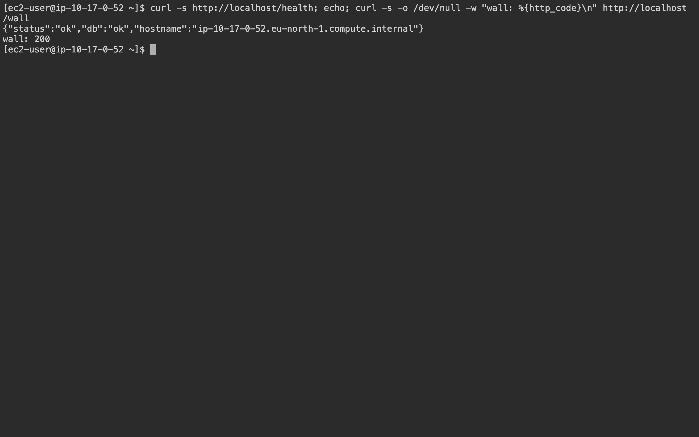

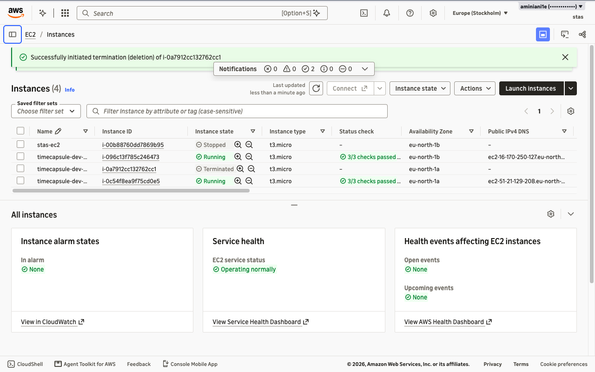

**Почему не пришлось менять `DB_HOST`?** Приложение с ЛР3 обращается к базе по имени `db.timecapsule.internal`,
а не по адресу. Поменялось только то, куда указывает имя в приватной зоне Route 53: вместо A-записи на `db-server`
теперь CNAME на endpoint RDS.

**Какие обязанности из ЛР3 перешли к AWS, а какие остались за вами?** К AWS перешли: ОС и установка PostgreSQL,
патчи в окно обслуживания (больше не нужен временный NAT Gateway), ежедневные снимки и восстановление на момент
времени, шифрование диска и TLS, мониторинг и журнал событий, замена сломанного железа. За мной остались: сеть
и Security Group, пользователи, права и пароли в базе, схема и данные, выбор версии и класса, мажорные обновления,
расписание и контроль расходов, проверка восстановления.

### Задание 11. Обслуживание

Во время перезагрузки (`17:37:14 UTC`) `/health` опрашивался каждые 2 секунды: около 10 секунд (с `17:37:20`
по `17:37:28`) он отвечал `{"status":"error","db":"error","hint":"Cannot connect to the database…"}`, затем снова `ok`.

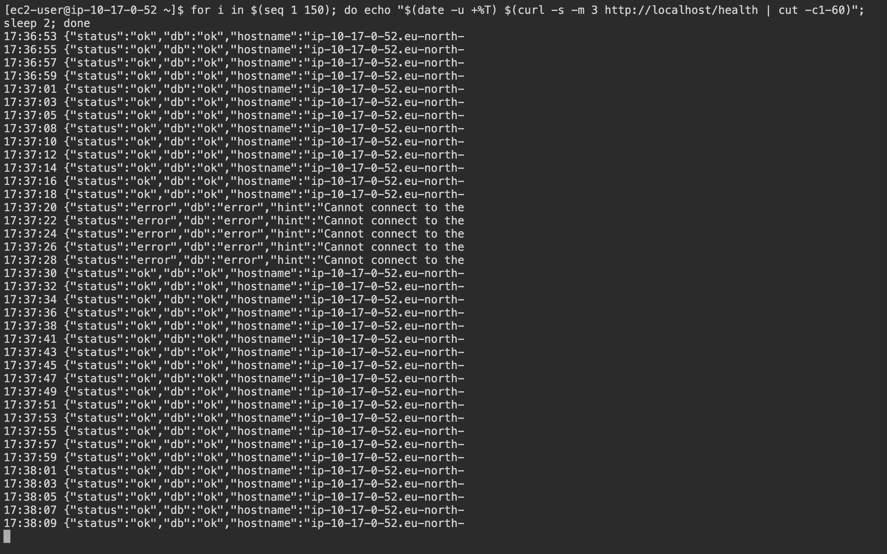

В `Logs & events` видны `DB instance shutdown` и `DB instance restarted`, выше - остановка и запуск из задания 7:

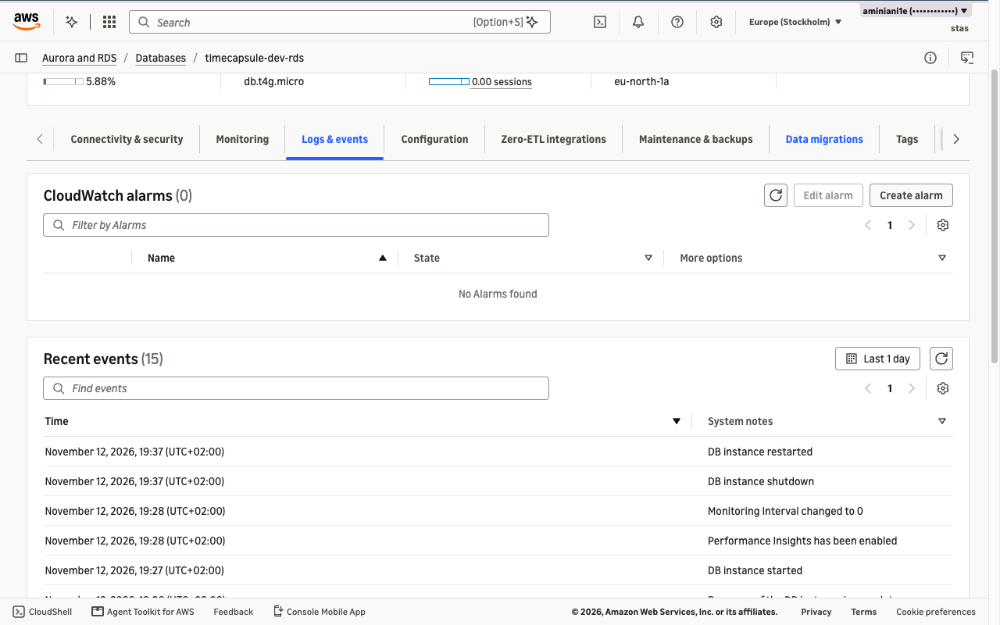

С остановленной базой сайт отдаёт 500:

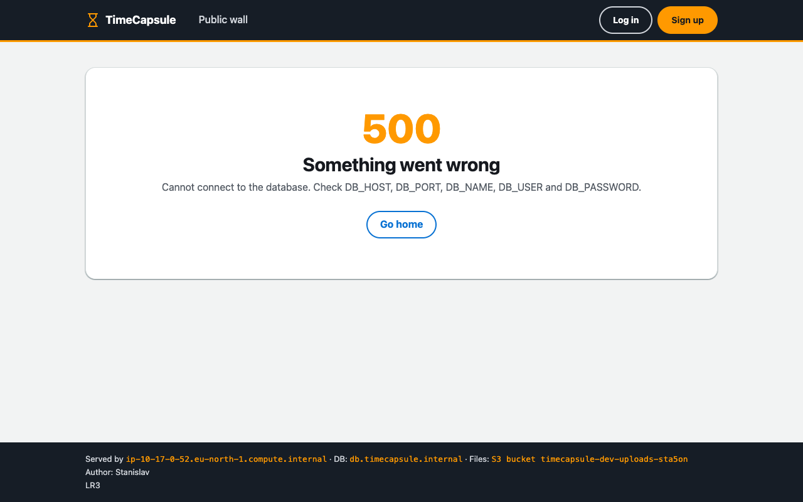

После запуска `/health` снова `ok`, `db.timecapsule.internal` указывает на тот же endpoint и тот же адрес `10.17.10.156`:

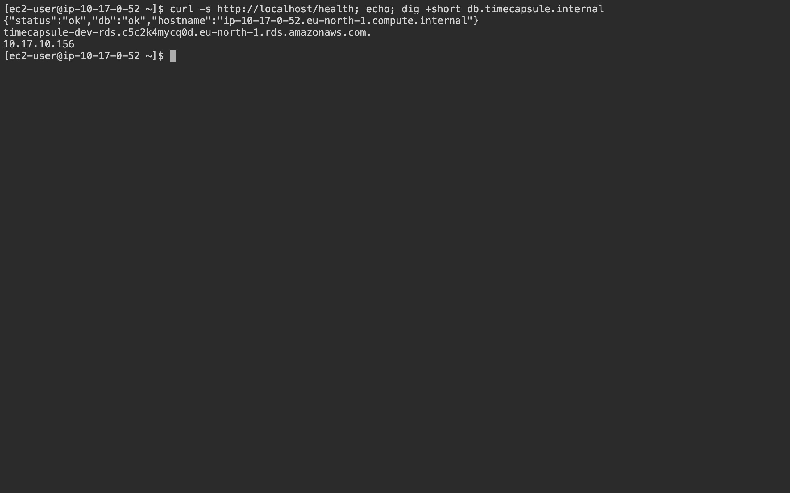

В CloudTrail вызов `StopDBInstance` в `17:18:31 UTC` сделан ролью `timecapsule-dev-scheduler-role`
(`AssumedRole`, userAgent `AmazonEventBridgeScheduler`):

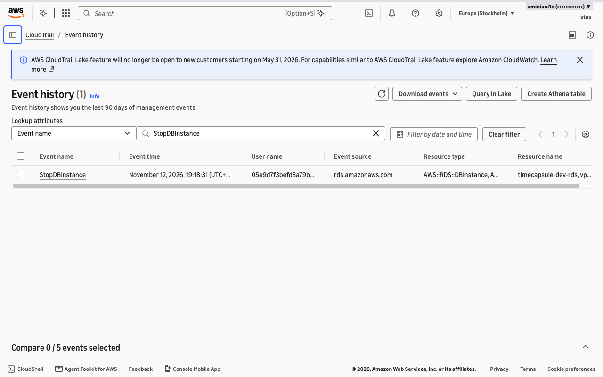

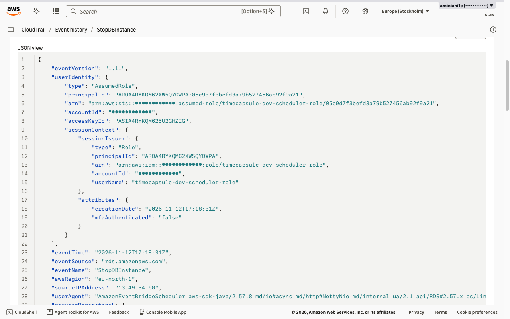

**Что показывал `/health` во время перезагрузки?** Около 10 секунд `"status":"error","db":"error"` с подсказкой
о невозможности подключиться к базе, затем `ok`. Приложение открывает новое соединение на каждый запрос, поэтому
восстановилось само, без перезапуска PHP-FPM.

**Изменился ли endpoint после остановки и запуска?** Нет: имя endpoint постоянное, и даже приватный адрес остался
`10.17.10.156`. Поэтому CNAME и `.env` менять не нужно.

**Какую ошибку получает расписание, если база уже остановлена?** `InvalidDBInstanceState: Instance timecapsule-dev-rds
is not in available state` (проверено тем же вызовом `StopDBInstance`). Scheduler попытку не повторяет, база
остаётся остановленной, то есть ошибка безопасна.

### Задание 12. Архитектура и решение

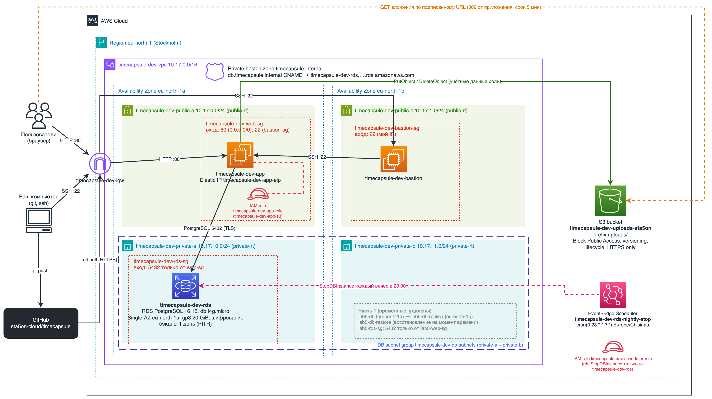

Схема в формате draw.io: [architecture.drawio](architecture.drawio). По сравнению с ЛР4 `db-server` заменён на
`timecapsule-dev-rds` в `private-a`, группа `db-sg` - на `timecapsule-dev-rds-sg` (только 5432 от `web-sg`),
добавлены DB subnet group на обе приватные подсети, CNAME в приватной зоне, EventBridge Scheduler с ролью
и стрелка `StopDBInstance`. Временный NAT Gateway и SSH к базе больше не нужны и убраны. Серым отмечены временные
ресурсы Части 1.

Решение о размещении базы: [ADR-0004](../adr/0004-database-hosting.md) (заменяет ADR-0002).

## Устные вопросы

**1. Как проходит запрос от браузера до базы? Какие проверки проходит соединение на каждом шаге?**
Браузер идёт по HTTP на публичный адрес `app-server` через Internet Gateway; маршрут `0.0.0.0/0` в `public-rt`
и `web-sg` пропускают порт 80. nginx передаёт запрос PHP-FPM, приложение проверяет сессию и права пользователя.
Затем оно разрешает `db.timecapsule.internal` в приватной зоне Route 53 (CNAME → endpoint → `10.17.10.156`) и
подключается к 5432 через локальный маршрут VPC; `timecapsule-dev-rds-sg` пропускает только группу `web-sg`.
PostgreSQL требует TLS и проверяет пользователя `timecapsule` и пароль, а права в самой базе ограничены базой `timecapsule`.

**2. Чем репликация отличается от резервного копирования?** Репликация держит копию базы в актуальном состоянии и
защищает от отказа сервера или зоны, но сразу повторяет и ошибки: `DELETE` из задания 5 исчез и на реплике.
Резервное копирование хранит состояние в прошлом (снимки и журналы), позволяет вернуться на любой момент
в пределах срока хранения и защищает от ошибок людей и приложения, но восстановление занимает минуты и создаёт новую базу.

**3. Как пережить отказ зоны `eu-central-1a` (у нас `eu-north-1a`) и сколько это будет стоить?** Сейчас - вручную:
восстановить базу из резервной копии в `eu-north-1b` (subnet group это позволяет) и переключить CNAME, потеряв
последние минуты данных и получив простой на десятки минут; доплачивать за это не нужно. Без простоя - RDS Multi-AZ
(автоматическое переключение за 1-2 минуты, база дороже вдвое, около +$16 в месяц при работе 24/7) плюс второй сервер
приложения в `public-b` и балансировщик (ещё около $16-20 в месяц).

**4. Как вы решили проблему автоматического запуска базы через 7 дней?** Расписание `timecapsule-dev-rds-nightly-stop`
каждый вечер в 23:00 вызывает `StopDBInstance`. Если AWS сам запустит базу на 8-й день, она проработает максимум до
вечера и снова остановится; если база уже стоит, вызов просто вернёт `InvalidDBInstanceState`. Кроме того, бюджеты
AWS Budgets из ЛР1 предупредят о неожиданных расходах.

## Завершение работы

Часть 1 удалена целиком:

- `lab5-db-replica` и `lab5-db-restore` удалены сразу после заданий 4 и 5;
- у `lab5-db` через `Modify` (с `Apply immediately`) выключена защита от удаления, затем база удалена без финального
  снимка и без сохранения резервных копий; её автоматические снимки `rds:lab5-db-…` RDS удалил сам через пару минут;
- после удаления базы удалены `lab5-db-subnets` и `lab5-rds-sg`; `lab5-web-sg` снята с `app-server` и удалена
  (её можно удалить только после `lab5-rds-sg`, которая на неё ссылается).

Проверка через CLI: Security Group, баз, subnet group и снимков с префиксом `lab5-` нет. В списке баз осталась только
база приложения:

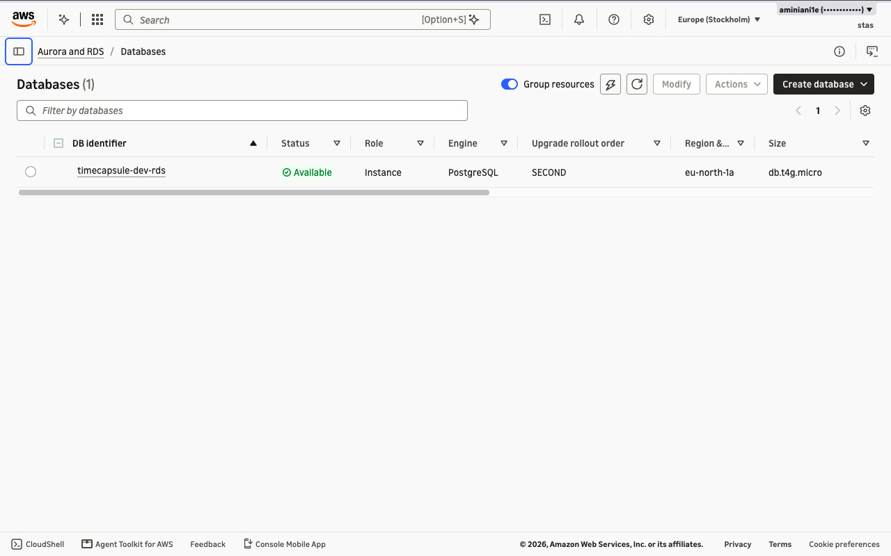

Часть 2 оставлена для следующих работ: `timecapsule-dev-rds` остановлена (`Stopped temporarily`), расписание каждый
вечер останавливает её снова, если AWS запустит её через 7 дней. Серверы bastion и `app-server` остановлены,
`db-server` удалён в задании 10. В начале следующего занятия сначала запускается база, потом серверы.
