# Лабораторная работа №6. Масштабирование и балансировка нагрузки. Elastic Load Balancing, Amazon EC2 Auto Scaling

- **ФИО:** Voronetchii Stanislav
- **Группа:** IA2404
- **Специальность:** Informatica Aplicata
- **Уровень:** продвинутый
- **Репозиторий:** https://github.com/sta5on-cloud/timecapsule
- **Решение о сессиях:** [ADR-0005](../adr/0005-session-storage.md)
- **Отчёты ЛР2-ЛР5:** [README.md](../../README.md), [docs/lab3/README.md](../lab3/README.md),
  [docs/lab4/README.md](../lab4/README.md), [docs/lab5/README.md](../lab5/README.md)

## Базовый уровень

| Ресурс | Имя |
| --- | --- |
| Security Group балансировщика / серверов | `lab6-alb-sg` (80 из `0.0.0.0/0`) / `lab6-web-sg` (80 от `lab6-alb-sg`, 22 от `timecapsule-dev-bastion-sg`) |
| Целевая группа | `lab6-tg` |
| Балансировщик | `lab6-alb` |
| Шаблон запуска | `lab6-lt` |
| Группа Auto Scaling, политика | `lab6-asg`, `lab6-requests-per-target` |

У всех ресурсов Части 1 тег `Lab=lab6`.

### Задание 1. Балансировщик

```bash
aws elbv2 create-target-group --name lab6-tg --protocol HTTP --port 80 --vpc-id $VPC --target-type instance \
  --health-check-path /health --health-check-interval-seconds 10 --health-check-timeout-seconds 5 \
  --healthy-threshold-count 2 --unhealthy-threshold-count 2 --tags Key=Lab,Value=lab6
aws elbv2 create-load-balancer --name lab6-alb --type application --scheme internet-facing \
  --subnets $PUBLIC_A $PUBLIC_B --security-groups $LAB6_ALB_SG --tags Key=Lab,Value=lab6
aws elbv2 create-listener --load-balancer-arn $ALB --protocol HTTP --port 80 \
  --default-actions Type=forward,TargetGroupArn=$TG
```

Порог `healthy` снижен с 5 до 2 проверок, чтобы новые серверы входили в работу через 20 секунд, а не через 50.

Сразу после создания балансировщик отвечает `503 Service Temporarily Unavailable`:

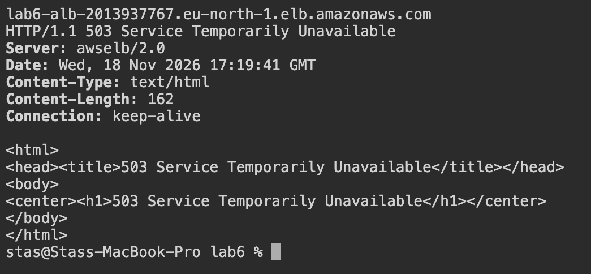

**Какой ответ вернул балансировщик и почему?** `503 Service Temporarily Unavailable` с заголовком
`Server: awselb/2.0`. Его сформировал сам балансировщик: listener передаёт запрос в `lab6-tg`, а в целевой группе
ещё нет ни одного зарегистрированного, а значит и исправного, сервера. Передать запрос некому.

**Зачем ему подсети в двух зонах?** ALB требует минимум две зоны: в каждой выбранной подсети он держит свой узел
с публичным адресом, а DNS-имя возвращает адреса всех узлов. Если одна зона откажет, DNS перестанет отдавать её узел,
и балансировщик продолжит работать через другую зону. Кроме того, узел в зоне нужен, чтобы отправлять запросы
серверам этой зоны.

### Задание 2. Группа Auto Scaling

Шаблон `lab6-lt`: Amazon Linux 2023 (`ami-077895aaa52ddd242`), `t3.micro`, ключ `stas-ec2`, группа `lab6-web-sg`,
IMDSv2 обязателен, подсети нет, в `User data` скрипт из задания (nginx, имя сервера и зона на странице, `/health`).

Группа `lab6-asg` создана из шаблона в подсетях `public-a` и `public-b`, подключена к `lab6-tg`, проверки
`EC2, ELB` с grace period 120 секунд, размер 2 / 2 / 4. Политика target tracking держит
`Application Load Balancer request count per target` около 50.

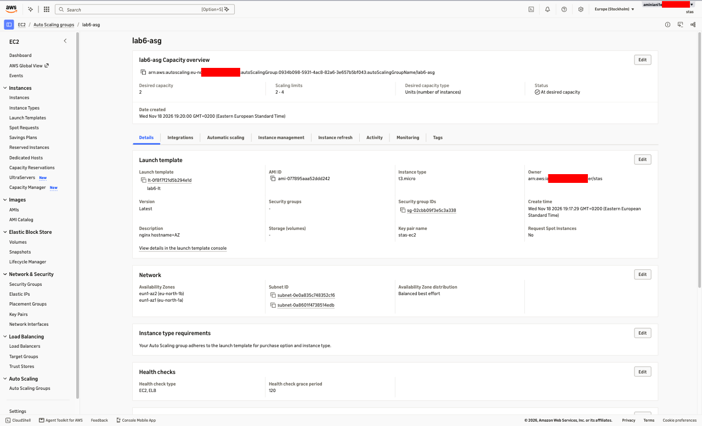

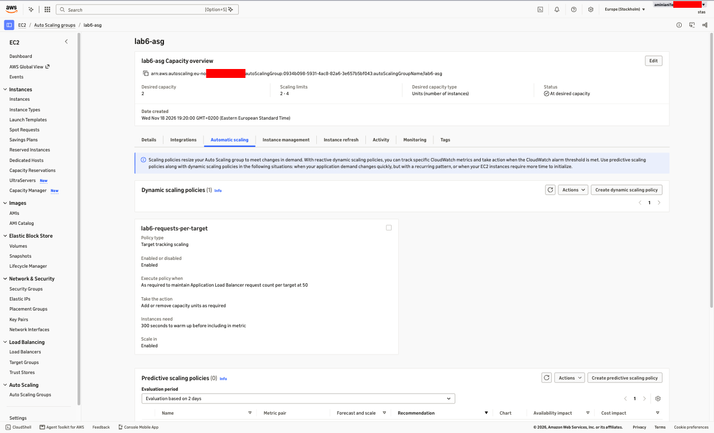

Первая попытка добавить политику сразу после создания группы завершилась ошибкой
`ValidationError: Provided Target Groups may not be valid`. В этот момент AWS создавал служебную роль
`AWSServiceRoleForAutoScaling` (её не было в аккаунте) и ещё не подключил целевую группу. Через 20 секунд та же
команда прошла и создала две тревоги: `TargetTracking-lab6-asg-AlarmHigh-…` и `TargetTracking-lab6-asg-AlarmLow-…`.

Серверы запустились в 17:21 UTC. Около 40 секунд цели были `unhealthy` (nginx ещё ставился из `User data`),
в 17:22:08 обе перешли в `healthy`:

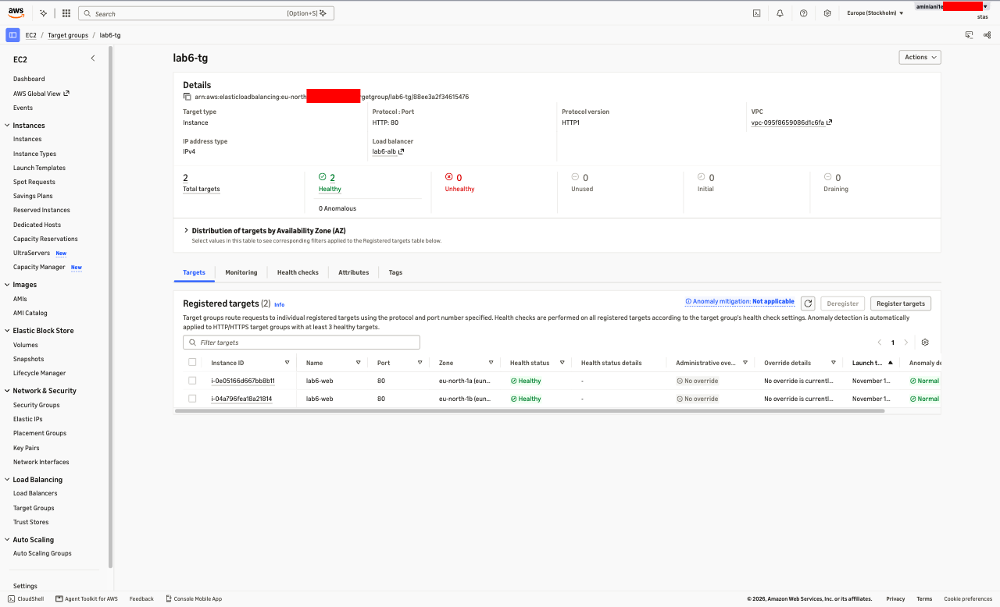

Балансировщик по очереди отправляет запросы двум серверам в разных зонах:

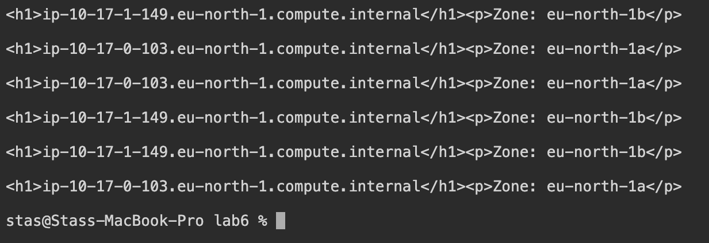


**Чем группа Auto Scaling отличается от целевой группы?** Целевая группа - часть балансировщика: это список
адресатов, куда передавать запросы, и проверка их здоровья. Серверы она не создаёт и не удаляет, неисправный только
перестаёт получать запросы. Группа Auto Scaling управляет жизненным циклом серверов: запускает их из шаблона, держит
нужное количество, заменяет неисправные, добавляет и убирает по политике, а также регистрирует их в целевой группе
и снимает с неё.

**Почему в шаблоне нет подсети?** Подсеть выбирает группа: ей заданы `public-a` и `public-b`, и она распределяет
серверы по зонам поровну, а при отказе зоны запускает замену в другой. Шаблон с подсетью привязал бы все серверы
к одной зоне. Шаблон описывает, *какой* сервер запускать, а группа решает, *где* и *сколько*.

### Задание 3. Нагрузка

Нагрузка запущена с моего компьютера в 17:23:47 UTC скриптом из задания. Один цикл `curl` давал около 4 запросов
в секунду, то есть около 240 запросов в минуту, или 120 на каждый из двух серверов, при цели 50.

```bash
ALB=lab6-alb-2013937767.eu-north-1.elb.amazonaws.com
end=$((SECONDS+600)); while [ $SECONDS -lt $end ]; do curl -s -o /dev/null http://$ALB/; done
```

`AlarmHigh` (`RequestCountPerTarget > 50` 3 точки за 3 минуты) перешла в `ALARM` в 17:28:14, и политика сразу
изменила желаемое количество с 2 до 4. После окончания нагрузки она вернулась в `OK` в 17:36:14:

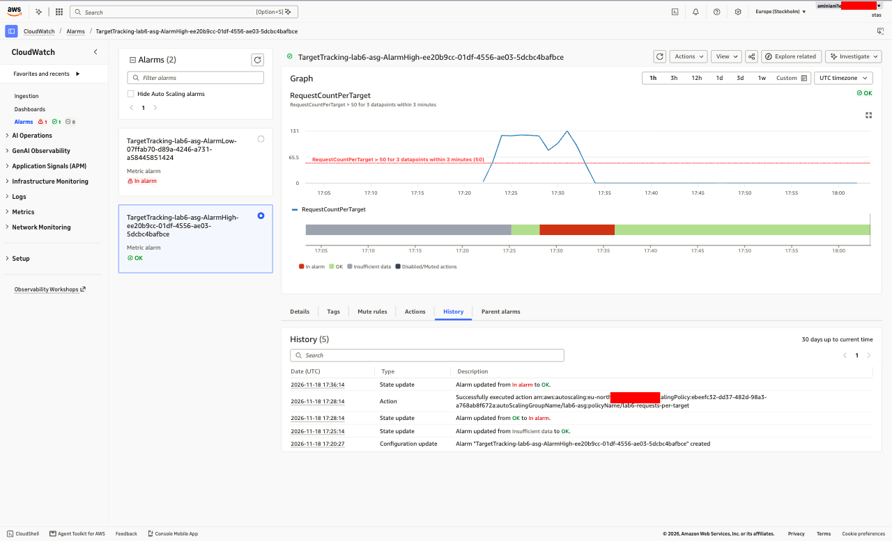

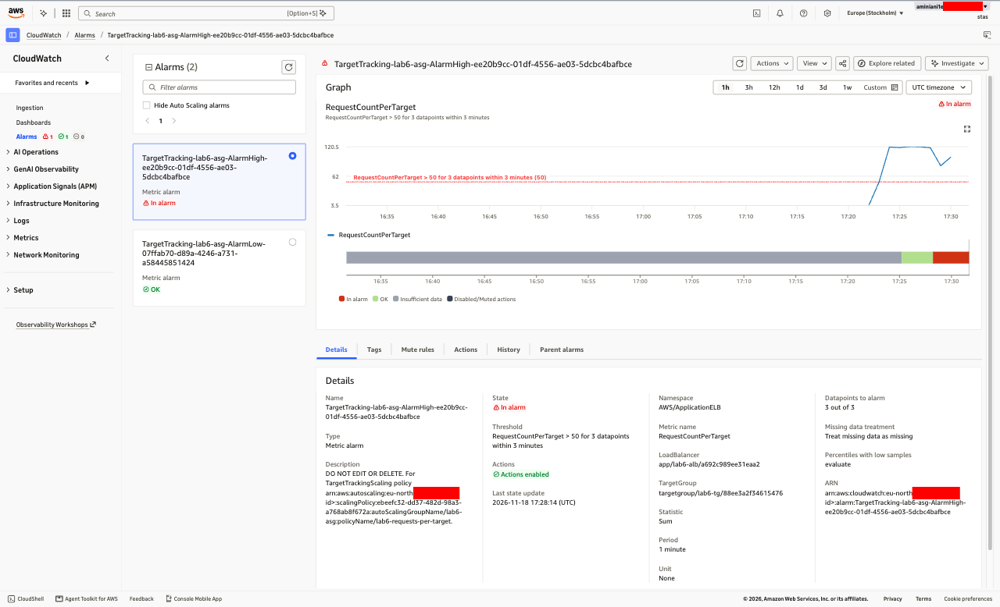

Вкладка `Activity` во время роста: причина - `monitor alarm TargetTracking-lab6-asg-AlarmHigh-… in state ALARM
triggered policy lab6-requests-per-target changing the desired capacity from 2 to 4`:

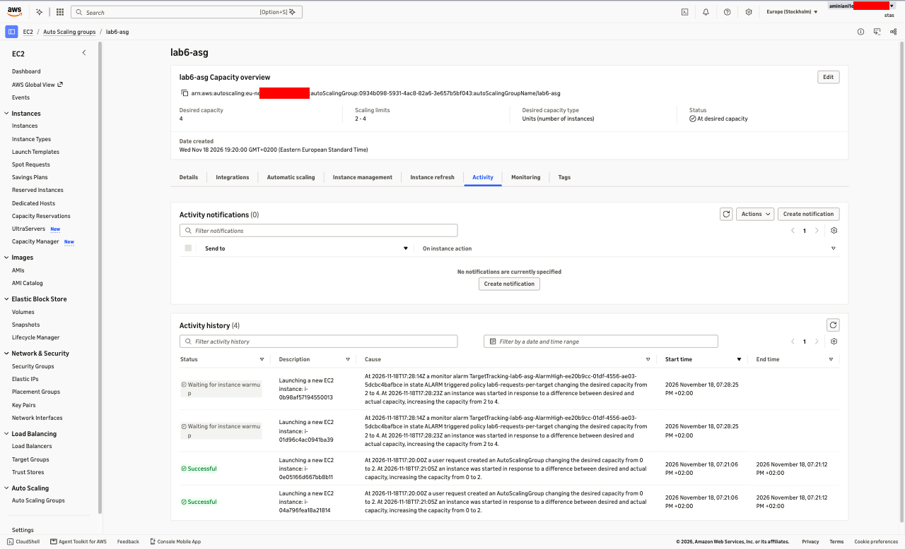

`AlarmLow` (`RequestCountPerTarget < порога` 15 точек за 15 минут) сработала в 17:51:44: 15 минутных точек без
запросов (с 17:34) плюс несколько минут задержки метрик. Группа убрала один сервер (4 → 3), через 5 минут, в 17:56:50, ещё один
(3 → 2). Каждый сервер перед удалением 5 минут снимается с балансировщика (deregistration delay 300 секунд), поэтому
два сервера остались в 18:02:46, через 29 минут после конца нагрузки. В истории `AlarmLow` видно, что Auto Scaling
меняет её порог при каждом изменении размера группы (`Configuration update`): при 2 серверах он был 45, при 4 - 37,5,
при 3 - 35.

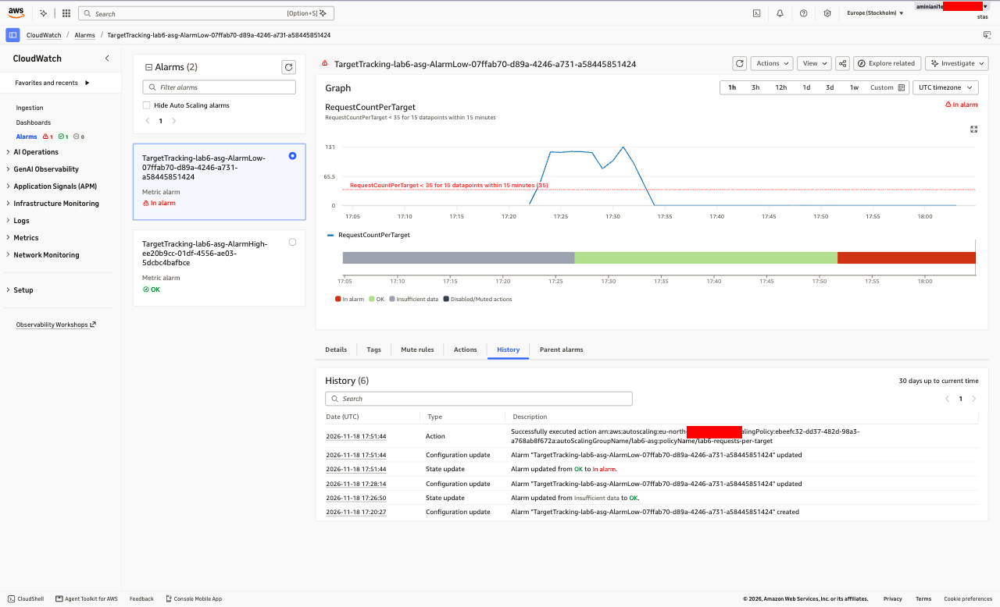

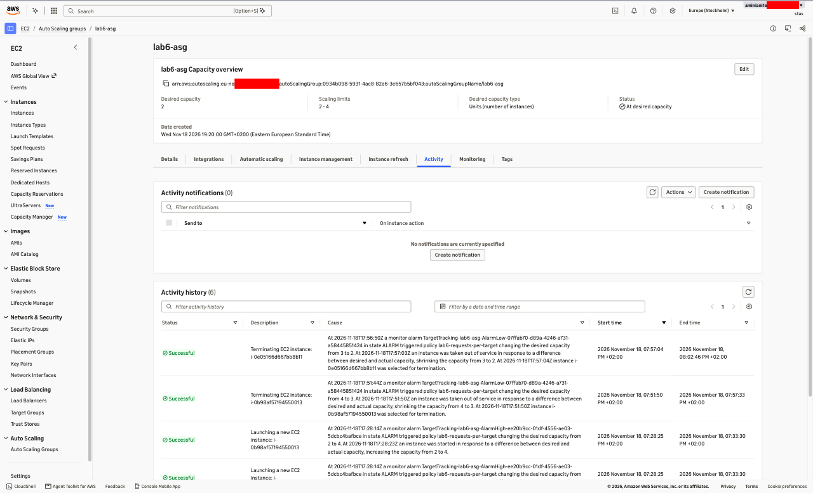

| Время (UTC) | Событие |
| --- | --- |
| 17:23:47 | старт нагрузки, ~240 запросов в минуту |
| 17:28:14 | `AlarmHigh` → `ALARM`, желаемое 2 → 4 |
| 17:29 | новые серверы `healthy`, `HealthyHostCount` = 4 |
| 17:33:47 | конец нагрузки |
| 17:36:14 | `AlarmHigh` → `OK` |
| 17:51:44 | `AlarmLow` → `ALARM`, желаемое 4 → 3 |
| 17:56:50 | желаемое 3 → 2 |
| 18:02:46 | в группе снова 2 сервера |

**Сколько серверов запустила группа и почему не больше четырёх?** Два новых, итого четыре. По расчёту target
tracking нужно было `2 × 120 / 50 ≈ 5` серверов, но максимальный размер группы 4, и больше она не запускает,
какой бы ни была метрика. В моём аккаунте пятый сервер и так не запустился бы: 4 × `t3.micro` = 8 vCPU, это весь лимит.

**Почему метрика упала после запуска новых серверов, хотя запросов не стало меньше?** `RequestCountPerTarget` - это
число запросов к целевой группе, делённое на число исправных целей. В 17:29 запросов было столько же (241 за минуту),
но целей стало 4 вместо 2, и значение на графике упало со 120 примерно до 80. Нагрузка разделилась на большее
число серверов, а тревога смотрит на нагрузку *одного* сервера.

**Почему группа добавляет серверы быстрее, чем убирает?** Так устроен target tracking: `AlarmHigh` нужно 3 точки
за 3 минуты, а `AlarmLow` - 15 за 15 минут, и порог для уменьшения ниже цели. Нехватка серверов сразу бьёт по
пользователям, а лишний сервер стоит лишь пару центов, поэтому добавлять нужно быстро, а убирать - только убедившись,
что нагрузка ушла надолго, иначе группа будет «дёргаться» туда-сюда. Убирает она по одному серверу за раз и с паузой,
а каждый сервер ещё 300 секунд дорабатывает уже начатые запросы (deregistration delay).

### Завершение Части 1

См. раздел [Завершение работы](#завершение-работы).

## Продвинутый уровень

| Ресурс | Имя |
| --- | --- |
| Таблица DynamoDB | `timecapsule-dev-sessions` |
| Политика IAM для сессий | `timecapsule-dev-app-sessions` |
| Образ (AMI) | `timecapsule-dev-app-lab6` |
| Шаблон запуска | `timecapsule-dev-app-lt` |
| Security Group балансировщика | `timecapsule-dev-alb-sg` (80 из `0.0.0.0/0`) |
| Целевая группа | `timecapsule-dev-tg` |
| Балансировщик | `timecapsule-dev-alb` |
| Группа Auto Scaling, политика | `timecapsule-dev-asg`, `timecapsule-dev-requests-per-target` |

Теги Части 2: `Project=timecapsule`, `Environment=dev`, `Owner=sta5on`, `Lab=lab6`. В задании образ в одном месте
назван `timecapsule-dev-app-image`, а в таблице имён - `timecapsule-dev-app-lab6`; я взял имя из таблицы.

### Задание 4. Сессии в DynamoDB

Вариант приложения - `open_capsules_php_functional`, поэтому ключ таблицы `id`, атрибут TTL `expires`.
Таблица `timecapsule-dev-sessions`: ключ `id` (String), режим `On-demand`, TTL по `expires` включён.

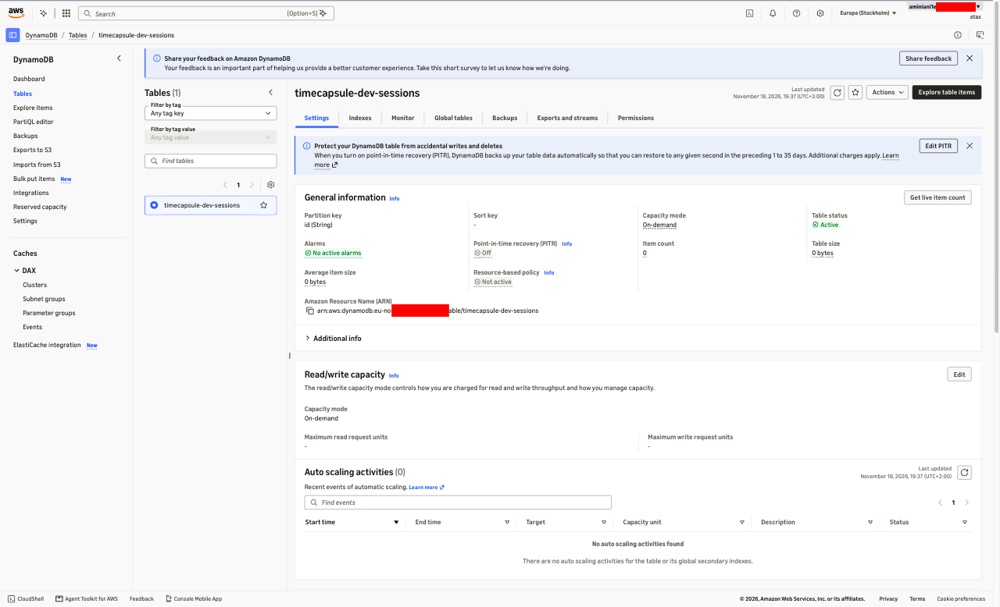

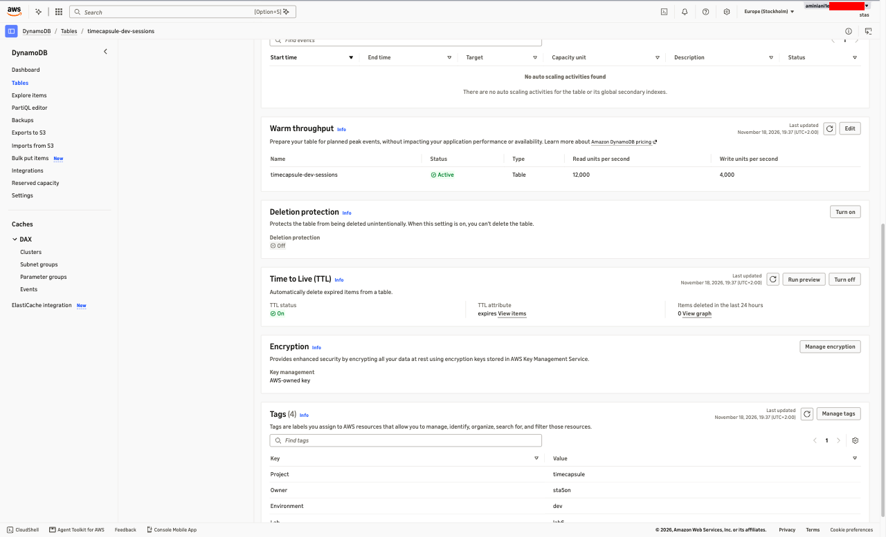

Политика `timecapsule-dev-app-sessions` разрешает только четыре действия на одну таблицу и прикреплена к роли
`timecapsule-dev-app-role` рядом с `timecapsule-dev-app-s3` из ЛР4:

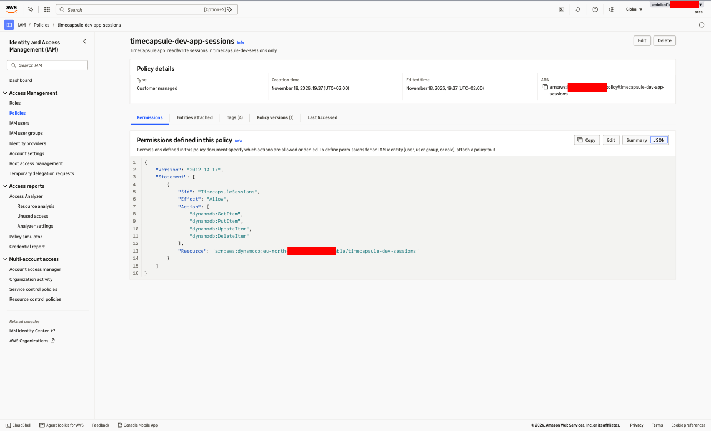

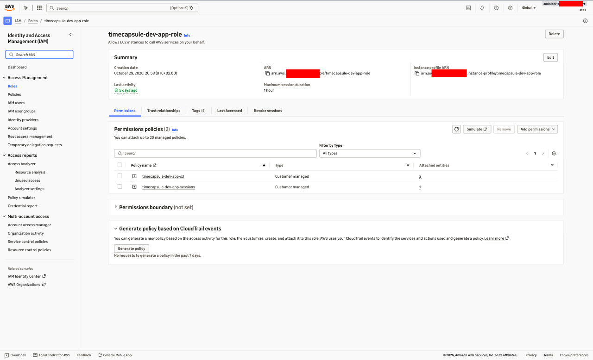

Изменение в коде ([коммит 1674e6f](https://github.com/sta5on-cloud/timecapsule/commit/1674e6f)) - функция
`start_session()` в `src/bootstrap.php`, до `session_start()`:

```php
$table = config('SESSIONS_TABLE');
if ($table !== null) {
    $client = new Aws\DynamoDb\DynamoDbClient(['region' => config('AWS_REGION', 'eu-north-1')]);
    Aws\DynamoDb\SessionHandler::fromClient($client, ['table_name' => $table])->register();
} else {
    session_save_path(ROOT_DIR . '/storage/sessions');
}
```

Ключей доступа нет: SDK берёт временные учётные данные роли из метаданных экземпляра, как для S3 в ЛР4. Если
`SESSIONS_TABLE` не задан (локальный `docker-compose`), сессии по-прежнему пишутся в файлы. В `.env.example`
добавлена переменная `SESSIONS_TABLE=`, а на `app-server` в `.env` - `SESSIONS_TABLE=timecapsule-dev-sessions`.
Заодно в подвале страницы `LR3` заменено на `LR6`.

Новая версия выпущена способом из ЛР2 (ADR-0001): `git push`, затем `./deploy.sh` на `app-server` через bastion
(`git pull --ff-only`, `composer install`, `init-db.php`, `reload php-fpm`). Перед коммитом файл проверен
`php -l` на сервере (локально PHP нет).

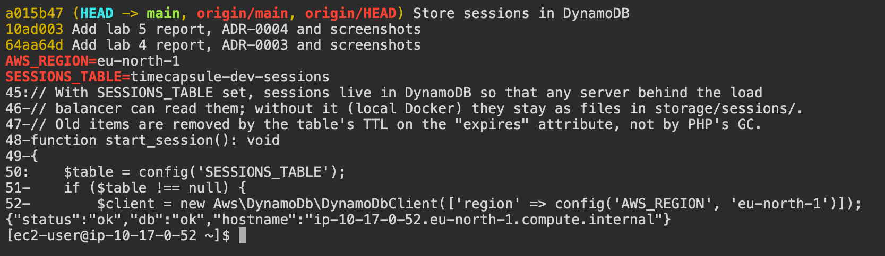

После входа на `app-server` (по его публичному адресу, балансировщика ещё нет) в таблице появились элементы
`timecapsule_session_<id>`. SDK добавляет к идентификатору имя cookie сессии. У залогиненной сессии в `data`
лежат CSRF-токен и `user_id|i:6`, в `expires` - время истечения (UNIX-время, сейчас + 24 минуты, это
`session.gc_maxlifetime`). Идентификатор сессии и токен на скриншотах скрыты: это значение cookie.

Приложение на `app-server` (`Served by ip-10-17-0-52`):

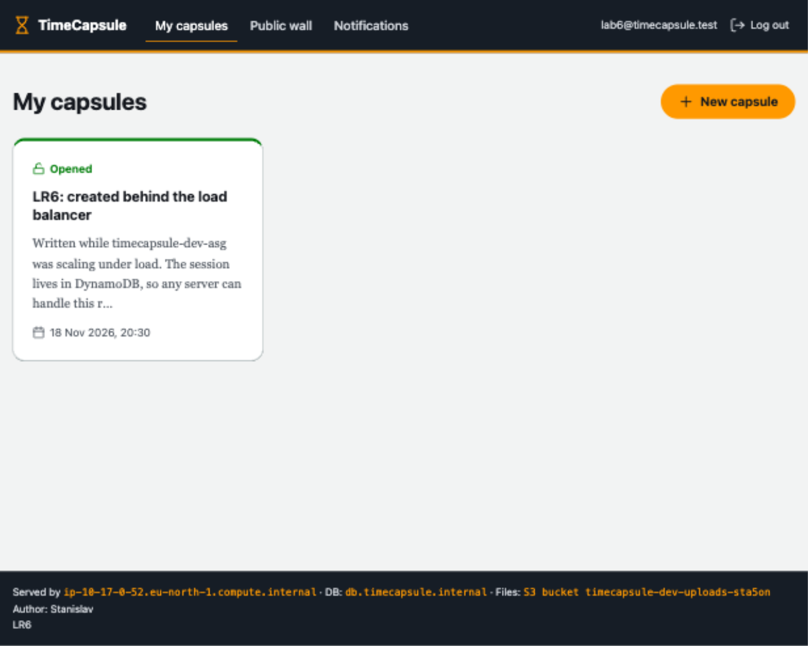

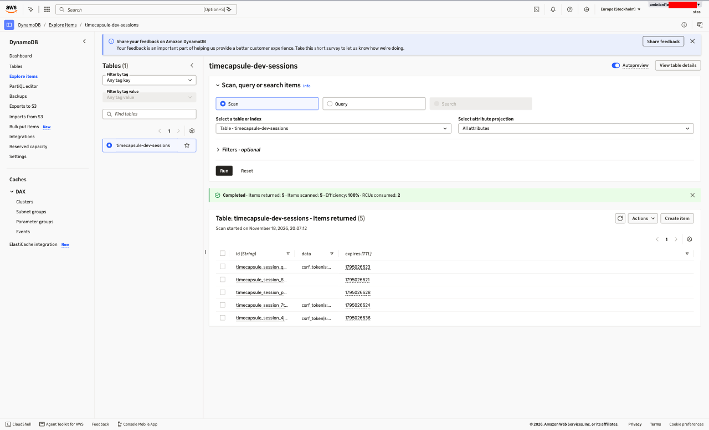

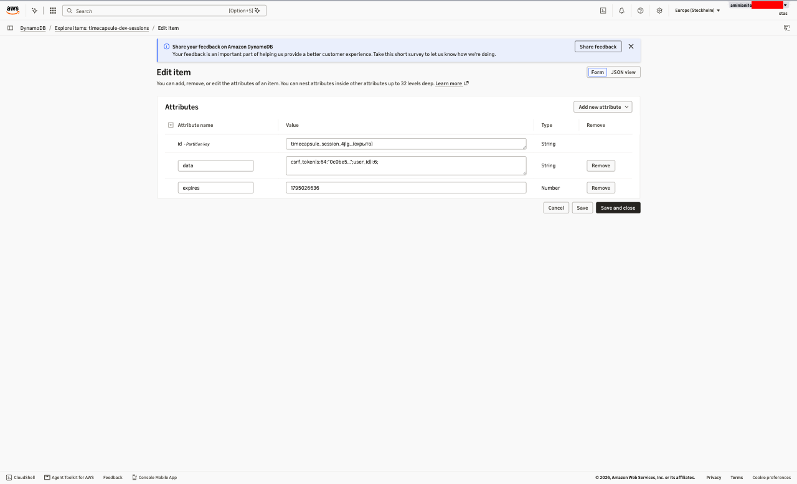

**Почему сессии нельзя оставить в файлах, когда серверов несколько?** Файл сессии лежит на диске того сервера, который
её создал. Балансировщик отправляет следующий запрос пользователя на любой сервер, и там файла нет: PHP создаёт новую
пустую сессию, и пользователь оказывается не залогинен, а CSRF-токен формы не совпадает. К тому же серверы группы
временные: при уменьшении группы или замене сервер удаляется вместе с диском и всеми сессиями.

**Зачем Node.js нужен `initialized: true`?** Без него `connect-dynamodb` при запуске сам пытается создать таблицу
(`DescribeTable`/`CreateTable`). Таблица уже создана вручную, а роль приложения по принципу наименьших привилегий
может только читать и писать элементы, поэтому такой вызов закончится `AccessDeniedException`. Параметр говорит
библиотеке, что таблица уже есть и создавать её не нужно. В PHP SDK обработчик таблицы не создаёт, поэтому мне этот
параметр не понадобился.

### Задание 5. Приложение в группе Auto Scaling

Образ `timecapsule-dev-app-lab6` создан из `app-server` после выпуска версии с DynamoDB (с перезагрузкой, чтобы
файловая система была согласованной). В нём код `1674e6f`, `vendor/`, `.env`, nginx и PHP-FPM с автозапуском.

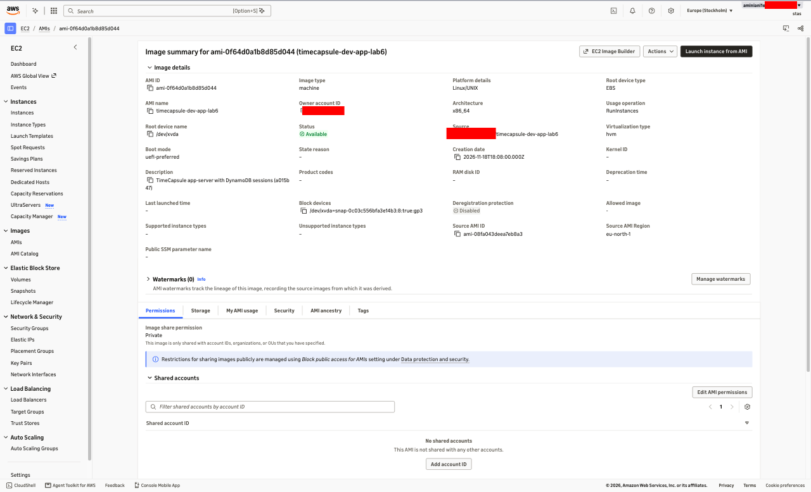

Шаблон `timecapsule-dev-app-lt`: этот образ, `t3.micro`, ключ `stas-ec2`, профиль `timecapsule-dev-app-role`,
группа `timecapsule-dev-web-sg` (та же, что у `app-server`, поэтому `timecapsule-dev-rds-sg` пускает серверы к базе
без изменений), IMDSv2. `User data` не нужен: всё уже в образе.

Целевая группа `timecapsule-dev-tg` проверяет `/health` приложения каждые 10 секунд (ответ 200 только если
работает база), балансировщик `timecapsule-dev-alb` в `public-a` и `public-b` с группой `timecapsule-dev-alb-sg`.
Группа `timecapsule-dev-asg`: те же подсети, проверки ELB, 2 / 2 / 4, target tracking 50 запросов на сервер.
Через минуту после создания обе цели были `healthy`:

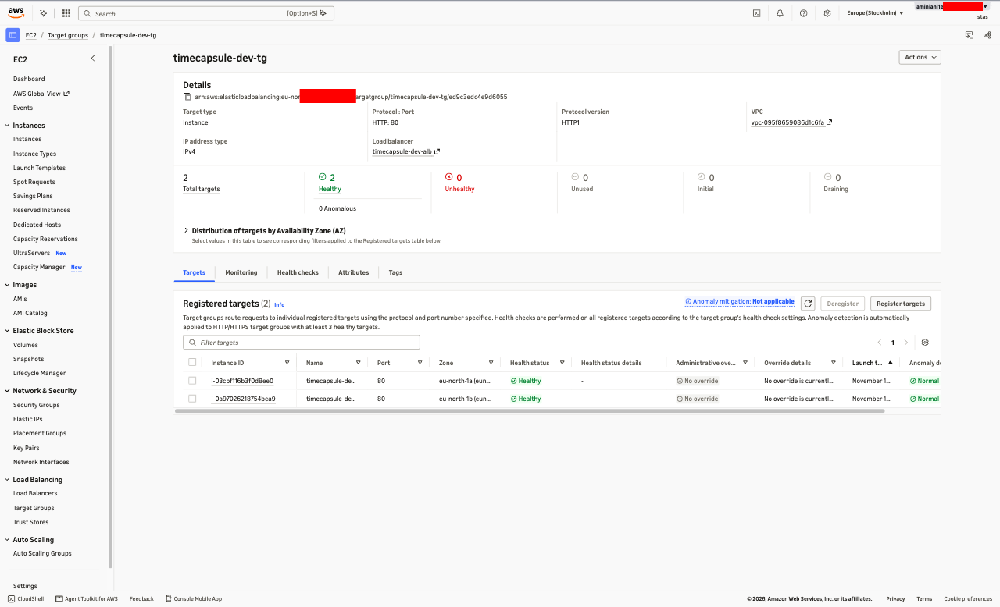

После этого `app-server` (`timecapsule-dev-app`) остановлен, а в `timecapsule-dev-web-sg` правило `80 из 0.0.0.0/0`
заменено на `80 от timecapsule-dev-alb-sg`. Описание группы (`HTTP from internet and SSH from bastion`) в AWS
изменить нельзя, но правило уже другое:

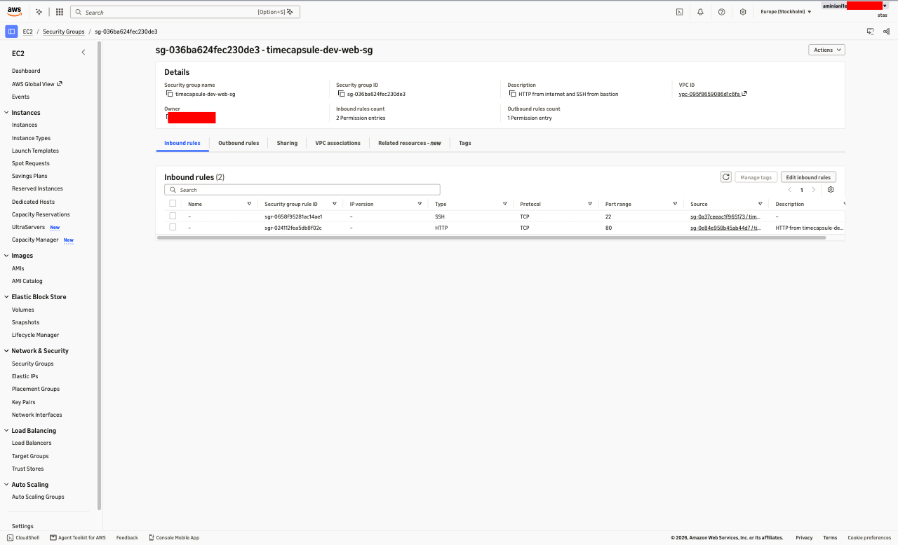

Elastic IP у `app-server` к этому моменту уже не было: я освободил его 1 ноября, после ЛР4, чтобы он
не тарифицировался, пока сервер остановлен. Сейчас `describe-addresses` показывает только два адреса с `ServiceManaged = alb` - это публичные
адреса узлов балансировщика в двух зонах, ими управляет AWS. Прямой запрос на публичный адрес сервера группы
завершается таймаутом, а через балансировщик `/health` отвечает `ok`:

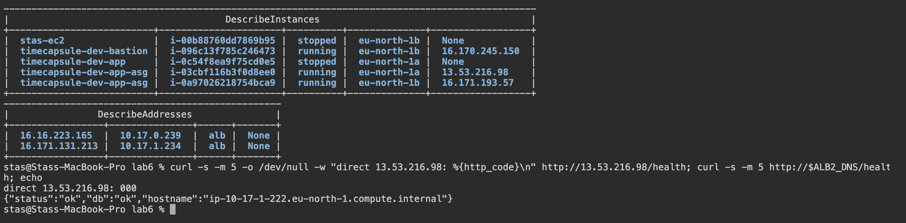

Приложение по DNS-имени балансировщика: я вошёл один раз, и при обновлении страницы в `Served by` меняется сервер,
а вход сохраняется:


То же из терминала через `curl`: один вход, одна cookie, запросы распределяются между серверами группы,
и все возвращают страницу пользователя `lab6@timecapsule.test`:

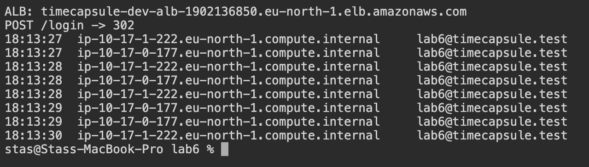

**Почему Elastic IP больше не нужен?** Пользователи обращаются к DNS-имени балансировщика, а не к адресу сервера.
Серверы группы появляются и исчезают, получают случайные публичные адреса, и прямого HTTP к ним нет. Постоянный
адрес нужен только точке входа, а у балансировщика это DNS-имя, за которым AWS сам держит адреса узлов в каждой зоне.
Для своего домена достаточно записи CNAME (или alias в Route 53) на это имя.

**Почему у всех серверов группы одинаковые `.env` и секреты?** Все они запущены из одного образа и выполняют одну и ту
же роль: работают с одной базой, одним бакетом и одной таблицей сессий, поэтому и настройки, и пароль базы у них
общие. Если бы `.env` отличались, запрос пользователя давал бы разный результат в зависимости от сервера. Минус в том,
что пароль базы зашит в образ: смена пароля требует нового образа. В рабочей системе его лучше хранить в Secrets
Manager или SSM Parameter Store и читать при запуске, используя ту же роль.

**Что станет с проверкой `/health`, если базу остановить?** `/health` выполняет `SELECT COUNT(*) FROM users` и при
ошибке отвечает 500. Через две неудачные проверки (20 секунд) все цели станут `unhealthy`. Когда неисправны все цели,
ALB переходит в режим fail-open и шлёт запросы всем, поэтому пользователь увидит страницу 500 приложения
(`Cannot connect to the database`), а не 503. Группа
с проверками ELB решит, что серверы сломаны, и начнёт по кругу удалять и запускать новые, хотя дело не в них.
Это важно для ночной остановки базы из ЛР5: на ночь вместе с базой нужно удалять балансировщик и группу (или ставить
группу на 0), что я и делаю в конце занятия.

### Задание 6. Нагрузка на приложение

Перед нагрузкой я остановил `bastion` (иначе группа упёрлась бы в лимит 8 vCPU), вошёл в приложение в браузере
и в 18:15:06 UTC запустил тот же скрипт на DNS-имя `timecapsule-dev-alb`. Запросы без cookie получают от приложения
`302` на `/login`, и каждый из них проходит через PHP, DynamoDB (новая анонимная сессия) и RDS, поэтому один цикл
`curl` давал только около 130 запросов в минуту, то есть 63 на сервер.

| Время (UTC) | Событие |
| --- | --- |
| 18:15:06 | старт нагрузки, ~130 запросов в минуту, `RequestCountPerTarget` ≈ 63 |
| 18:16 | в браузере создана капсула `LR6: created behind the load balancer` (сервер `ip-10-17-1-222`) |
| 18:20:30 | `AlarmHigh` → `ALARM`, желаемое 2 → 3 (`2 × 63 / 50 ≈ 2,5`, округление вверх) |
| 18:21 | третий сервер `ip-10-17-0-204` `healthy`, метрика ≈ 45-50, четвёртый не нужен |
| 18:23 | вход проверен на всех трёх серверах |
| 18:24:30 | `AlarmHigh` → `OK` |
| 18:25:06 | конец нагрузки |
| 18:30 | капсула открылась, открыта без повторного входа |
| 18:42:42 | `AlarmLow` → `ALARM`, желаемое 3 → 2, `ip-10-17-0-204` снимается с балансировщика (`draining`) |
| 18:48:12 | в группе снова 2 сервера |

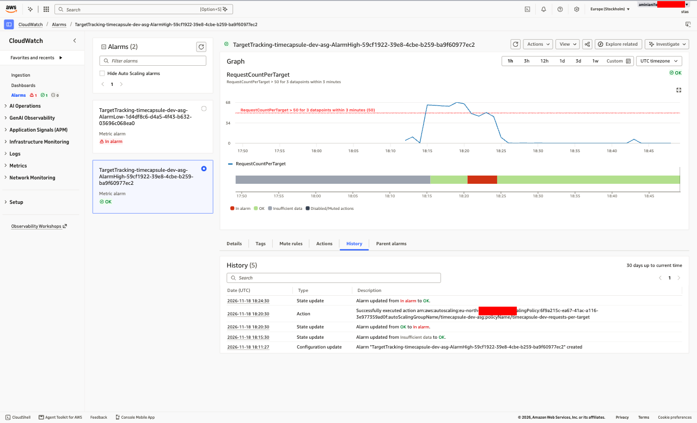

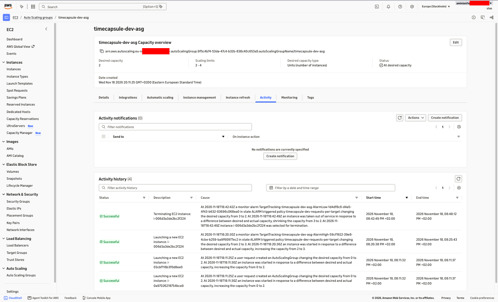

Капсула создана во время нагрузки, и новый сервер `ip-10-17-0-204`, который группа запустила под нагрузкой,
показывает её без повторного входа:

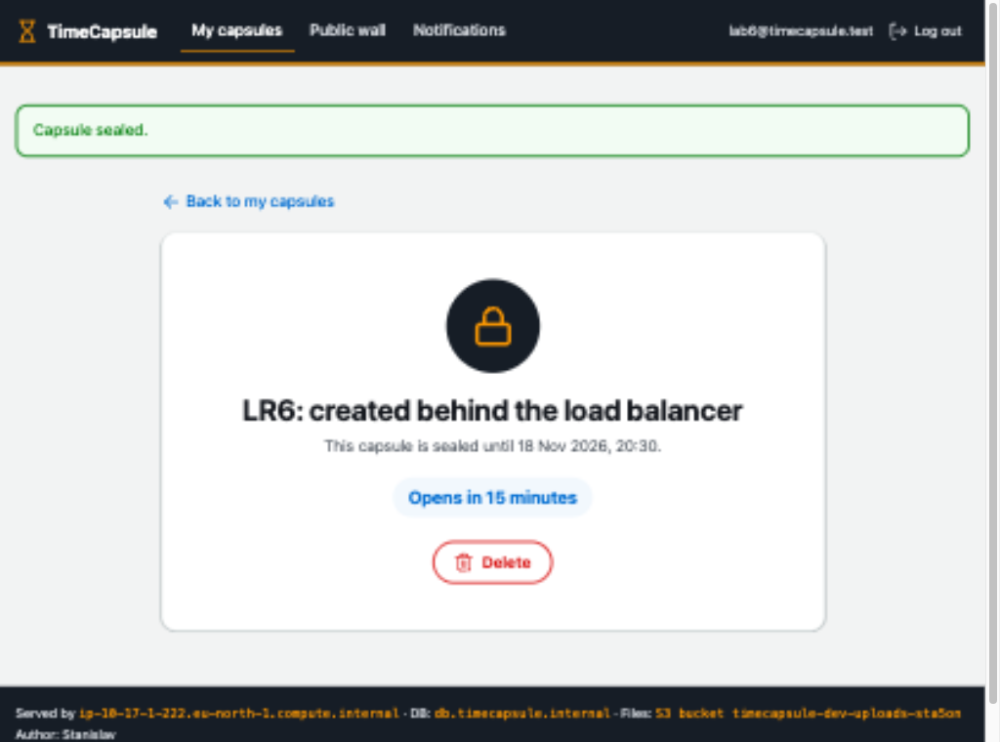

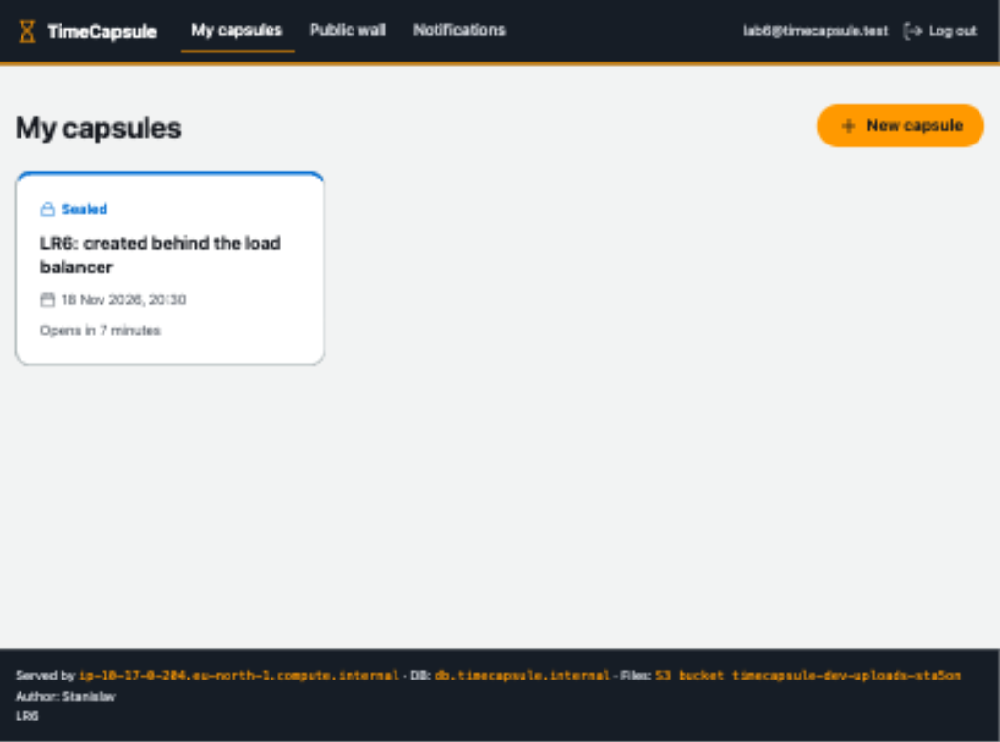

В 18:30 капсула открылась:

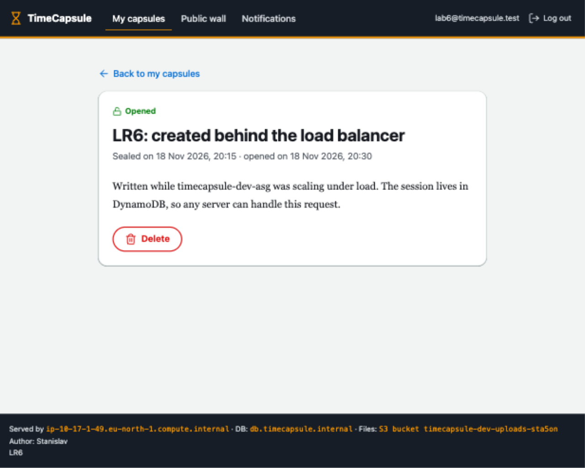

Проверка из терминала на трёх серверах и во время удаления одного из них (`draining`):

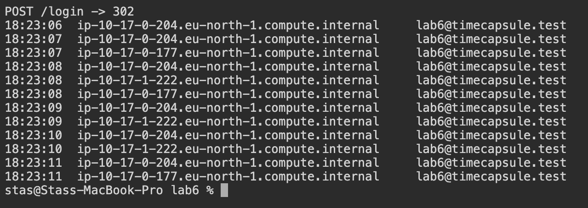

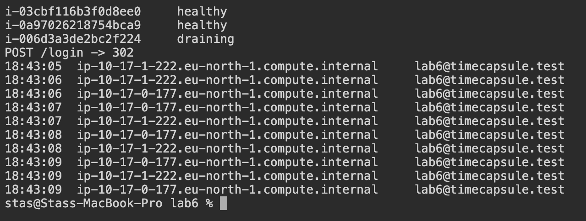

После того как группа удалила сервер `ip-10-17-0-204`, браузер, который только что работал на нём, по-прежнему
залогинен:

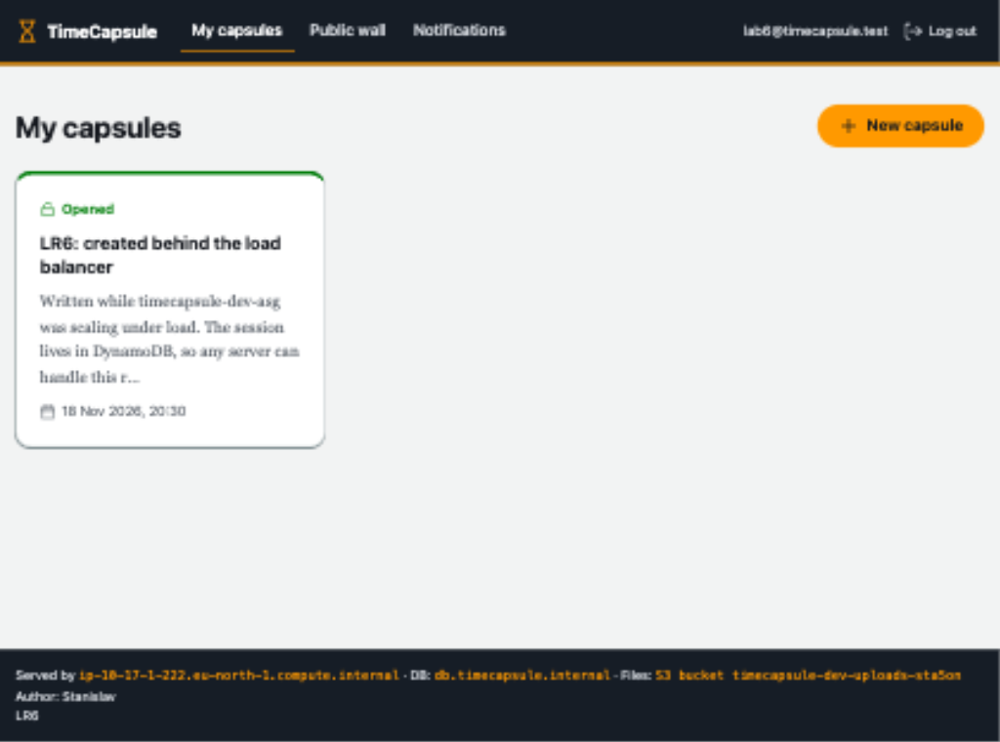

**Пришлось ли входить заново, когда группа добавляла или удаляла серверы? Почему?** Нет. Ни в браузере, ни в
проверке через `curl` вход не терялся: ни когда запросы стали попадать на новый сервер `ip-10-17-0-204`, ни когда
этот сервер сняли с балансировщика и удалили. В cookie браузера лежит только идентификатор сессии, а сама сессия
хранится в DynamoDB, которую видят все серверы. Новый сервер читает её по идентификатору так же, как старый, а при
удалении сервера ничего не теряется, потому что на его диске сессий нет. Перед удалением сервер 5 минут находится
в `draining`: новые запросы на него не идут, а уже начатые успевают завершиться.

### Задание 7. Архитектура и решение

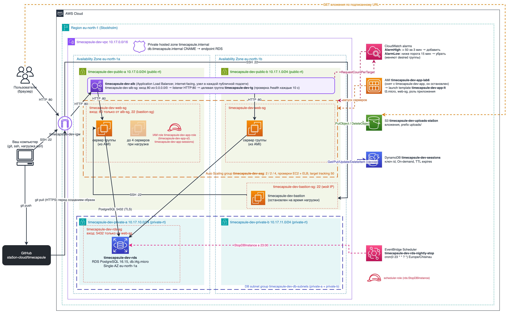

Схема в формате draw.io: [architecture.drawio](architecture.drawio). По сравнению с ЛР5 пользователи приходят
через Internet Gateway на `timecapsule-dev-alb` (узлы в обеих публичных подсетях), а он передаёт запросы серверам
группы `timecapsule-dev-asg` в двух зонах. `web-sg` пускает HTTP только от `timecapsule-dev-alb-sg`. Elastic IP
и постоянный `app-server` убраны: сервер остановлен и служит только источником образа `timecapsule-dev-app-lab6`,
из которого шаблон `timecapsule-dev-app-lt` запускает серверы. Добавлены таблица DynamoDB для сессий (вне VPC,
доступ по роли), тревоги CloudWatch, которые меняют размер группы, и вторая политика роли.

Решение о хранении сессий: [ADR-0005](../adr/0005-session-storage.md). В нём сравниваются файлы на сервере с
привязкой сессий (sticky sessions), таблица в RDS и DynamoDB.

## Устные вопросы

**1. Как проходит запрос от браузера до базы и таблицы сессий?** Браузер разрешает DNS-имя балансировщика в адрес
одного из его узлов и идёт по HTTP через Internet Gateway; `timecapsule-dev-alb-sg` пропускает 80 из интернета.
Listener передаёт запрос в `timecapsule-dev-tg`, балансировщик выбирает исправную цель и отправляет запрос на
приватный адрес сервера; `web-sg` пропускает 80 только от группы балансировщика. На сервере nginx передаёт запрос
PHP-FPM, приложение берёт идентификатор из cookie и читает сессию из DynamoDB (`GetItem` по HTTPS с временными
ключами роли, `timecapsule-dev-app-sessions` разрешает только эту таблицу). Затем оно подключается к
`db.timecapsule.internal` (CNAME в приватной зоне → endpoint RDS) по TLS на 5432, `rds-sg` пускает только `web-sg`.
В конце запроса сессия записывается обратно (`UpdateItem`), а ответ возвращается тем же путём через балансировщик.

**2. Чем проверка балансировщика отличается от проверки группы Auto Scaling?** Балансировщик каждые 10 секунд
запрашивает `/health` и решает, *слать ли трафик* на сервер: неисправный остаётся работать, просто не получает
запросов, а когда поправится, снова получит. Проверка EC2 в группе смотрит только на состояние виртуальной машины
(запущена ли, проходят ли status checks) и решает, *жив ли сервер*: неисправный удаляется и заменяется новым.
С включёнными ELB health checks группа учитывает и мнение балансировщика: сервер, который не отвечает на `/health`
дольше grace period, будет заменён, даже если ВМ формально в порядке.

**3. Что произойдёт при отказе зоны `eu-central-1a` (у нас `eu-north-1a`)?** Узел балансировщика в `1a` пропадёт
из DNS, и запросы пойдут через узел в `1b`. Сервер группы в `1a` станет недоступен, балансировщик перестанет слать
на него запросы, а группа запустит замену в `public-b`, чтобы снова было 2 сервера; сессии в DynamoDB (данные
хранятся в нескольких зонах региона) и вложения в S3 не пострадают, и пользователям не придётся входить заново.
Но база `timecapsule-dev-rds` Single-AZ и находится в `1a`, поэтому `/health` будет отвечать ошибкой, и приложение
целиком перестанет работать, пока базу не восстановят из резервной копии в `1b` (ADR-0004). Чтобы пережить отказ
зоны без простоя, базе нужен Multi-AZ.

## Завершение работы

Часть 1 удалена в 18:05 UTC целиком: `lab6-asg` (вместе с серверами), `lab6-alb`, `lab6-lt`, `lab6-tg`,
`lab6-web-sg`, `lab6-alb-sg`. Тревоги `TargetTracking-lab6-asg-*` AWS удалил вместе с политикой.

В Части 2 удалены `timecapsule-dev-alb` и группа `timecapsule-dev-asg`. Группу в задании не нужно оставлять,
к тому же в 23:00 база останавливается по расписанию из ЛР5, после чего все серверы стали бы `unhealthy`, и
группа с проверками ELB пересоздавала бы их по кругу. Оставлены: таблица `timecapsule-dev-sessions`, целевая группа
`timecapsule-dev-tg`, политика `timecapsule-dev-app-sessions`, образ `timecapsule-dev-app-lab6`, шаблон
`timecapsule-dev-app-lt` и `timecapsule-dev-alb-sg`, на которую ссылается правило `web-sg`. База
`timecapsule-dev-rds`, `bastion` и `app-server` остановлены.

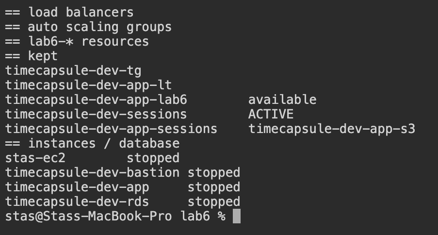
