# Лабораторная работа №7. Бессерверные вычисления и события. AWS Lambda, Amazon SQS, Amazon SNS

- **ФИО:** Voronetchii Stanislav
- **Группа:** IA2404
- **Специальность:** Informatica Aplicata
- **Уровень:** продвинутый
- **Репозиторий:** https://github.com/sta5on-cloud/timecapsule
- **Lambda-функции:** https://github.com/sta5on-cloud/timecapsule-mailer, https://github.com/sta5on-cloud/timecapsule-opener
- **Формат событий:** [docs/events.md](../events.md)
- **Решение о фоновой работе:** [ADR-0006](../adr/0006-background-jobs.md)
- **Схема:** [architecture.png](architecture.png) ([architecture.drawio](architecture.drawio))
- **Отчёты ЛР2-ЛР6:** [README.md](../../README.md), [docs/lab3/README.md](../lab3/README.md),
  [docs/lab4/README.md](../lab4/README.md), [docs/lab5/README.md](../lab5/README.md),
  [docs/lab6/README.md](../lab6/README.md)

## Часть 1. Базовый уровень

| Ресурс | Имя | Параметры |
| --- | --- | --- |
| Тема SNS | `lab7-reviews` | стандартная |
| Очередь | `lab7-reviews-queue` | видимость 60 с, хранение 4 дня, redrive в DLQ после 5 получений |
| DLQ | `lab7-reviews-dlq` | хранение 14 дней |
| Lambda-функция | `lab7-review-worker` | Python 3.12, 128 МБ, таймаут 10 с |
| Роль | `lab7-review-worker-role` | `AWSLambdaSQSQueueExecutionRole` |
| Триггер | SQS → `lab7-review-worker` | batch size 10, batch window 0 |

У всех ресурсов тег `Lab=lab7`.

### Задание 1. Тема и очередь отзывов

```bash
aws sns create-topic --name lab7-reviews --tags Key=Lab,Value=lab7
aws sqs create-queue --queue-name lab7-reviews-dlq --attributes MessageRetentionPeriod=1209600 --tags Lab=lab7
aws sqs create-queue --queue-name lab7-reviews-queue --attributes file://part1/queue-attrs.json --tags Lab=lab7
aws sqs set-queue-attributes --queue-url $Q_URL --attributes file://part1/queue-policy.json
aws sns subscribe --topic-arn $TOPIC --protocol sqs --notification-endpoint $Q_ARN --return-subscription-arn
```

`queue-attrs.json`: `VisibilityTimeout=60`, `MessageRetentionPeriod=345600`,
`RedrivePolicy={"deadLetterTargetArn": "…:lab7-reviews-dlq", "maxReceiveCount": "5"}`. Политика доступа очереди
разрешает `sqs:SendMessage` только сервису `sns.amazonaws.com` и только с `aws:SourceArn` темы `lab7-reviews`.
Без неё SNS не сможет доставлять сообщения в очередь.

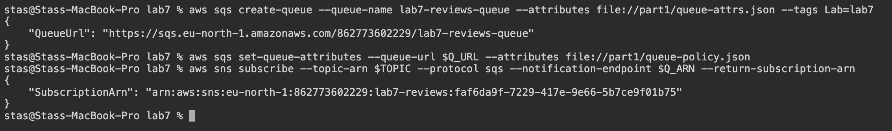

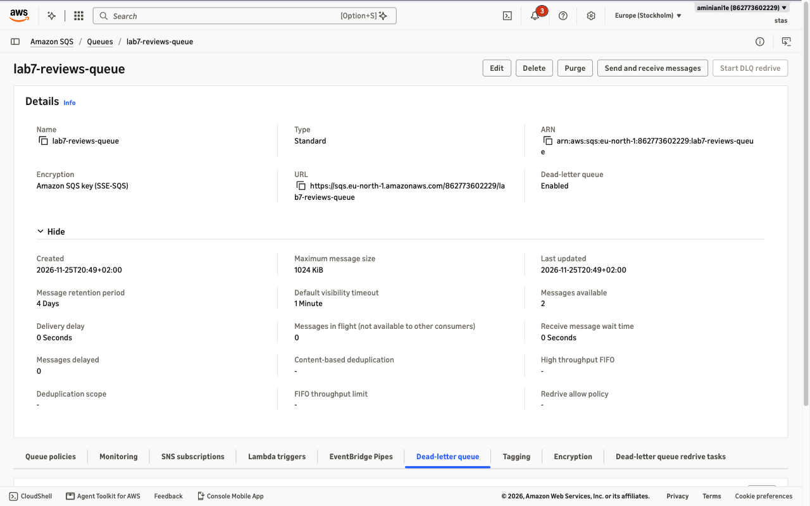

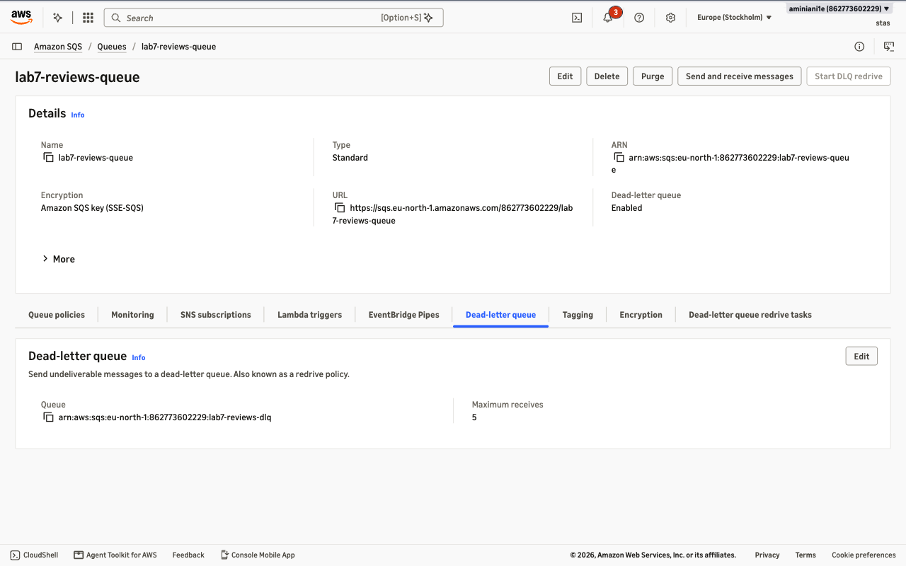

**Какие значения параметров выбраны и почему:**

| Параметр | Значение | Почему | Что будет при другом значении |
| --- | --- | --- | --- |
| Таймаут видимости | 60 с | AWS рекомендует не меньше 6 таймаутов Lambda-функции (10 с). Запас покрывает повторы самой службы Lambda при throttling | Меньше таймаута функции: сообщение снова станет видно, пока его ещё обрабатывают, и его возьмёт второй вызов. Триггер с таймаутом функции больше таймаута видимости не создастся. Сильно больше: упавший отзыв ждёт следующей попытки долго |
| Срок хранения | 4 дня (по умолчанию) | Отзывы нужно обработать в течение дней, а не недель. Хватает на выходные, если обработчик сломался в пятницу | Меньше: сообщение может истечь раньше, чем его обработают. До 14 дней можно, но отзыв двухнедельной давности уже никому не нужен |
| Хранение в DLQ | 14 дней (максимум) | В стандартной очереди при переносе в DLQ сохраняется исходное время отправки, поэтому срок хранения DLQ должен быть больше, чем у основной очереди | Если DLQ хранит меньше, неудачные отзывы исчезают раньше, чем до них дойдут руки |
| `maxReceiveCount` | 5 | Рекомендация AWS для Lambda: не меньше 5, чтобы получения, которые не дошли до функции (throttling, ошибки службы), не отправляли сообщение в DLQ раньше времени | 1: любой временный сбой сразу уводит отзыв в DLQ. Очень большое значение: «ядовитое» сообщение долго крутится в очереди и тратит вызовы |
| Raw message delivery | включено | Lambda-функции нужен сам отзыв, а не конверт SNS. Атрибут `rating` при этом приходит атрибутом сообщения SQS | Без raw тело - JSON-конверт SNS, отзыв лежит в поле `Message` строкой, и его нужно разбирать дважды |

Сначала я опубликовал `r-1` без Raw message delivery, затем включил его и опубликовал тот же отзыв ещё раз:

```bash
aws sns publish --topic-arn $TOPIC \
  --message '{"id": "r-1", "rating": 5, "text": "Fast delivery, good packaging"}' \
  --message-attributes '{"rating": {"DataType": "Number", "StringValue": "5"}}'
aws sns set-subscription-attributes --subscription-arn $SUB_Q \
  --attribute-name RawMessageDelivery --attribute-value true
```

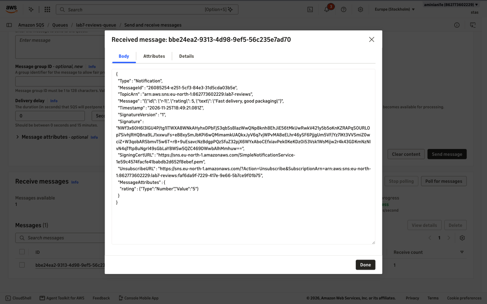

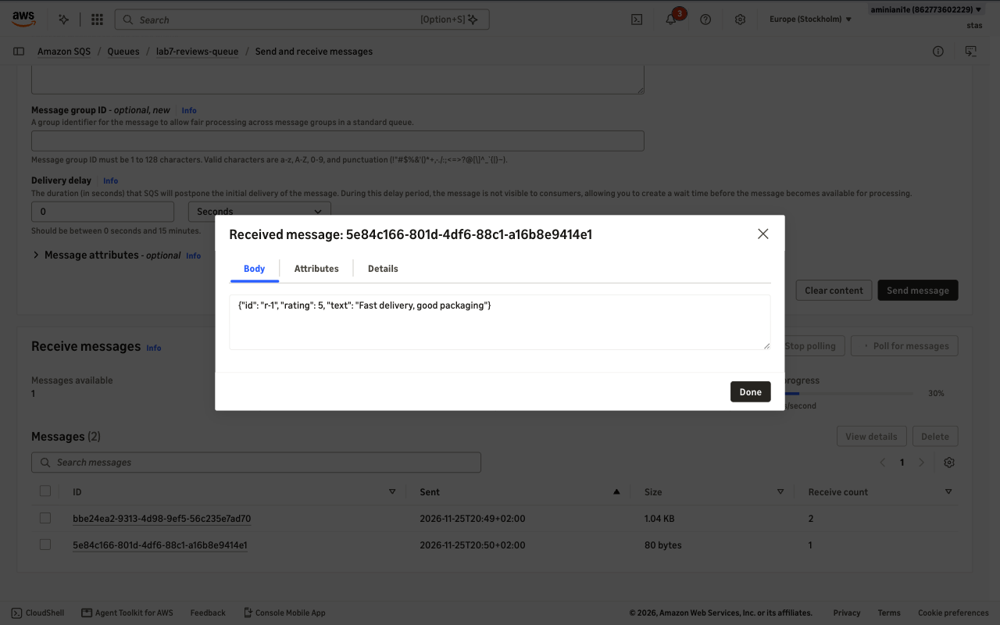

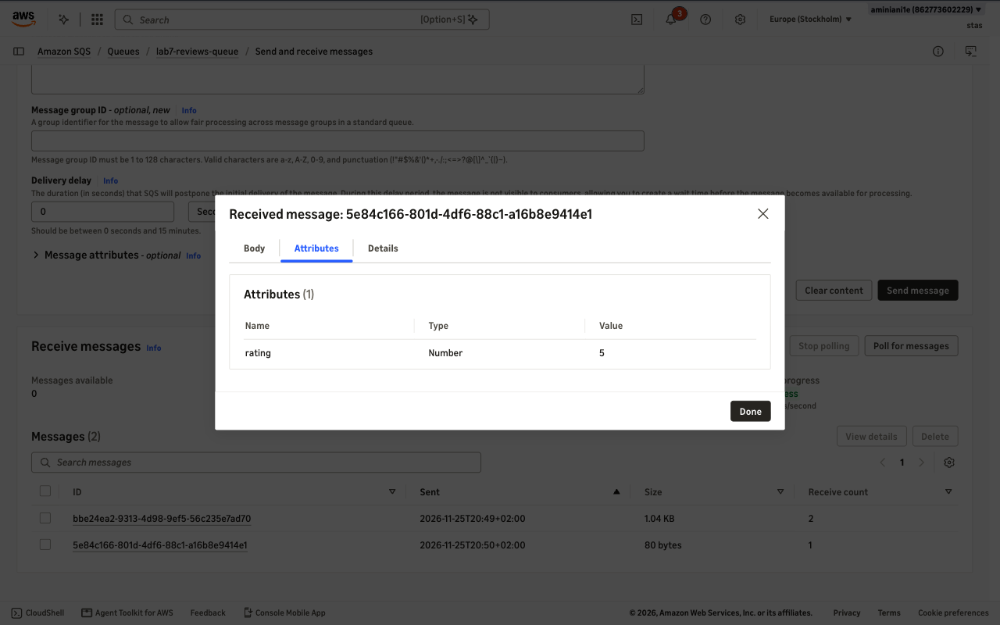

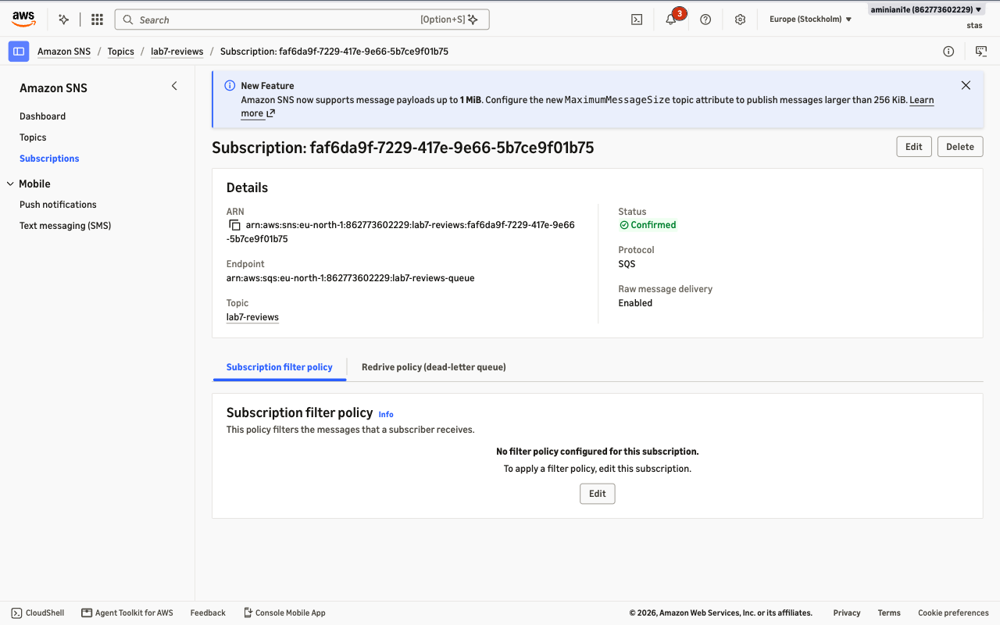

**Как выглядит тело с Raw message delivery и без него?** Без raw тело - JSON-конверт SNS размером 1,04 КБ:
`Type: Notification`, `MessageId`, `TopicArn`, `Message` (отзыв строкой с экранированными кавычками), `Timestamp`,
`Signature`, `SigningCertURL`, `UnsubscribeURL` и `MessageAttributes` (`rating: {"Type": "Number", "Value": "5"}`).
С raw тело - исходный отзыв `{"id": "r-1", "rating": 5, "text": "…"}` размером 80 байт, а `rating` становится
атрибутом сообщения SQS (вкладка Attributes).

**Почему сообщение снова видно через некоторое время после получения?** Получение (`ReceiveMessage`) сообщение не
удаляет, а только скрывает его на время таймаута видимости (60 с). Удаляет его получатель отдельным запросом
`DeleteMessage` после успешной обработки. Консоль только смотрит сообщения и не удаляет их, поэтому через 60 с первая
копия `r-1` снова стала видна, а её `Receive count` вырос до 2 (второй скриншот). Если получатель упал, сообщение
так же возвращается, и это механизм повторов SQS.

### Задание 2. Обработчик отзывов

```python
import json


def lambda_handler(event, context):
    for record in event["Records"]:
        review = json.loads(record["body"])
        print(f'{review["id"]}: {review["rating"]}/5 {review["text"][:20]}')
```

```bash
aws iam create-role --role-name lab7-review-worker-role --assume-role-policy-document file://part1/trust-lambda.json
aws iam attach-role-policy --role-name lab7-review-worker-role \
  --policy-arn arn:aws:iam::aws:policy/service-role/AWSLambdaSQSQueueExecutionRole
aws lambda create-function --function-name lab7-review-worker --runtime python3.12 \
  --handler lambda_function.lambda_handler --role arn:aws:iam::<account>:role/lab7-review-worker-role \
  --zip-file fileb://part1/worker.zip --timeout 10 --memory-size 128 --tags Lab=lab7
aws lambda create-event-source-mapping --function-name lab7-review-worker --event-source-arn $Q_ARN \
  --batch-size 10 --maximum-batching-window-in-seconds 0
```

Таймаут функции 10 с: вывод строки в журнал занимает 1-2 мс, 10 с - запас на холодный старт. Таймаут видимости
(60 с) в 6 раз больше. Размер пачки 10 (по умолчанию для SQS): функция дешёвая, за один вызов можно обработать
до 10 отзывов. Batch window 0: отзыв обрабатывается сразу, без ожидания пачки.

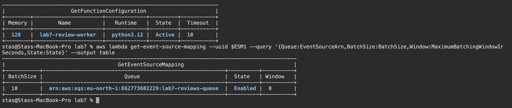

Три отзыва подряд:

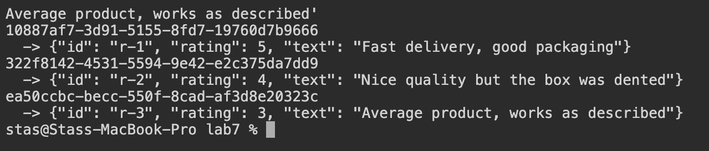

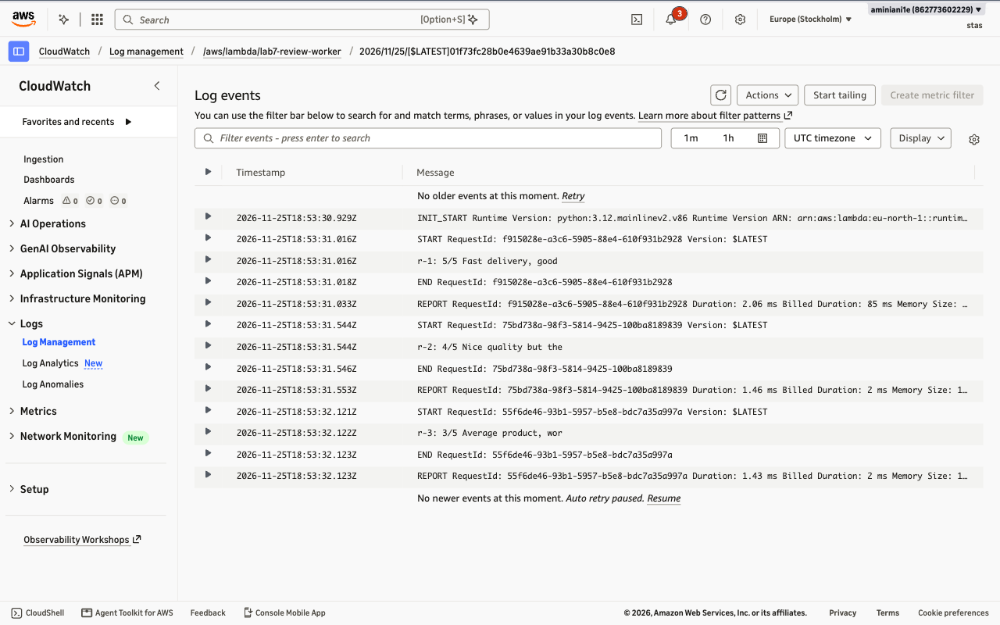

**Сколько вызовов понадобилось для трёх отзывов и от чего это зависит?** Три: в журнале три пары
`START`/`REPORT`, по одному отзыву в каждой. Команды `aws sns publish` шли друг за другом с интервалом около 0,5 с,
а batch window равен 0. Служба Lambda опрашивает очередь несколькими параллельными long poll и вызывает функцию,
как только получила хотя бы одно сообщение, не дожидаясь 10. Число вызовов зависит от размера пачки, окна
(`MaximumBatchingWindowInSeconds`), от того, как быстро сообщения попадают в очередь, и от числа одновременных
опросов. С окном, например, 5 с те же три отзыва пришли бы одним вызовом.

### Задание 3. Отзыв, который не удалось обработать

В 18:54:21 UTC опубликован `{"id": "r-4", "rating": 4}`. Функция падает с `KeyError: 'text'`:

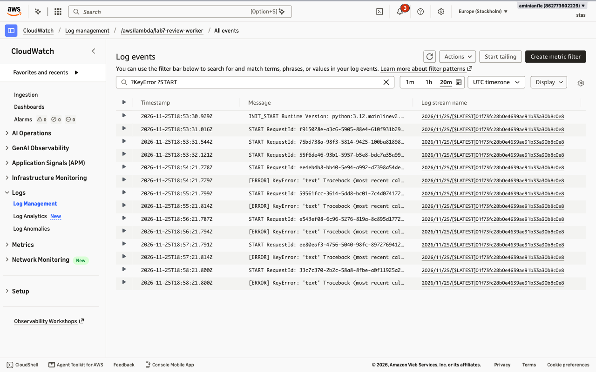

В журнале пять ошибок: 18:54:21, 18:55:21, 18:56:21, 18:57:21, 18:58:21, ровно через таймаут видимости. В 18:59:24
отзыв оказался в `lab7-reviews-dlq`. `Receive count 6` на скриншоте: 5 получений службой Lambda плюс одно моё
в консоли.

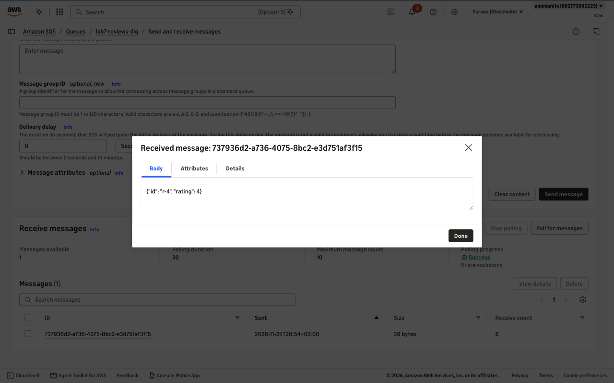

Исправленная функция подставляет текст по умолчанию:

```python
        text = review.get("text") or "(no text)"
        print(f'{review["id"]}: {review["rating"]}/5 {text[:20]}')
```

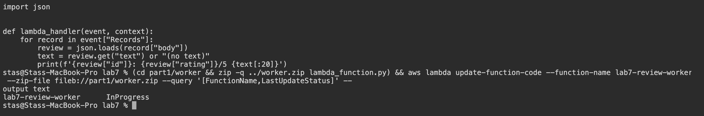

После этого `Start DLQ redrive` → `Redrive to source queue(s)` (задача `COMPLETED`, перенесено 1 сообщение),
и в 19:01:11 в журнале появилась строка `r-4: 4/5 (no text)`:

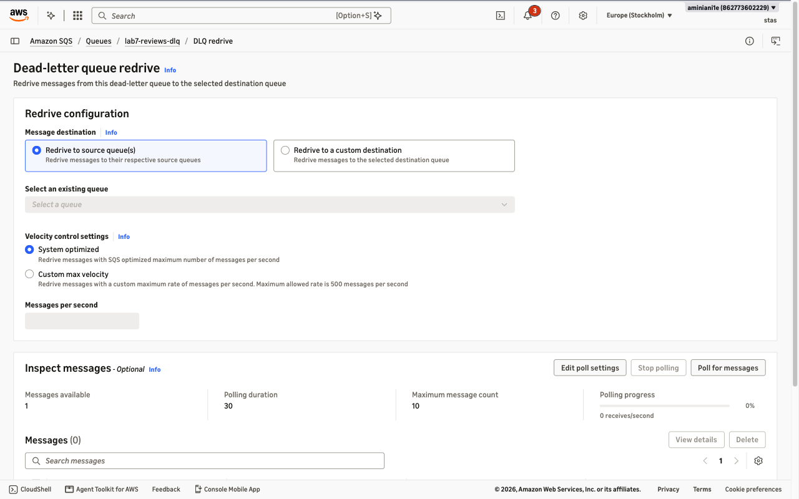

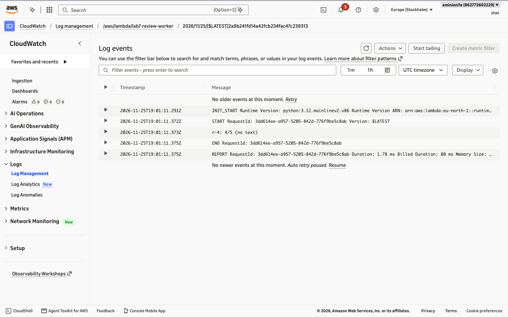

**Сколько раз обрабатывался отзыв с ошибкой и от какой настройки это зависит?** Пять раз. Это `maxReceiveCount`
в redrive policy очереди (5). Каждое получение увеличивает `ApproximateReceiveCount`, и когда он превысил 5,
SQS перенёс сообщение в DLQ.

**Почему он попал в DLQ не сразу?** SQS не знает, что функция упала. Для него сообщение просто не удалили, и оно
снова становится видимым через таймаут видимости (60 с). Перенос в DLQ происходит только при следующем
получении после пятого, поэтому прошло около 5 минут: 5 попыток × 60 с.

**Что произойдёт с остальными отзывами пачки, если ошибка случится на одном из десяти?** В этой функции ошибка
завершает весь вызов, и служба Lambda считает неудачной всю пачку. Все 10 сообщений вернутся в очередь после
таймаута видимости, в том числе 9 уже обработанных (их обработают повторно), а при постоянной ошибке все 10 уйдут
в DLQ. Чтобы этого не было, в триггере включают `ReportBatchItemFailures`, а функция возвращает
`batchItemFailures` только с id неудачных сообщений, как сделано в `timecapsule-dev-mailer` в Части 2.

### Задание 4. Плохие отзывы на почту

Почта подписана на тему с политикой фильтрации по атрибутам сообщения:

```bash
aws sns subscribe --topic-arn $TOPIC --protocol email --notification-endpoint <моя почта> \
  --attributes '{"FilterPolicy": "{\"rating\": [{\"numeric\": [\"<\", 3]}]}", "FilterPolicyScope": "MessageAttributes"}'
```

Фильтр добавлен к подписке почты, а не очереди: очередь должна по-прежнему получать все отзывы. Условие числовое
(`numeric < 3`), а не список значений `[1, 2]`: так оно верно и для дробных оценок, и для оценки 0.

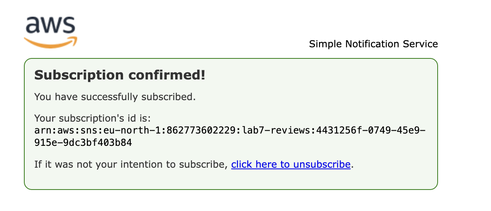

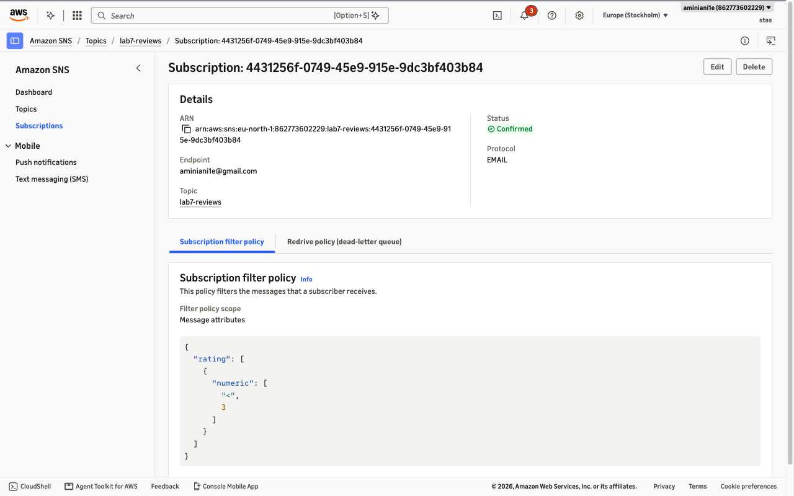

Четыре отзыва: `r-5` (1), `r-6` (3), `r-7` (5) и `r-8` - в теле оценка 1, но без атрибута `rating`:

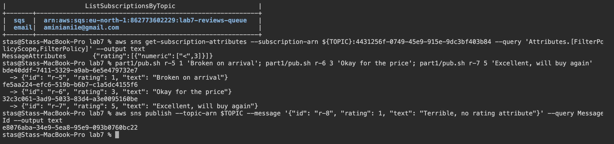

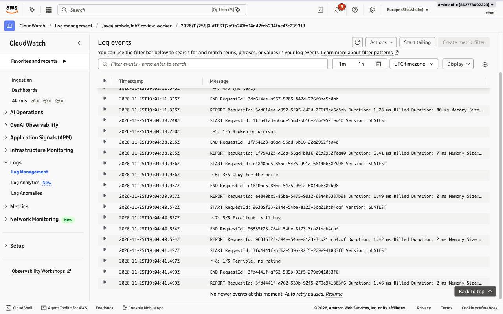

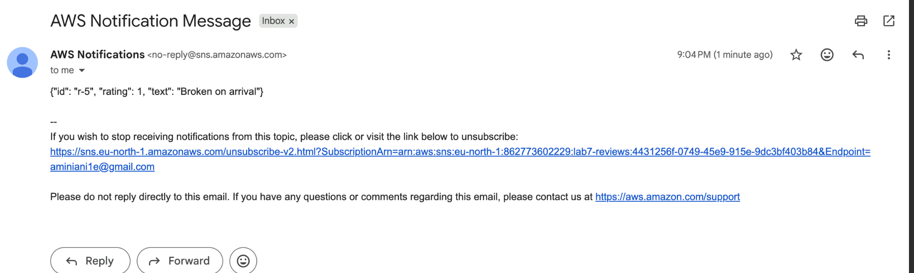

| Отзыв | Почта | Журнал `lab7-review-worker` |
| --- | --- | --- |
| rating = 1 (`r-5`) | да | да, `r-5: 1/5 Broken on arrival` |
| rating = 3 (`r-6`) | нет | да, `r-6: 3/5 Okay for the price` |
| rating = 5 (`r-7`) | нет | да, `r-7: 5/5 Excellent, will buy` |
| без rating (`r-8`) | нет | да, `r-8: 1/5 Terrible, no rating` |

**Почему отзыв без атрибута не пришёл на почту?** Фильтр с `FilterPolicyScope = MessageAttributes` смотрит
только на атрибуты сообщения, а не на тело. Условие на ключ `rating` выполняется, только если атрибут есть и
подходит. Отсутствующий атрибут не подходит ни под одно условие, кроме `{"exists": false}`. Поэтому `r-8`
отсеян, хотя оценка в его теле 1. У подписки очереди фильтра нет, поэтому в журнал попали все четыре.

**Что пришлось бы менять в издателе, если бы он отправлял отзывы напрямую в каждую очередь?** Издатель знал бы
каждого получателя: для отдела аналитики пришлось бы добавить в код магазина ещё одну отправку в новую очередь,
выдать ему права на неё, выкатить новую версию и решить, что делать, если одна из отправок не удалась. Фильтр
«только плохие» тоже был бы в коде издателя. С темой издатель публикует один раз, а новый получатель - это новая
подписка со своим фильтром, без изменений у издателя.

### Завершение Части 1

```bash
aws lambda delete-event-source-mapping --uuid $ESM1
aws lambda delete-function --function-name lab7-review-worker
aws logs delete-log-group --log-group-name /aws/lambda/lab7-review-worker
# отписать почту и очередь, удалить тему, очереди и роль
```

Проверка: ресурсов с префиксом `lab7-` не осталось (последняя строка - ресурсы с тегом `Lab=lab7` и `lab7-` в имени.
Тот же тег есть у ресурсов Части 2, но их имена начинаются с `timecapsule-dev-`):

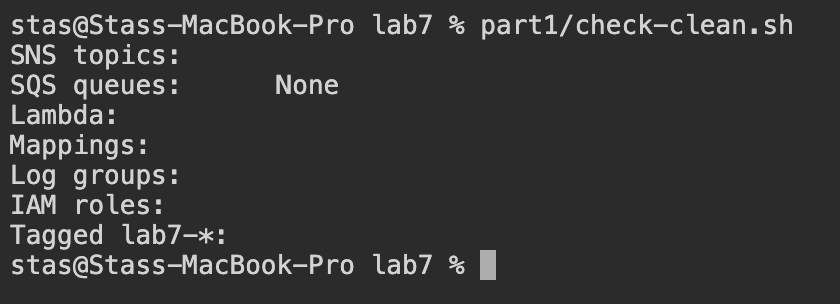

## Часть 2. Продвинутый уровень

| Ресурс | Имя | Параметры |
| --- | --- | --- |
| Тема SNS | `timecapsule-dev-events` | стандартная |
| Очередь писем | `timecapsule-dev-mail` | видимость 180 с, хранение 4 дня, redrive после 5 получений |
| DLQ | `timecapsule-dev-mail-dlq` | хранение 14 дней |
| Подписка очереди | raw, фильтр по телу | `capsule.sealed` или `responsePayload.count > 0` |
| Подписка почты | фильтр по телу | `responsePayload.count > 0` |
| Lambda писем | `timecapsule-dev-mailer` | Python 3.12, 256 МБ, таймаут 30 с, VPC |
| Триггер | SQS → mailer | batch 5, window 0, `MaximumConcurrency = 2`, `ReportBatchItemFailures` |
| Lambda открытия | `timecapsule-dev-opener` | Python 3.12, 256 МБ, таймаут 15 с, VPC, повторов 0, назначение OnSuccess → тема |
| Роли | `timecapsule-dev-mailer-role`, `timecapsule-dev-opener-role` | `AWSLambdaVPCAccessExecutionRole` + своя inline-политика |
| Security Group | `timecapsule-dev-lambda-sg` | входящих правил нет |
| Политика приложения | `timecapsule-dev-app-events` | `sns:Publish` в `timecapsule-dev-events` |
| Расписание | `timecapsule-dev-open-capsules` | `rate(1 minute)`, роль `timecapsule-dev-scheduler-role` |

Теги: `Project=timecapsule`, `Environment=dev`, `Owner=sta5on`, `Lab=lab7`.

Новая схема архитектуры (по образцу рисунка 7.2, на основе схемы ЛР6):

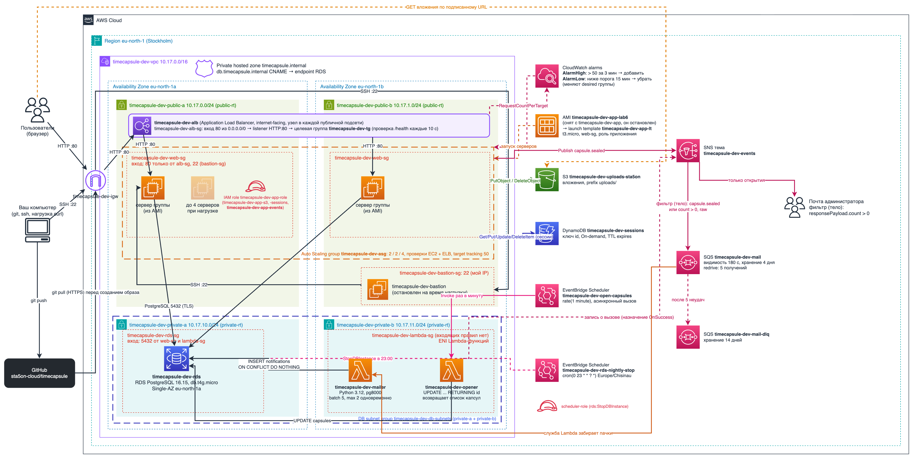

### Задание 5. Очередь писем и событие о запечатывании

```bash
aws sns create-topic --name timecapsule-dev-events --tags $TAGS
aws sqs create-queue --queue-name timecapsule-dev-mail-dlq --attributes MessageRetentionPeriod=1209600 --tags $TAGS
aws sqs create-queue --queue-name timecapsule-dev-mail --attributes file://part2/mail-attrs.json --tags $TAGS
aws sns subscribe --topic-arn $TOPIC --protocol sqs --notification-endpoint $MAIL_ARN \
  --attributes file://part2/mail-sub-attrs.json --return-subscription-arn
```

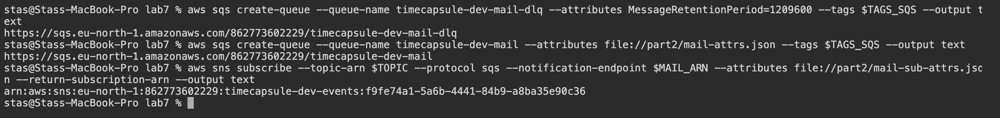

`mail-attrs.json` задаёт таймаут видимости 180 с, хранение 4 дня, redrive в DLQ после 5 получений и политику доступа
(только тема `timecapsule-dev-events`). `mail-sub-attrs.json` включает Raw message delivery и фильтр по телу
сообщения (`FilterPolicyScope = MessageBody`):

```json
{"$or": [{"type": ["capsule.sealed"]}, {"responsePayload": {"count": [{"numeric": [">", 0]}]}}]}
```

Фильтр по телу нужен из-за записей о вызове opener (задание 8): у них нет атрибутов сообщения, а приходят они раз
в минуту, даже пустые.

Формат события описан в [docs/events.md](../events.md):

```json
{"type": "capsule.sealed", "version": 1, "event_id": "4b0d…", "occurred_at": "2026-11-25T19:40:12Z",
 "capsule_id": 42, "user_id": 6}
```

**Что в событии нужно получателю, а что лучше не передавать?** Получателю нужны тип события (по нему его
отличают фильтр и mailer), версия формата, идентификаторы капсулы и пользователя, время и `event_id` для поиска в
журналах. Не нужно передавать содержимое капсулы (текст, вложение, название): это секрет до времени открытия,
а тема может разослать событие любому подписчику, например почте администратора. Не нужно передавать адрес
получателя (персональные данные) и, конечно, пароли, сессии и ключи. Всё остальное mailer читает из базы в момент
обработки. Так он видит актуальное состояние: если капсулу удалили до обработки, письмо не пишется.

### Задание 6. Lambda-функция писем

Код: https://github.com/sta5on-cloud/timecapsule-mailer (`lambda_function.py`, `requirements.txt` с
`pg8000==1.31.6`, `build.sh`, сертификаты RDS `rds-ca.pem`).

Как решены «подводные камни» из задания:

- **VPC.** Функция подключена к `timecapsule-dev-private-a` и `timecapsule-dev-private-b` с группой
  `timecapsule-dev-lambda-sg` (входящих правил нет). В `timecapsule-dev-rds-sg` добавлено правило
  `5432 от timecapsule-dev-lambda-sg`. Роль функции получила `AWSLambdaVPCAccessExecutionRole` для создания ENI.
- **Выход в интернет не нужен.** Очередь опрашивает служба Lambda, а функция получает уже готовую пачку
  сообщений. Права на очередь (`ReceiveMessage`, `DeleteMessage`, `GetQueueAttributes`,
  `ChangeMessageVisibility`) - у роли, и используются они службой Lambda. Журналы тоже пишет служба Lambda.
- **Шифрование.** `pg8000` подключается с `ssl_context`, который проверяет сертификат RDS по bundle
  `eu-north-1` (`verify-full`). Поэтому `DB_HOST` функции - endpoint RDS: имя `db.timecapsule.internal` из
  приватной зоны не совпало бы с сертификатом.
- **Драйвер.** `pg8000` написан целиком на Python, поэтому zip собирается на macOS и работает на Linux.
  В репозитории только `requirements.txt`, zip и библиотеки в `.gitignore`.
- **Повторы.** В `notifications` добавлены колонка `kind` и уникальный индекс `(capsule_id, kind)`
  (`database/schema.sql`, применился через `deploy.sh` → `bin/init-db.php`). Mailer пишет через
  `INSERT … ON CONFLICT (capsule_id, kind) DO NOTHING RETURNING id` и пишет в журнал, вставил строку или
  отбросил повтор.
- **Подключения.** Подключение создаётся один раз на среду выполнения и переиспользуется между вызовами, а
  `MaximumConcurrency = 2` ограничивает число сред.

Параметры очереди писем и функции:

| Параметр | Значение | Почему |
| --- | --- | --- |
| Таймаут функции | 30 с | Пачка из 5 писем × 3 с задержки = 15 с плюс подключение к базе и холодный старт в VPC |
| Таймаут видимости | 180 с | 6 × 30 с, рекомендация AWS. Меньше 30 с триггер не создастся, а при 30-60 с сообщение может получить второй вызов, пока первый ещё ждёт почтовый сервер |
| Batch size | 5 | Не дольше 15 с на пачку. Ошибки отдельных писем возвращаются через `batchItemFailures`, не повторяя всю пачку |
| `maxReceiveCount` | 5 | Как в Части 1: временный сбой базы не уводит письмо в DLQ сразу, но сломанное письмо не крутится бесконечно |
| Хранение | 4 дня / DLQ 14 дней | Письмо переживает выходные со сломанным обработчиком, а DLQ хранит дольше основной очереди |

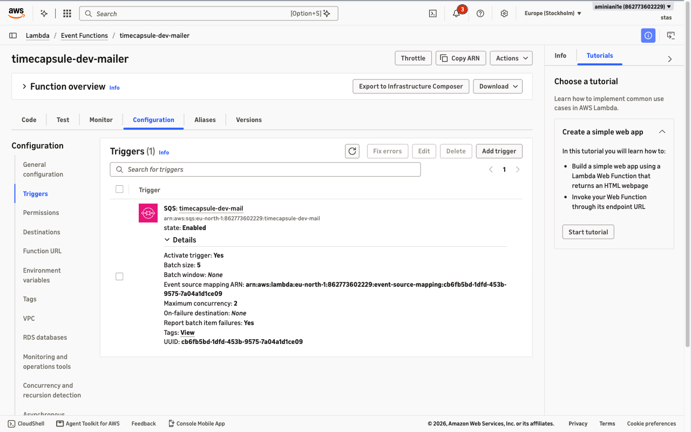

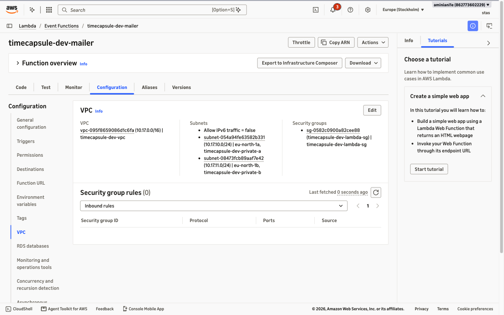

Проверка без приложения: удалил уведомление `sealed` тестовой капсулы 11 и дважды отправил в очередь одно и то же
сообщение `capsule.sealed`:

```bash
aws sqs send-message --queue-url $MAIL_URL --message-body "$MSG"   # дважды
```

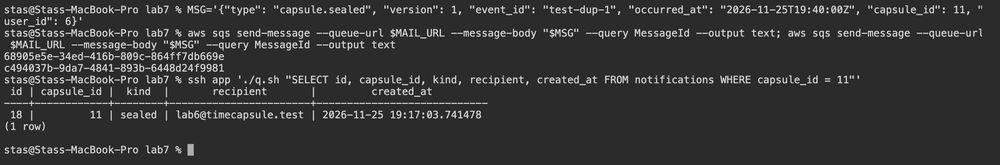

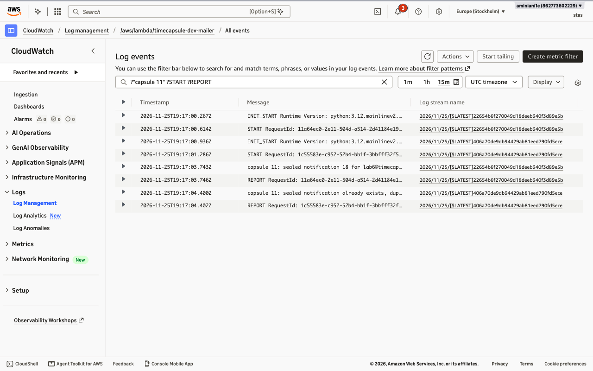

**Сколько уведомлений появилось после двух одинаковых сообщений и почему?** Одно (`id 18`). Служба Lambda взяла
оба сообщения одновременно и запустила две среды выполнения (два потока журнала, оба с `INIT_START`). Первая
вставила строку: `capsule 11: sealed notification 18`. Вторая через 0,7 с получила конфликт по уникальному индексу
`(capsule_id, kind)`: `sealed notification already exists, duplicate message ignored`. Такая проверка работает и при
одновременной обработке, потому что повтор отсекает база, а не проверка «SELECT, потом INSERT» в коде.

**Какой предел одновременных вызовов выбран и из чего исходили?** `MaximumConcurrency = 2` на триггере. Это минимум,
который разрешает AWS. У `db.t4g.micro` `max_connections = 79`, часть занимает приложение, и каждый одновременный
вызов держит своё подключение. Двух вызовов хватает с запасом: 2 × 5 писем за ~15 с - около 40 писем в минуту,
а у учебного стенда единицы писем в минуту. Ограничение на триггере лучше reserved concurrency: служба Lambda
просто не берёт больше пачек, а не получает throttling, который увеличивал бы счётчик получений.

### Задание 7. Публикация событий из приложения

Изменения приложения (коммит `44ef1df`):

- `src/events.php`: `publish_event()` через `Aws\Sns\SnsClient` из уже подключённого AWS SDK. Учётные данные -
  временные, роли сервера.
- `src/controllers/capsules.php`: после `INSERT` публикуется `capsule.sealed`. Если `EVENTS_TOPIC_ARN` пуст
  (локальный Docker), письмо по-старому пишет `mail_send()`.
- `public/index.php`: `open_due_capsules()` вызывается только без `EVENTS_TOPIC_ARN`. На AWS капсулы открывает
  `timecapsule-dev-opener`.
- `database/schema.sql`: колонка `notifications.kind` и уникальный индекс.

Права на публикацию - политика `timecapsule-dev-app-events` (`sns:Publish` только в `timecapsule-dev-events`),
прикреплена к `timecapsule-dev-app-role`. Группа Auto Scaling и балансировщик ЛР6 в конце той работы были
удалены, приложение работает на одном `app-server`, поэтому новая версия выкачена способом из ЛР2: `git push`,
затем `./deploy.sh` на сервере через bastion. В `.env` сервера добавлен `EVENTS_TOPIC_ARN`, затем
`systemctl reload php-fpm`. Если вернуть группу Auto Scaling, новую версию нужно запечь в новый AMI и обновить
launch template, а затем запустить instance refresh. `.env` в образе уже содержал бы `EVENTS_TOPIC_ARN`.

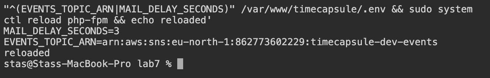

Время запроса Seal capsule (`POST /capsules`) на вкладке Network инструментов разработчика Chrome:

До: 3,27 с, почти всё - `Waiting for server response` (3 с ожидания «почтового сервера»):

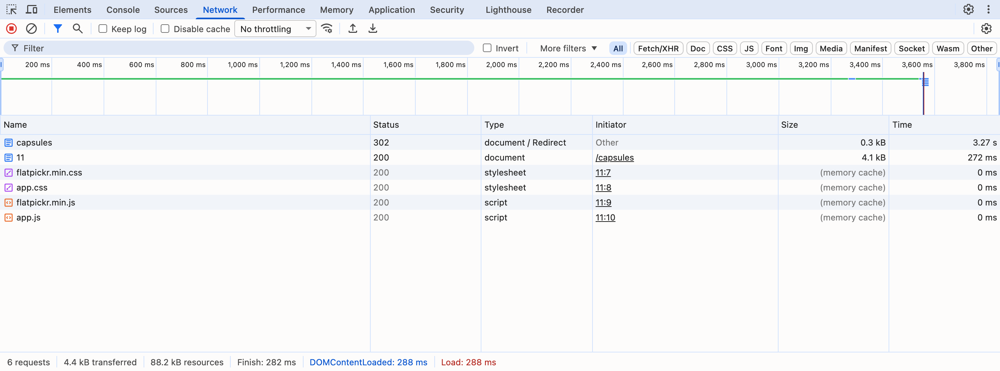

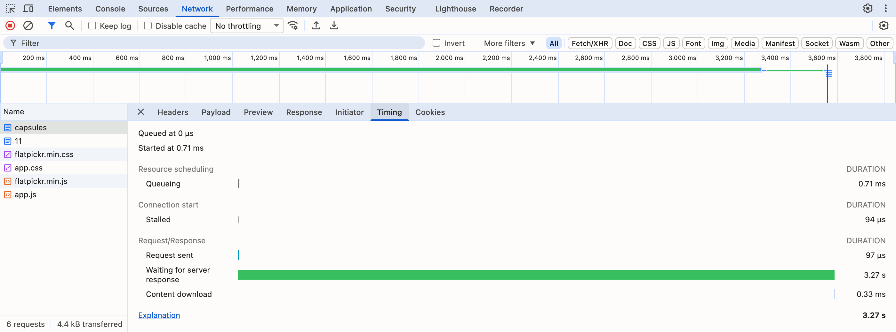

После: 0,36 с:

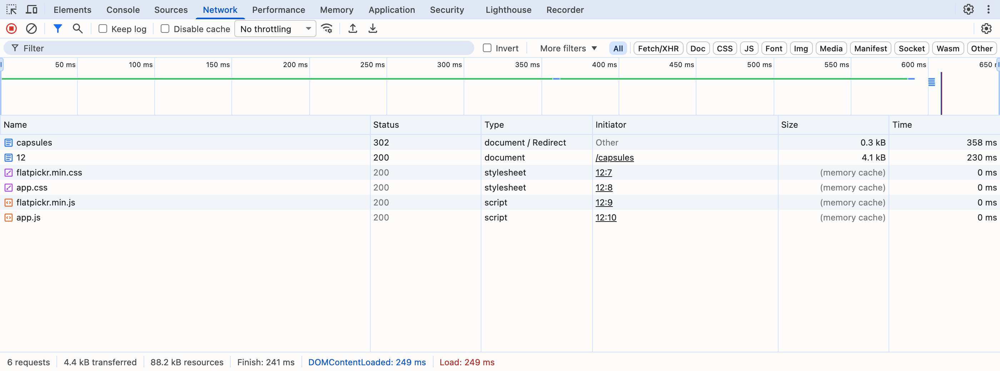

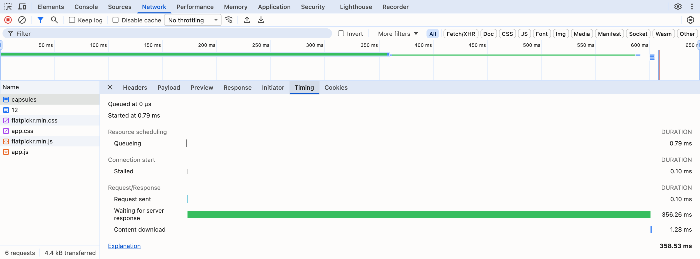

**Что увидит пользователь, если Lambda-функция писем сломана? Где в это время его письмо?** Пользователь ничего не
заметит: запрос по-прежнему отвечает за ~0,7 с, появляется «Capsule sealed» (проверено в задании 9). Только на
странице Notifications не появится строка о запечатывании. Письмо - сообщение `capsule.sealed` в очереди
`timecapsule-dev-mail`: служба Lambda получает его, функция падает, и оно снова становится видимым через 180 с.
После 5 получений оно лежит в `timecapsule-dev-mail-dlq` (до 14 дней), пока его не вернут.

### Задание 8. Открытие капсул по расписанию

Код: https://github.com/sta5on-cloud/timecapsule-opener. Функция выполняет
`UPDATE capsules SET opened_at = now() WHERE opened_at IS NULL AND open_at <= now() RETURNING id` и возвращает

```json
{"type": "capsules.opened", "count": 1, "capsule_ids": [13], "opened_at": "2026-11-25T19:22:45+00:00"}
```

Настройки асинхронного вызова и назначение:

```bash
aws lambda put-function-event-invoke-config --function-name timecapsule-dev-opener \
  --maximum-retry-attempts 0 --maximum-event-age-in-seconds 60 \
  --destination-config '{"OnSuccess": {"Destination": "arn:aws:sns:eu-north-1:<account>:timecapsule-dev-events"}}'
aws scheduler create-schedule --name timecapsule-dev-open-capsules --schedule-expression 'rate(1 minute)' \
  --flexible-time-window Mode=OFF --target file://part2/schedule-target.json
```

У роли `timecapsule-dev-opener-role` есть `sns:Publish` в тему: запись о вызове служба Lambda отправляет с правами
функции. Расписание использует роль `timecapsule-dev-scheduler-role` из ЛР5, которой добавлена inline-политика
`invoke-opener` (`lambda:InvokeFunction` только на opener). Повторов нет ни у расписания, ни у асинхронного
вызова: пропущенный запуск догонит следующий через минуту.

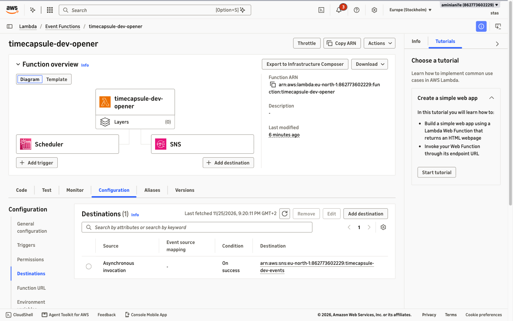

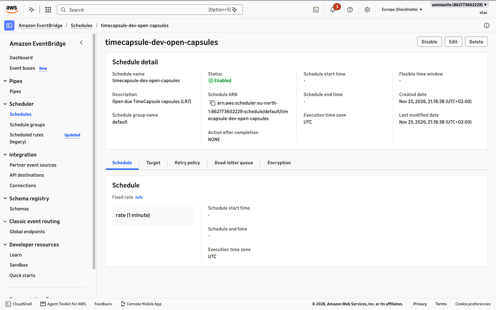

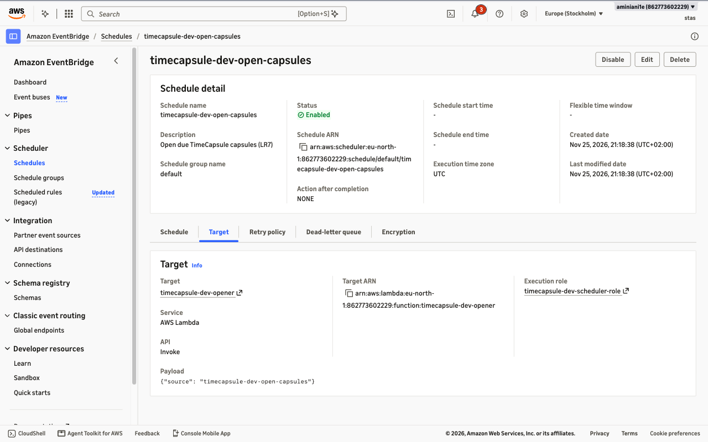

Почта подписана на тему с фильтром по телу `{"responsePayload": {"count": [{"numeric": [">", 0]}]}}`: пустые
записи раз в минуту и `capsule.sealed` отсекаются. Формат записи о вызове добавлен в [docs/events.md](../events.md).

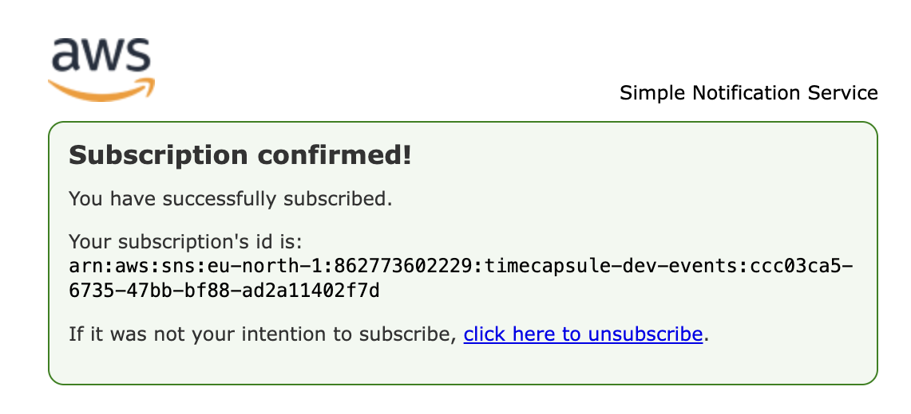

Проверка: в 19:18:55 UTC через приложение создана капсула 13 «LR7: opens by schedule» с открытием в 19:22, сайт я
больше не открывал. В 19:22:45 opener открыл её (`opened capsules: [13]`), в 19:22:48 mailer записал уведомление
`opened` (id 22), и SNS отправил письмо на почту:

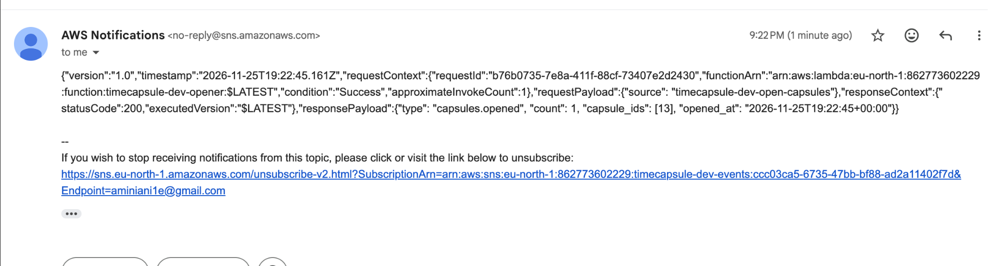

В письме - запись о вызове целиком: `requestContext.condition = "Success"`, `requestPayload` - вход от расписания,
`responsePayload` - то, что вернула функция. Пустые записи (`count = 0`), которые приходят каждую минуту, фильтр
подписки отсекает, и на почту они не приходят.

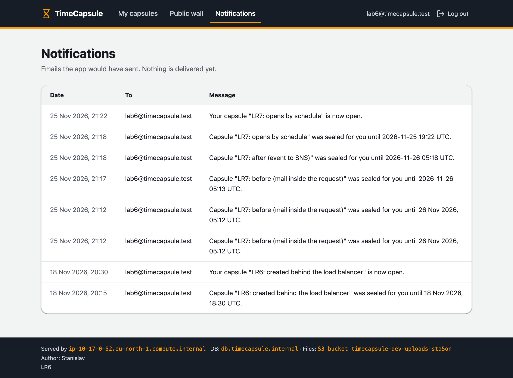

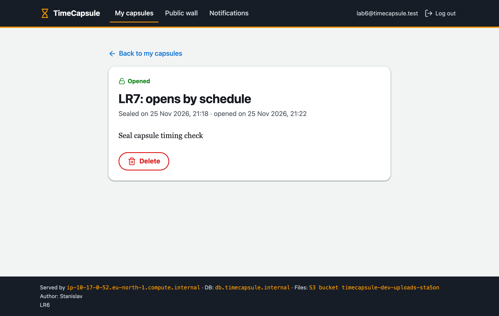

**Что будет, если Lambda-функция открыла капсулы, но служба Lambda не смогла доставить запись в тему?**
Капсулы уже открыты: `UPDATE` закоммичен в базе, приложение покажет их открытыми. Но событие потеряно: mailer не
запишет уведомление `opened`, письмо не придёт. Следующий запуск о них не сообщит, потому что `opened_at` уже не
`NULL`. Назначение - «лучшая попытка» после успешного вызова, а не транзакция вместе с базой. Защититься можно
таблицей «исходящих» в той же транзакции или периодической сверкой: открытые капсулы без уведомления `opened`.

**Что пришлось бы добавить в сеть, если бы код Lambda-функции сам публиковал события в SNS, и сколько бы это
стоило?** Функция в приватных подсетях не имеет выхода в интернет, а API SNS - публичный endpoint. Нужен либо
NAT Gateway в публичной подсети с маршрутом из `private-rt` (около $0,046 в час, то есть ~$34 в месяц, плюс
$0,046 за ГБ, а для отказоустойчивости по одному на зону), либо interface VPC endpoint
`com.amazonaws.eu-north-1.sns` в двух приватных подсетях (около $0,011 в час за зону, ~$16 в месяц за две, плюс
$0,01 за ГБ). Для учебного стенда это дороже всего остального в ЛР7. Назначение бесплатно: публикует служба Lambda
вне VPC.

**Чем открытие капсул по расписанию хуже открытия при запросе?** Капсула открывается с задержкой до минуты:
если пользователь открыл страницу ровно в момент открытия, он ещё увидит её запечатанной. Функция запускается
1440 раз в сутки, даже когда открывать нечего, а каждый запуск - это вызов, подключение к базе и запись в тему.
Ночью база остановлена, и все запуски заканчиваются ошибкой (в журнале каждую минуту). Появились новые части,
которые могут сломаться незаметно для пользователя (расписание, назначение, права), и их нужно отключать в конце
занятия. Зато капсулы открываются, даже если на сайт никто не заходит, и `UPDATE` выполняется один раз в минуту,
а не на каждом запросе каждого сервера.

### Задание 9. Сбой обработчика

В 19:24 UTC я указал в переменных окружения `timecapsule-dev-mailer` неверный `DB_PASSWORD` и запечатал через
приложение две капсулы (14 и 15). Seal capsule по-прежнему отвечал за 0,7-0,8 с и показывал «Capsule sealed».

Каждое сообщение получено 5 раз с интервалом 180 с: 19:24:26, 19:27:26, 19:30:26, 19:33:26, 19:36:26 для первого и
19:24:37, 19:27:37, 19:30:37, 19:33:58, 19:36:58 для второго. Ошибка каждый раз одна:
`password authentication failed for user "timecapsule"`. В 19:39:37 и 19:40:03 сообщения оказались в DLQ:

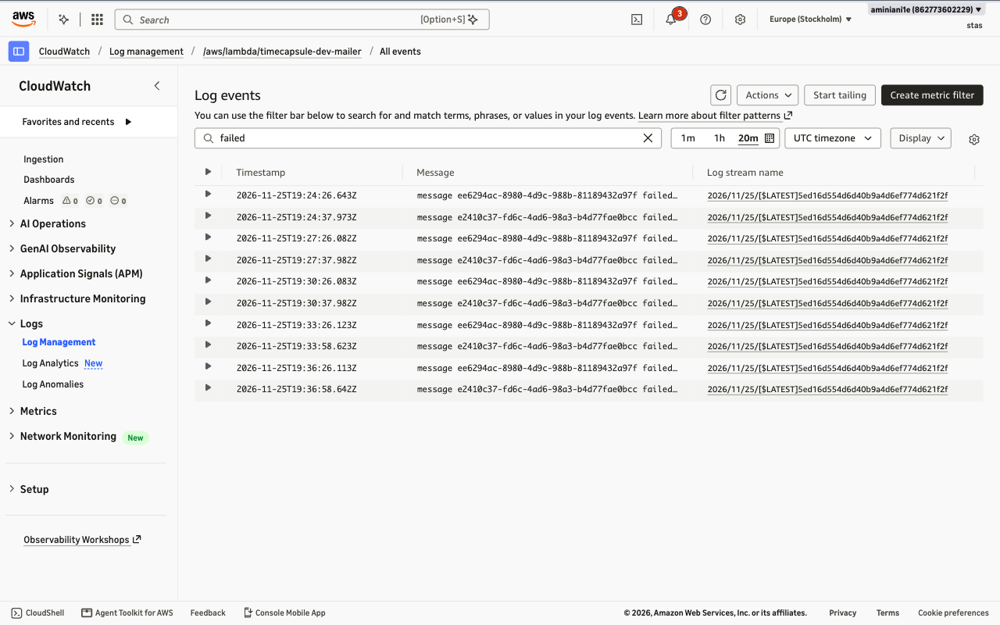

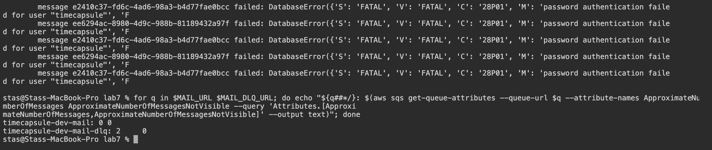

Метрики `timecapsule-dev-mail` во время сбоя: `NumberOfMessagesReceived` - пять всплесков по 2 сообщения,
`ApproximateNumberOfMessagesNotVisible` - 2 всё время сбоя (сообщения на руках у службы Lambda),
`ApproximateAgeOfOldestMessage` растёт до ~9 минут, `NumberOfMessagesDeleted` - 0 после 19:24 (удалять нечего).
Всплески `NumberOfMessagesSent` и `Deleted` около 19:17-19:22 - успешные письма заданий 6-8:

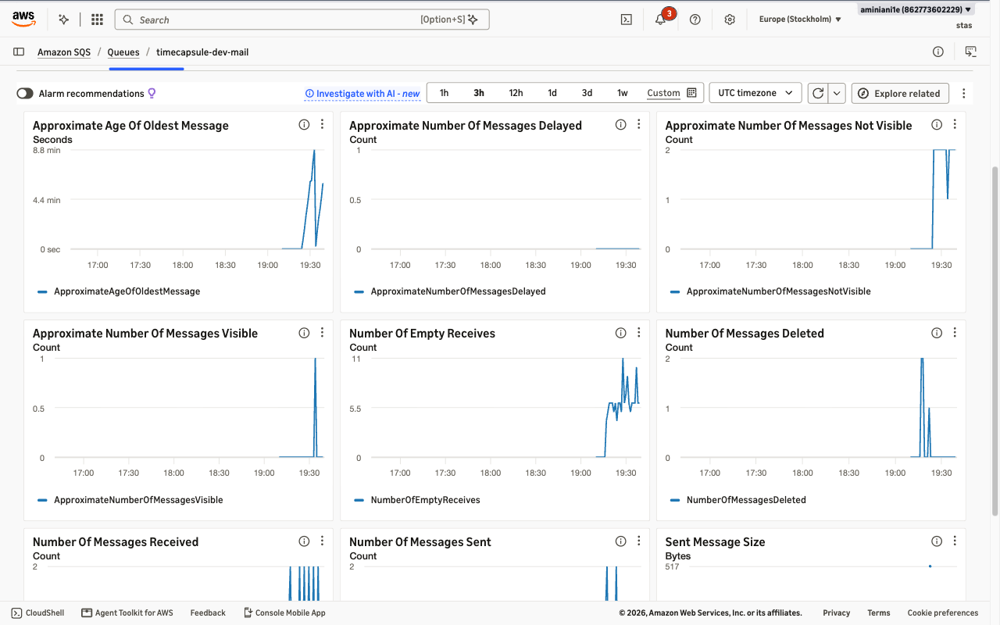

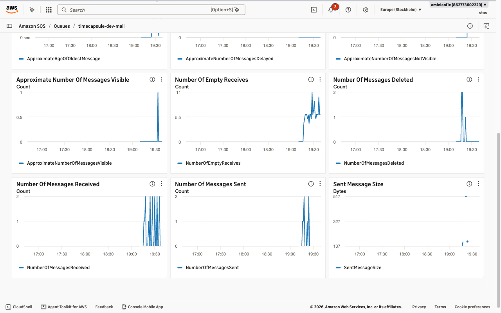

DLQ: `ApproximateNumberOfMessagesVisible` вырос с 0 (метрика SQS отстаёт на несколько минут, поэтому на
скриншоте ещё 1) и `ApproximateAgeOfOldestMessage`:

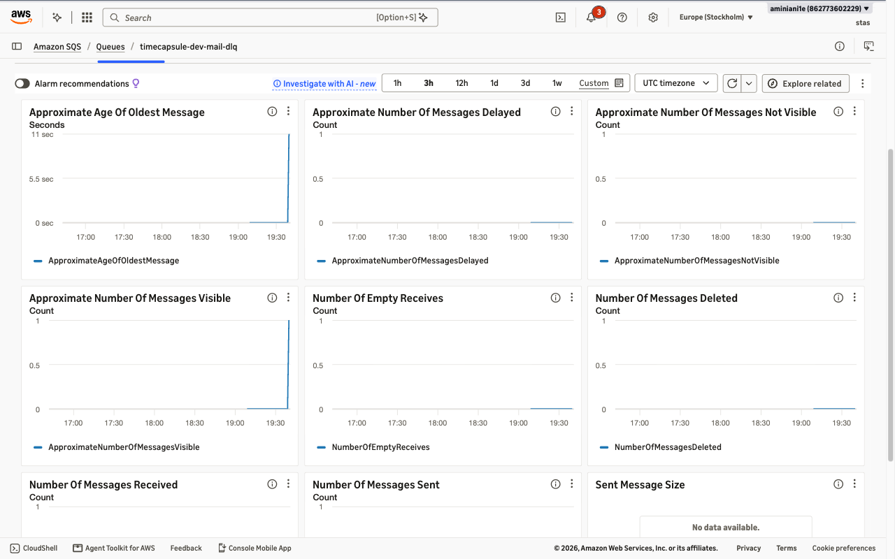

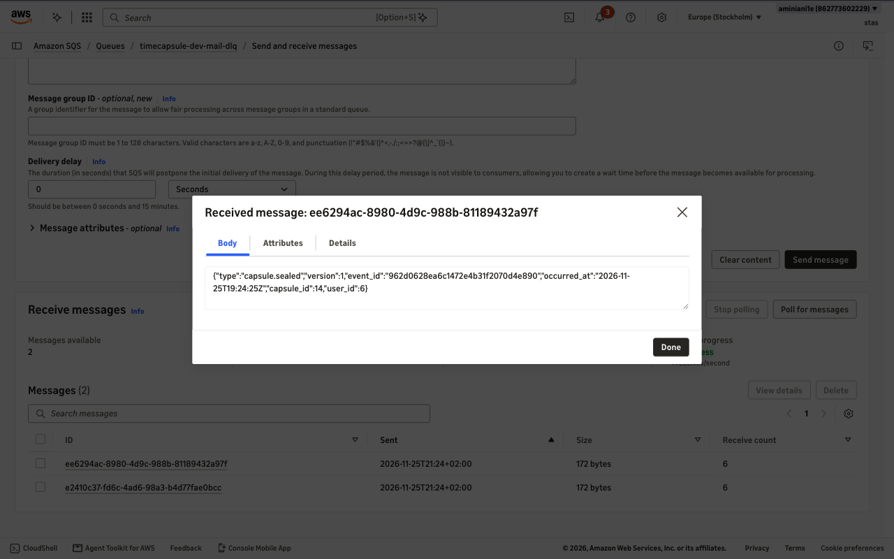

В 19:42:30 я вернул правильный пароль, в 19:43 запустил `Start DLQ redrive` → `Redrive to source queue(s)`
(задача `COMPLETED`, 2 сообщения). Через секунду mailer записал уведомления 23 (капсула 15) и 24 (капсула 14).
У каждой капсулы ровно одно уведомление `sealed`, обе очереди пусты:

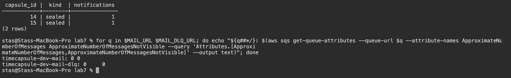

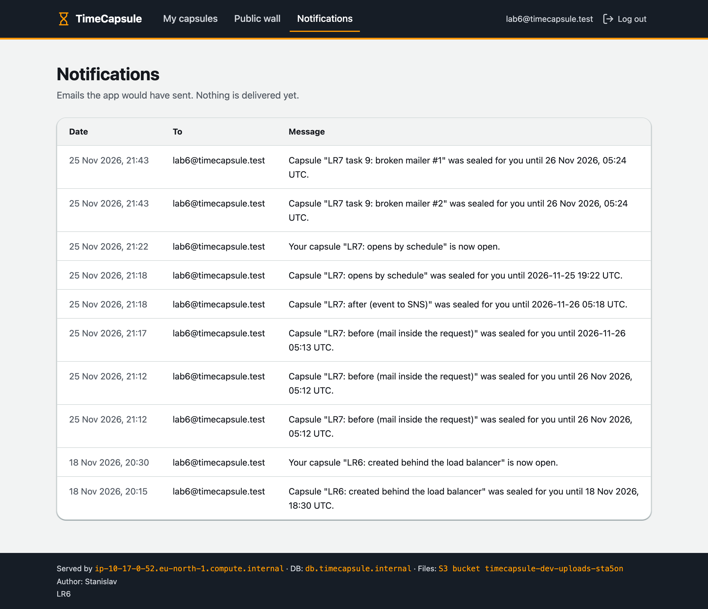

**Через сколько попыток сообщения оказались в DLQ и от каких настроек это зависело?** Через 5 получений,
примерно через 15 минут после публикации. Число попыток задаёт `maxReceiveCount = 5` в redrive policy, а
интервал между ними - таймаут видимости очереди (180 с): упавшее сообщение никто не удаляет, и оно снова
становится видимым только через 180 с. На общее время влияют и таймаут функции (видимость выбрана как 6 × 30 с),
и `MaximumConcurrency` (при большом числе сообщений часть ждала бы своей очереди). Ошибка возникала на
подключении, поэтому `batchItemFailures` вернул оба сообщения пачки.

**Что произошло бы с письмами при той же поломке в ЛР6?** В ЛР6 письмо записывал сам веб-сервер, используя тот
же `DB_PASSWORD` из `.env`. С неверным паролем не работал бы весь сайт: вход, список капсул, Seal capsule
возвращали бы 500 («cannot connect to the database»), и капсулу нельзя было бы даже создать. Если бы сломалась
только отправка письма (медленный или недоступный почтовый сервер), `mail_send()` упал бы внутри запроса:
пользователь увидел бы ошибку, а письмо пропало бы, потому что его нигде не сохраняли для повтора. Теперь
событие ждёт в очереди и DLQ, а сайт продолжает работать.

### Задание 10. Архитектура и решение

Схема обновлена ([architecture.png](architecture.png), [architecture.drawio](architecture.drawio)), решение
записано в [ADR-0006](../adr/0006-background-jobs.md). В нём сравниваются выполнение в веб-запросе, cron на
сервере приложения и Lambda с SNS и SQS, а в «Последствиях» описано, что происходит с письмами при сбое
Lambda-функции и при остановке базы и как работает защита от повторов.

### Завершение работы

В конце занятия (`part2/session-off.sh`):

- расписание `timecapsule-dev-open-capsules` переведено в `DISABLED`;
- триггер SQS → `timecapsule-dev-mailer` выключен: служба Lambda перестала опрашивать пустую очередь;
- `timecapsule-dev-rds` остановлена, `timecapsule-dev-app` и `timecapsule-dev-bastion` остановлены;
- удалено временное правило `80 от моего IP` в `timecapsule-dev-web-sg`: на время работы балансировщика не было,
  и сайт открывался по публичному адресу `app-server`. Снова осталось только `80 от timecapsule-dev-alb-sg`.

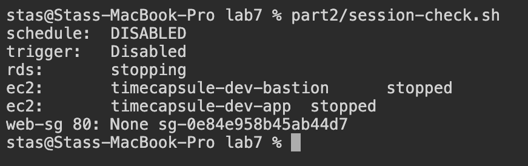

Тема, очереди, Lambda-функции, роли, таблица сессий, бакет и база не удалены: они нужны для защиты и для ЛР8.
Перед защитой нужно запустить базу и серверы, включить триггер и расписание.

## Контрольные вопросы

**Как проходит событие от нажатия Seal capsule до строки в таблице notifications? Где оно может задержаться и где
потеряться?** Браузер отправляет `POST /capsules`, PHP пишет капсулу в RDS и публикует `capsule.sealed` в тему
`timecapsule-dev-events`. SNS проверяет фильтр подписки и кладёт сообщение в очередь `timecapsule-dev-mail`.
Служба Lambda забирает его пачкой и вызывает `timecapsule-dev-mailer`, который ждёт 3 с и делает `INSERT` в
`notifications`. Задержаться событие может в очереди: функция упала, достигнут предел одновременных вызовов, база
недоступна, и тогда повтор будет через 180 с, а после 5 попыток сообщение уходит в DLQ. Потеряться оно может, если
публикация в SNS не удалась после `INSERT` капсулы (капсула есть, письма нет), если сообщение пролежало в DLQ
дольше 14 дней или если фильтр подписки по ошибке отсёк событие.

**Чем очередь SQS отличается от темы SNS и зачем в этой работе нужны обе?** Тема рассылает каждое сообщение всем
подпискам сразу (push, «один ко многим») и ничего не хранит: если получатель недоступен, сообщение для него
потеряно или ушло в DLQ подписки. Очередь хранит сообщения до 14 дней, пока их не заберёт получатель (pull),
повторяет доставку и переносит неудачные в DLQ. Тема даёт веерную рассылку с фильтрами: одно событие попадает в
очередь писем и на почту, и новых получателей можно добавлять, не меняя издателя. Очередь даёт надёжность и
ограничение нагрузки на базу для mailer.

**Какую работу с SQS и SNS выполняет за Lambda-функции в VPC служба Lambda и почему им не нужен выход в
интернет?** Event source mapping службы Lambda сам опрашивает `timecapsule-dev-mail`, собирает пачки, вызывает
функцию, удаляет успешно обработанные сообщения и возвращает неудачные. Назначение тоже работает на стороне службы
Lambda: после успешного асинхронного вызова служба публикует запись о вызове в тему. Код функций обращается только
к RDS внутри VPC, а SQS и SNS видят только служба Lambda, поэтому ни NAT, ни VPC endpoints не нужны.

**Как изменилась архитектура приложения по сравнению с ЛР2? Какие обязанности перешли к AWS, а какие остались за
вами?** В ЛР2 всё было на одном EC2: PHP, PostgreSQL, файлы вложений и сессии на диске, письма и открытие капсул в
веб-запросе. Теперь база - RDS (ЛР5), вложения - S3 (ЛР4), сессии - DynamoDB (ЛР6), серверы приложения - группа
Auto Scaling за ALB (ЛР6), а фоновая работа - Lambda, SNS, SQS и EventBridge Scheduler. К AWS перешли резервные
копии и патчи базы, хранение файлов, масштабирование серверов, доставка и хранение сообщений, повторы и DLQ,
запуск функций и расписание. За мной остались код (в том числе идемпотентность и формат событий), схема базы,
сеть и Security Groups, права IAM, параметры очередей и функций, разбор DLQ и журналов, а также отключение
ресурсов, чтобы не платить за них.
